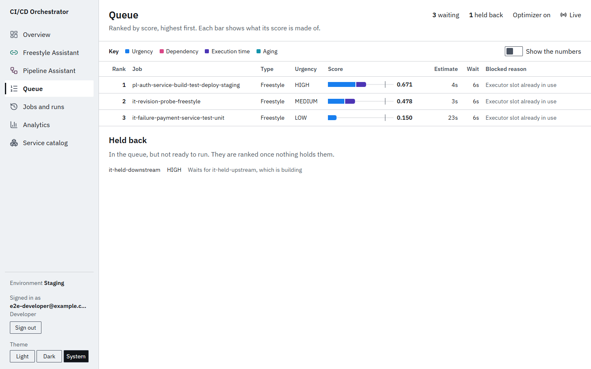
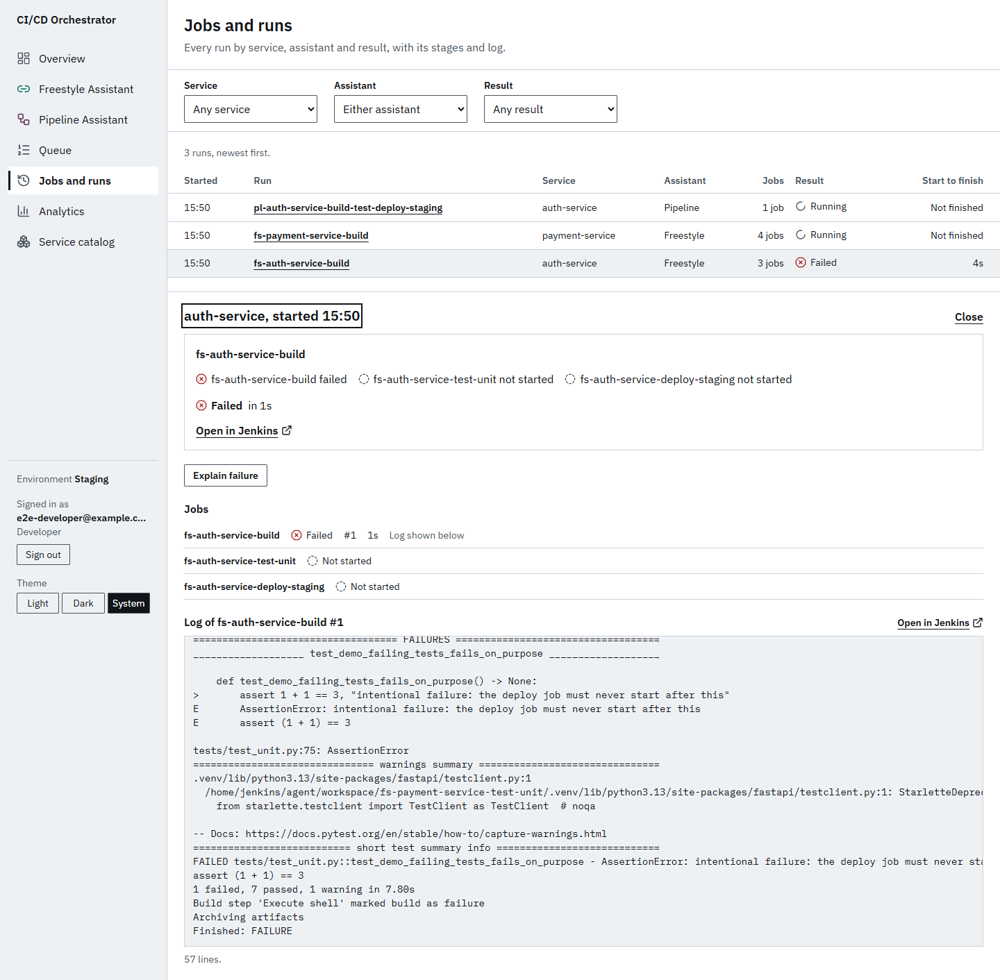
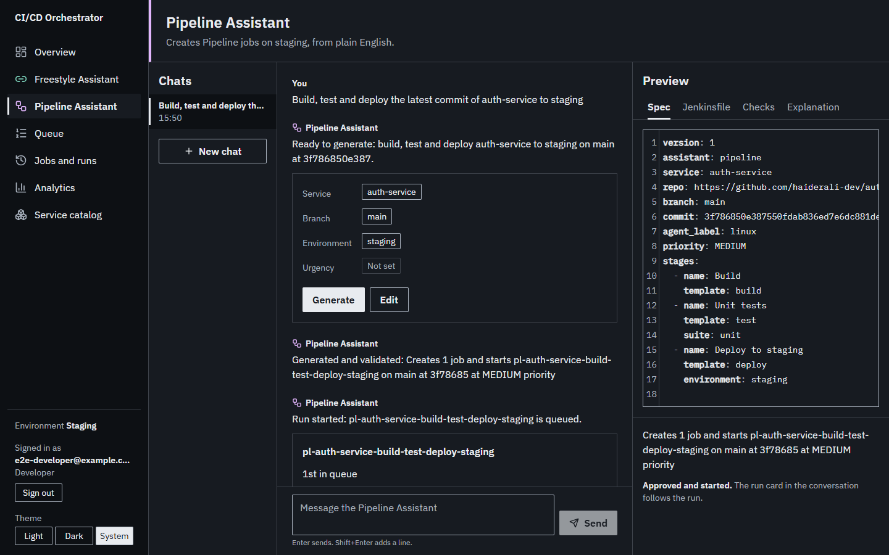
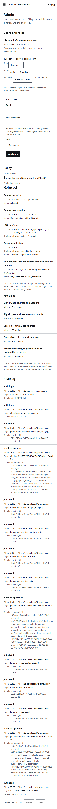
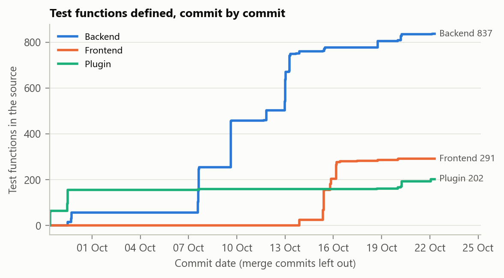
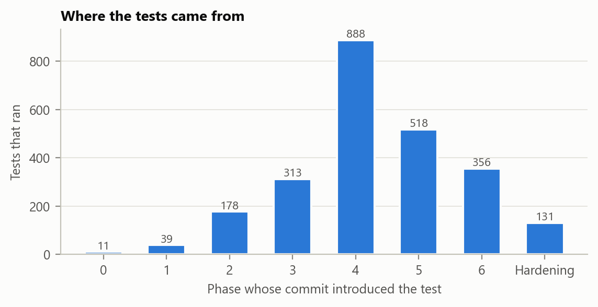
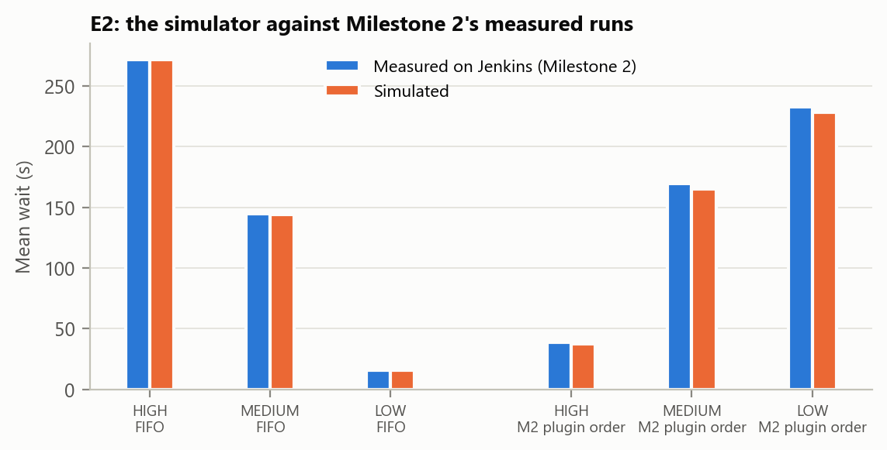
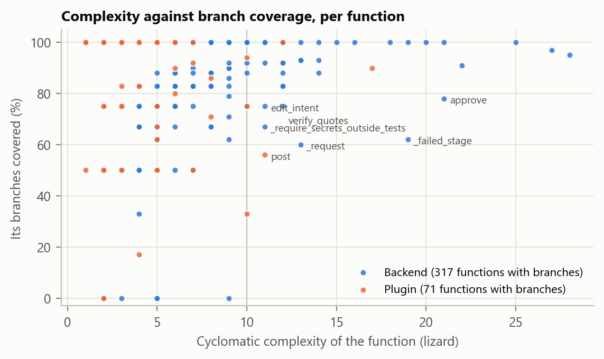

# Annexure A: test evidence

The evidence behind Chapter 8, generated by `scripts/report/testing_annexure.py` from the evidence campaign at commit `31eb935`, the gate's log and the files listed in each section. Annexure B lists every test that ran.

## A.1 The test environment

| Item | Value |
| --- | --- |
| Commit | `31eb935` (`31eb93530935124935261039df99c6efa6460c98`) |
| Branch | phase-6-hardening |
| Campaign manifest written | 2026-10-22T06:11:22+00:00 |
| Machine | Windows 11 Pro, 8 logical processors |
| Python running the campaign | 3.14.2 |
| Versions of every tool | `docs/versions.md`; Table 8.2 |

## A.2 The evidence campaign, step by step

Each step's directory, command, start time, duration and exit code, from `manifest.json`. `<campaign>` is `.tmp/campaign/31eb935/`, where the logs and reports were kept; `uv` is the project's own copy in `.venv-tools/`. The per-test results are Annexure B.

| Step | Directory | Command | Started | Seconds | Exit |
| --- | --- | --- | --- | ---: | ---: |
| plugin | `plugin` | `mvn -B -ntp clean verify -P enable-jacoco` | 2026-10-22 05:31:31 UTC | 580.5 | 0 |
| plugin-mutation | `plugin` | `mvn -B -ntp -P mutation test-compile org.pitest:pitest-maven:mutationCoverage` | 2026-10-22 05:41:12 UTC | 81.6 | 0 |
| plugin-experiments | `plugin` | `mvn -B -ntp verify -Dtest=QueueSimulationExperiment -Dit.test=SchedulerOverheadExperiment -Dsurefire.failIfNoSpecifiedTests=false -Dfailsafe.failIfNoSpecifiedTests=false` | 2026-10-22 05:42:34 UTC | 79.1 | 0 |
| backend-offline | `backend` | `uv run --no-sync python -m pytest -m "not live and not e2e and not integration" -p no:cacheprovider --junitxml=<campaign>/backend/backend-offline.xml --cov=app --cov-report=json:<campaign>/backend/backend-offline-coverage.json` | 2026-10-22 05:43:53 UTC | 244.9 | 0 |
| backend-integration | `backend` | `uv run --no-sync python -m pytest -m integration -p no:cacheprovider --junitxml=<campaign>/backend/backend-integration.xml --cov=app --cov-report=json:<campaign>/backend/backend-integration-coverage.json --cov-append` | 2026-10-22 05:47:58 UTC | 429.8 | 0 |
| backend-e2e | `backend` | `uv run --no-sync python -m pytest -m e2e -p no:cacheprovider --junitxml=<campaign>/backend/backend-e2e.xml --cov=app --cov-report=json:<campaign>/backend/backend-e2e-coverage.json --cov-append` | 2026-10-22 05:55:07 UTC | 593.8 | 0 |
| backend-live | `backend` | `uv run --no-sync python -m pytest -m live -p no:cacheprovider --junitxml=<campaign>/backend/backend-live.xml --cov=app --cov-report=json:<campaign>/backend/backend-live-coverage.json --cov-append` | 2026-10-22 06:05:01 UTC | 12.7 | 0 |
| frontend-unit | `frontend` | `npx vitest run --coverage --reporter=default --reporter=junit --outputFile.junit=<campaign>/frontend/unit.xml` | 2026-10-22 06:05:38 UTC | 53.2 | 0 |
| browser-flows | `frontend` | `npx playwright test --reporter=line,junit` | 2026-10-22 06:06:31 UTC | 98.3 | 0 |
| lighthouse | `frontend` | `npx playwright test --project=lighthouse --reporter=line,junit` | 2026-10-22 06:08:10 UTC | 107.3 | 0 |
| stack-system | `(repository root)` | `python scripts/stack_system_test.py --reporter=line,junit` | 2026-10-22 06:09:57 UTC | 47.2 | 0 |
| payment-service | `sample-services/payment-service` | `python -m pytest tests -p no:cacheprovider --junitxml=<campaign>/sample-services/payment-service.xml` | 2026-10-22 06:10:44 UTC | 29.0 | 0 |
| auth-service | `sample-services/auth-service` | `node --test --test-reporter=spec --test-reporter-destination=stdout --test-reporter=junit --test-reporter-destination=<campaign>/sample-services/auth-service.xml test/unit.test.js` | 2026-10-22 06:11:13 UTC | 6.2 | 0 |
| frontend-audit | `frontend` | `npm audit --json` | 2026-10-22 06:11:19 UTC | 3.0 | 1 |

The frontend-audit step exits 1 when `npm audit` finds a known vulnerability; here it found Vite 8.3.2's development-server advisories, fixed after the campaign under D-075 (Section A.12).

**Two earlier runs, not cited.**

- **A rehearsal at `ac8305a`** ran the plugin and backend steps. Three backend steps failed during a network outage on this machine, when DNS for GitHub and the model provider failed for about 15 minutes, and passed when run again. `docs/testing/evidence/rehearsal-network-outage.txt` quotes their errors. Its one skipped test was a placeholder, which led to DF-42 and to a new commit.
- **A run at `e0c0c69`** was stopped during its backend steps when CI turned out red on that commit (DF-43). This campaign is its repeat at the fixed commit.

## A.3 The acceptance gate

Gate run 5, at commit `8263a7e`: `python scripts/verify.py --phase 6`, 89 checks, from its log `docs/testing/evidence/gate-run-5-8263a7e.log`. Result: **ALL CHECKS PASSED**.

| Phase | Check | Result | What it reported |
| --- | --- | --- | --- |
| 0 | skeleton folders exist | PASS | all 22 present |
| 0 | root documents exist | PASS | all 9 present |
| 0 | tracking documents exist | PASS | all 4 present |
| 0 | legacy/m2-poc present | PASS | plugin sources, harness and results all present |
| 0 | legacy/m2-poc unmodified against m2-final | PASS | byte-identical to the tag, nothing added |
| 0 | no secrets tracked by Git | PASS | 1094 tracked files, none matching 7 secret patterns |
| 0 | .gitattributes sets LF for the required types | PASS | all 7 types pinned to LF |
| 0 | legacy/ is exempt from line-ending normalisation | PASS | `legacy/** -text` keeps the frozen copy byte for byte |
| 0 | CI workflow parses | PASS | 6 jobs: detect, verify, plugin, backend, frontend, flows |
| 0 | M2 baseline figures match the legacy result files | PASS | HIGH-band wait 271.50 s -> 39.08 s, as documented |
| 0 | no Jenkins script console call in our code | PASS | 468 code files scanned, no reference |
| 1 | Docker and Compose files exist | PASS | all 11 present |
| 1 | docker-compose.yml is valid and matches Part 4.2.3 | PASS | 10 services, 6 default, 4 profiled |
| 1 | every published port is bound to loopback, and Jenkins keeps its safety checks | PASS | 6 published ports, all on 127.0.0.1; no agent port; signatures checked |
| 1 | Compose refuses to start rather than defaulting a secret | PASS | all 6 secrets fail loudly when unset |
| 1 | JCasC files are valid and the two arms differ only in optimizerEnabled | PASS | dev plus two arms differing only in optimizerEnabled |
| 1 | JCasC quotes every floating-point optimizer value, at Appendix D's values (D-017) | PASS | all 7 quoted, at the report's values, in 3 files |
| 1 | the controller image installs the built plugin | PASS | COPY present and the .hpi exists (90 KB) |
| 1 | controller plugins are pinned | PASS | 16 plugins, all pinned |
| 1 | Docker is available | PASS | daemon 29.8.1 |
| 1 | docker compose config validates | PASS | the merged configuration is valid |
| 1 | jenkins-dev and its agents run what the current source builds | PASS | jenkins-dev runs plugin/target's classes and files; both agents match their build |
| 1 | jenkins-dev answers with the bot token | PASS | authenticated as orchestrator-bot |
| 1 | controller runs zero executors | PASS | 0, so all work goes to the labelled agents |
| 1 | both agents are online | PASS | 2 agents online, 4 executors, linux on agent-1, agent-2 |
| 1 | sample services are present and complete | PASS | 2 services with build, test, deploy and a Dockerfile |
| 1 | both sample services' own tests pass | PASS | payment-service 12 passed; auth-service 7 passed |
| 1 | deploy scripts refuse production | PASS | both refuse production explicitly |
| 1 | shell scripts use LF endings | PASS | all sample-service shell scripts are LF |
| 1 | catalog validates | PASS | schema, production policy and structure all valid |
| 1 | reference configs were exported from Jenkins | PASS | 3 configs, all carrying Jenkins' own plugin version stamps |
| 2 | every test named in Part 4.3.10 exists | PASS | all 17 present |
| 2 | integration tests are bound to the Maven lifecycle | PASS | integration-test and verify goals both bound |
| 2 | the scoring formula matches the report | PASS | U = 1.0/0.6/0.3 and weights 0.5/0.3/0.2 with aging 0.05 per 5 min, cap 0.15 |
| 2 | mvn -B verify passes: every unit and integration test | PASS | BUILD SUCCESS: 121 unit tests (1 skipped), 97 integration tests (0 skipped) |
| 2 | plugin artifact was built | PASS | dynamic-queue-optimizer.hpi (90 KB) |
| 2 | the ranking endpoint answers with the bot token | PASS | 200, queueLength=0, weights 0.5/0.3/0.2, aging 0.05 cap 0.15 |
| 2 | the plugin health and metrics endpoints answer | PASS | both answer 200 |
| 3 | Alembic is configured and has a migration | PASS | 5 migration(s), newest 20261018_1300_9d4f2b6e8a10_users_token_epoch.py |
| 3 | migrations create every table in Part 4.4.3 | PASS | all 14 tables |
| 3 | every migration is reversible, and the migrations build the models' schema | PASS | every downgrade() acts; on PostgreSQL the migrations match the models, downgrade to base and build them again (2 passed) |
| 3 | seed scripts exist and are idempotent by construction | PASS | seed_admin and seed_catalog, both checking before writing |
| 3 | the backend image ships its migrations | PASS | alembic.ini, alembic/ and app/ all copied |
| 3 | the backend container runs what the current source builds | PASS | building the backend now gives the image it runs |
| 3 | backend quality bars pass | PASS | ruff, ruff format, mypy and pytest all clean |
| 3 | the auth endpoints and role guards exist | PASS | login, refresh, logout and /api/me, with three role guards |
| 3 | the auth endpoints are rate limited | PASS | login 5/min per address and account and 30/min per address, refresh 30/min, general 300/min; the 429s seen by 5 passed |
| 3 | suspicious activity is written to the audit log | PASS | role denials, replayed refresh tokens and engaged sign-in limits are audited; 9 passed |
| 3 | the catalog loads through one schema-validated loader | PASS | one loader, schema-validated, safe_load only |
| 3 | git refs are validated before reaching git | PASS | option-shaped refs rejected, ordinary branches accepted, no shell |
| 3 | the metrics endpoint exists and accepts what it cannot parse | PASS | gated, constant-time, open to unknown fields, all four kinds handled |
| 3 | the plugin publishes metrics over HTTP/1.1 | PASS | pinned to HTTP/1.1 and asserted by a test |
| 3 | the controller reinstalls the plugin under test on start | PASS | entrypoint replaces the plugin and execs jenkins.sh |
| 3 | a live plugin event reaches the backend | PASS | 374 published, 0 failed, 0 dropped |
| 3 | the WebSocket never takes its token from the URL | PASS | auth by first frame, timed out, nothing read from the query string |
| 3 | publishing to the hub cannot block the tracker | PASS | synchronous, bounded, drops the oldest event |
| 3 | the tracker polls on the interval 4.4.5 fixes | PASS | 3 second interval, bounded tick, abandoned triggers time out |
| 3 | a polled queue wait never overwrites a plugin-measured one | PASS | the tracker fills queue_wait_ms only when it is unset |
| 3 | Part 4.4.4's endpoints are all registered | PASS | 17 routes across 14 router modules |
| 3 | mutating endpoints carry a role guard | PASS | cancel needs DevOps; resync and every admin route need Admin |
| 3 | the queue endpoint degrades when the plugin is absent | PASS | reports availability and a reason instead of failing |
| 3 | GET /api/health on the Compose stack reports database, Jenkins and LLM provider | PASS | database up, jenkins up (Jenkins 2.568.3), LLM disabled (fake provider; no network calls) |
| 3 | integration tests create, trigger and read a freestyle and a Pipeline job | PASS | 8 passed against the live controller |
| 4 | the AI core's modules exist | PASS | 17 modules |
| 4 | the prompt is versioned and carries 8 to 12 examples | PASS | intent_v1 with 12 examples and Appendix E's rules |
| 4 | the model never sees a shell command | PASS | catalog context and schema carry names only |
| 4 | the SDK's own retries are off | PASS | max_retries=0; ModelChain owns the retry policy |
| 4 | llm_calls records the prompt version and the outcome | PASS | migration 8c2f4d1e7a90 present |
| 4 | drafted evaluation items stay capped and unreviewed | PASS | 30 drafts, all awaiting human review |
| 4 | AI unit and policy tests pass | PASS | 836 passed across 8 AI test files |
| 4 | with Groq unreachable the rule parser answers with ai_fallback | PASS | unreachable and keyless Groq both fall back to rules with ai_fallback: true |
| 4 | the evaluation command writes a metrics file | PASS | metrics.json written; 0 scored, 30 excluded pending review |
| 4 | the evaluation package passes ruff and strict mypy | PASS | ruff, ruff format and strict mypy clean |
| 5 | golden template tests pass, and the templates derive from the reference configs | PASS | 33 passed |
| 5 | the linter integration test passes against jenkins-dev | PASS | 4 passed |
| 5 | pytest -m e2e passes on the Compose stack | PASS | 12 passed |
| 5 | the failing-branch chain stops before deploy | PASS | test failed on demo/failing-tests and the deploy job never started |
| 5 | Explain failure (T5.9): redaction, analysis, checks, endpoint and a live failing job | PASS | 170 passed |
| 6 | DESIGN.md has every part 4.7.2 asks for, and its colours pass the floors it states | PASS | 6 named colours, 4 score bar and 3 build-state colours; worst text contrast 6.86:1 (Graphite on Ground, light); score bar neighbours at least 20.0 apart, 11.9 under CVD; 5 principles; wireframes for Assistant workspace, Queue, Overview |
| 6 | the frontend passes lint, typecheck, test and build | PASS | lint, typecheck and build clean; 296 tests passed |
| 6 | the browser flows of 4.7.6 pass against the backend in fake mode | PASS | 12 flows passed in Chrome, against the backend in fake mode |
| 6 | screenshots are present for every screen, in both themes at 1440 and 390 px | PASS | 40 screenshots: 10 screens, 1440 and 390 px, light and dark |
| 6 | an independent security review covers Phases 3, 5 and 6, each finding with its fix | PASS | 15 findings, each with its fix and regression test |
| 6 | Lighthouse scores both assistant pages 95 or more for accessibility | PASS | 16 audits; lowest accessibility score 100 (Freestyle), 100 (Pipeline) |
| 6 | the frontend's API types are generated from the backend's current OpenAPI schema | PASS | openapi.json is the backend's schema (41 paths), and schema.d.ts is its output |
| 6 | the frontend container runs what the current source builds | PASS | building the frontend now gives the image it serves |
| 6 | the system tests pass through the running stack's own frontend | PASS | 3 system tests passed on the real stack; the test account deactivated |
| 6 | the frontend container serves the build with its policy and proxies the API | PASS | the build with its CSP, frame-ancestors and nosniff, and /api proxied to the backend |
| 6 | the frontend's WebSocket event and topic names are the backend's | PASS | 12 event types and 4 topics, the same on both sides |

## A.4 Continuous integration

97 runs of `.github/workflows/ci.yml` between 2026-10-07 and 2026-10-22: 83 passed, 7 failed, 7 cancelled by a newer push. Each failure is in the defect log (A.10).

| Run | Date | Branch | Commit | Event | Result |
| --- | --- | --- | --- | --- | --- |
| [37654567305](https://github.com/haiderali-dev/INTELLIGENT-CI-CD-ORCHESTRATOR-FYP/actions/runs/37654567305) | 2026-10-07 | phase-3-backend | `71b0131` | push | failure |
| [37658215939](https://github.com/haiderali-dev/INTELLIGENT-CI-CD-ORCHESTRATOR-FYP/actions/runs/37658215939) | 2026-10-07 | phase-3-backend | `5db5e28` | push | success |
| [37954922569](https://github.com/haiderali-dev/INTELLIGENT-CI-CD-ORCHESTRATOR-FYP/actions/runs/37954922569) | 2026-10-09 | phase-4-ai-core | `576728f` | push | success |
| [37954922255](https://github.com/haiderali-dev/INTELLIGENT-CI-CD-ORCHESTRATOR-FYP/actions/runs/37954922255) | 2026-10-09 | phase-2-plugin | `ae92b60` | push | success |
| [37954921877](https://github.com/haiderali-dev/INTELLIGENT-CI-CD-ORCHESTRATOR-FYP/actions/runs/37954921877) | 2026-10-09 | phase-0-foundation | `716581c` | push | success |
| [38004200327](https://github.com/haiderali-dev/INTELLIGENT-CI-CD-ORCHESTRATOR-FYP/actions/runs/38004200327) | 2026-10-09 | phase-4-ai-core | `765e5d3` | push | success |
| [38137593861](https://github.com/haiderali-dev/INTELLIGENT-CI-CD-ORCHESTRATOR-FYP/actions/runs/38137593861) | 2026-10-11 | phase-5-assistants | `e4032f5` | push | success |
| [38138391114](https://github.com/haiderali-dev/INTELLIGENT-CI-CD-ORCHESTRATOR-FYP/actions/runs/38138391114) | 2026-10-11 | phase-3-backend | `79d3472` | push | success |
| [38139342335](https://github.com/haiderali-dev/INTELLIGENT-CI-CD-ORCHESTRATOR-FYP/actions/runs/38139342335) | 2026-10-11 | phase-5-assistants | `c43899b` | push | success |
| [38140615342](https://github.com/haiderali-dev/INTELLIGENT-CI-CD-ORCHESTRATOR-FYP/actions/runs/38140615342) | 2026-10-11 | phase-0-foundation | `716581c` | pull_request | success |
| [38142294637](https://github.com/haiderali-dev/INTELLIGENT-CI-CD-ORCHESTRATOR-FYP/actions/runs/38142294637) | 2026-10-11 | main | `9c3347c` | push | success |
| [38143281316](https://github.com/haiderali-dev/INTELLIGENT-CI-CD-ORCHESTRATOR-FYP/actions/runs/38143281316) | 2026-10-11 | phase-0-foundation | `3757733` | push | success |
| [38143775947](https://github.com/haiderali-dev/INTELLIGENT-CI-CD-ORCHESTRATOR-FYP/actions/runs/38143775947) | 2026-10-11 | phase-2-plugin | `057c2f0` | push | success |
| [38147273385](https://github.com/haiderali-dev/INTELLIGENT-CI-CD-ORCHESTRATOR-FYP/actions/runs/38147273385) | 2026-10-11 | recovery/phase-2-plugin | `ae92b60` | pull_request | success |
| [38147276654](https://github.com/haiderali-dev/INTELLIGENT-CI-CD-ORCHESTRATOR-FYP/actions/runs/38147276654) | 2026-10-11 | recovery/phase-3-backend | `5db5e28` | pull_request | success |
| [38147280740](https://github.com/haiderali-dev/INTELLIGENT-CI-CD-ORCHESTRATOR-FYP/actions/runs/38147280740) | 2026-10-11 | recovery/phase-4-ai-core | `765e5d3` | pull_request | success |
| [38148489921](https://github.com/haiderali-dev/INTELLIGENT-CI-CD-ORCHESTRATOR-FYP/actions/runs/38148489921) | 2026-10-11 | main | `0214390` | push | cancelled |
| [38148540818](https://github.com/haiderali-dev/INTELLIGENT-CI-CD-ORCHESTRATOR-FYP/actions/runs/38148540818) | 2026-10-11 | main | `7cab8cf` | push | cancelled |
| [38148570445](https://github.com/haiderali-dev/INTELLIGENT-CI-CD-ORCHESTRATOR-FYP/actions/runs/38148570445) | 2026-10-11 | main | `69d6f62` | push | success |
| [38153857626](https://github.com/haiderali-dev/INTELLIGENT-CI-CD-ORCHESTRATOR-FYP/actions/runs/38153857626) | 2026-10-11 | fix/pipeline-log-finish-race | `b1bc0c1` | pull_request | success |
| [38155038508](https://github.com/haiderali-dev/INTELLIGENT-CI-CD-ORCHESTRATOR-FYP/actions/runs/38155038508) | 2026-10-11 | main | `48b1dda` | push | success |
| [38155900580](https://github.com/haiderali-dev/INTELLIGENT-CI-CD-ORCHESTRATOR-FYP/actions/runs/38155900580) | 2026-10-11 | phase-2-plugin | `ae92b60` | push | success |
| [38155902273](https://github.com/haiderali-dev/INTELLIGENT-CI-CD-ORCHESTRATOR-FYP/actions/runs/38155902273) | 2026-10-11 | phase-3-backend | `5db5e28` | push | success |
| [38156409348](https://github.com/haiderali-dev/INTELLIGENT-CI-CD-ORCHESTRATOR-FYP/actions/runs/38156409348) | 2026-10-11 | phase-5-assistants | `c43899b` | pull_request | success |
| [38156987705](https://github.com/haiderali-dev/INTELLIGENT-CI-CD-ORCHESTRATOR-FYP/actions/runs/38156987705) | 2026-10-11 | main | `357f1aa` | push | success |
| [38160905159](https://github.com/haiderali-dev/INTELLIGENT-CI-CD-ORCHESTRATOR-FYP/actions/runs/38160905159) | 2026-10-11 | phase-5-assistants | `3aa1cff` | push | success |
| [38161864114](https://github.com/haiderali-dev/INTELLIGENT-CI-CD-ORCHESTRATOR-FYP/actions/runs/38161864114) | 2026-10-11 | phase-5-assistants | `3aa1cff` | pull_request | success |
| [38171280650](https://github.com/haiderali-dev/INTELLIGENT-CI-CD-ORCHESTRATOR-FYP/actions/runs/38171280650) | 2026-10-11 | phase-5-assistants | `2ac9d01` | push | success |
| [38171284360](https://github.com/haiderali-dev/INTELLIGENT-CI-CD-ORCHESTRATOR-FYP/actions/runs/38171284360) | 2026-10-11 | phase-5-assistants | `2ac9d01` | pull_request | success |
| [38321338100](https://github.com/haiderali-dev/INTELLIGENT-CI-CD-ORCHESTRATOR-FYP/actions/runs/38321338100) | 2026-10-12 | phase-5-assistants | `e1072da` | push | success |
| [38321341672](https://github.com/haiderali-dev/INTELLIGENT-CI-CD-ORCHESTRATOR-FYP/actions/runs/38321341672) | 2026-10-12 | phase-5-assistants | `e1072da` | pull_request | success |
| [38324951864](https://github.com/haiderali-dev/INTELLIGENT-CI-CD-ORCHESTRATOR-FYP/actions/runs/38324951864) | 2026-10-12 | phase-5-assistants | `18063be` | push | success |
| [38324955242](https://github.com/haiderali-dev/INTELLIGENT-CI-CD-ORCHESTRATOR-FYP/actions/runs/38324955242) | 2026-10-12 | phase-5-assistants | `18063be` | pull_request | success |
| [38325433887](https://github.com/haiderali-dev/INTELLIGENT-CI-CD-ORCHESTRATOR-FYP/actions/runs/38325433887) | 2026-10-13 | phase-5-assistants | `80639d1` | push | success |
| [38325438000](https://github.com/haiderali-dev/INTELLIGENT-CI-CD-ORCHESTRATOR-FYP/actions/runs/38325438000) | 2026-10-13 | phase-5-assistants | `80639d1` | pull_request | success |
| [38326122229](https://github.com/haiderali-dev/INTELLIGENT-CI-CD-ORCHESTRATOR-FYP/actions/runs/38326122229) | 2026-10-13 | phase-5-assistants | `049caa7` | push | success |
| [38326126200](https://github.com/haiderali-dev/INTELLIGENT-CI-CD-ORCHESTRATOR-FYP/actions/runs/38326126200) | 2026-10-13 | phase-5-assistants | `049caa7` | pull_request | success |
| [38326834111](https://github.com/haiderali-dev/INTELLIGENT-CI-CD-ORCHESTRATOR-FYP/actions/runs/38326834111) | 2026-10-13 | phase-5-assistants | `a4adf3d` | push | success |
| [38326837897](https://github.com/haiderali-dev/INTELLIGENT-CI-CD-ORCHESTRATOR-FYP/actions/runs/38326837897) | 2026-10-13 | phase-5-assistants | `a4adf3d` | pull_request | success |
| [38328017467](https://github.com/haiderali-dev/INTELLIGENT-CI-CD-ORCHESTRATOR-FYP/actions/runs/38328017467) | 2026-10-13 | phase-5-assistants | `c30dcc6` | push | success |
| [38328021287](https://github.com/haiderali-dev/INTELLIGENT-CI-CD-ORCHESTRATOR-FYP/actions/runs/38328021287) | 2026-10-13 | phase-5-assistants | `c30dcc6` | pull_request | success |
| [38330368459](https://github.com/haiderali-dev/INTELLIGENT-CI-CD-ORCHESTRATOR-FYP/actions/runs/38330368459) | 2026-10-13 | phase-5-assistants | `d011f73` | push | success |
| [38330371822](https://github.com/haiderali-dev/INTELLIGENT-CI-CD-ORCHESTRATOR-FYP/actions/runs/38330371822) | 2026-10-13 | phase-5-assistants | `d011f73` | pull_request | success |
| [38358654352](https://github.com/haiderali-dev/INTELLIGENT-CI-CD-ORCHESTRATOR-FYP/actions/runs/38358654352) | 2026-10-13 | phase-5-assistants | `f787450` | push | failure |
| [38358657287](https://github.com/haiderali-dev/INTELLIGENT-CI-CD-ORCHESTRATOR-FYP/actions/runs/38358657287) | 2026-10-13 | phase-5-assistants | `f787450` | pull_request | failure |
| [38366063791](https://github.com/haiderali-dev/INTELLIGENT-CI-CD-ORCHESTRATOR-FYP/actions/runs/38366063791) | 2026-10-13 | phase-5-assistants | `5f96bda` | push | success |
| [38366069196](https://github.com/haiderali-dev/INTELLIGENT-CI-CD-ORCHESTRATOR-FYP/actions/runs/38366069196) | 2026-10-13 | phase-5-assistants | `5f96bda` | pull_request | success |
| [38373779603](https://github.com/haiderali-dev/INTELLIGENT-CI-CD-ORCHESTRATOR-FYP/actions/runs/38373779603) | 2026-10-13 | phase-5-assistants | `1caa544` | push | success |
| [38373787540](https://github.com/haiderali-dev/INTELLIGENT-CI-CD-ORCHESTRATOR-FYP/actions/runs/38373787540) | 2026-10-13 | phase-5-assistants | `1caa544` | pull_request | success |
| [38427407502](https://github.com/haiderali-dev/INTELLIGENT-CI-CD-ORCHESTRATOR-FYP/actions/runs/38427407502) | 2026-10-13 | phase-5-assistants | `b662871` | push | success |
| [38427418084](https://github.com/haiderali-dev/INTELLIGENT-CI-CD-ORCHESTRATOR-FYP/actions/runs/38427418084) | 2026-10-13 | phase-5-assistants | `b662871` | pull_request | success |
| [38430339891](https://github.com/haiderali-dev/INTELLIGENT-CI-CD-ORCHESTRATOR-FYP/actions/runs/38430339891) | 2026-10-13 | phase-5-assistants | `42b04b2` | push | success |
| [38430348554](https://github.com/haiderali-dev/INTELLIGENT-CI-CD-ORCHESTRATOR-FYP/actions/runs/38430348554) | 2026-10-13 | phase-5-assistants | `42b04b2` | pull_request | success |
| [38437589365](https://github.com/haiderali-dev/INTELLIGENT-CI-CD-ORCHESTRATOR-FYP/actions/runs/38437589365) | 2026-10-13 | phase-5-assistants | `93b38cf` | push | success |
| [38437598025](https://github.com/haiderali-dev/INTELLIGENT-CI-CD-ORCHESTRATOR-FYP/actions/runs/38437598025) | 2026-10-13 | phase-5-assistants | `93b38cf` | pull_request | success |
| [38439318226](https://github.com/haiderali-dev/INTELLIGENT-CI-CD-ORCHESTRATOR-FYP/actions/runs/38439318226) | 2026-10-13 | main | `8da58b9` | push | success |
| [38442251676](https://github.com/haiderali-dev/INTELLIGENT-CI-CD-ORCHESTRATOR-FYP/actions/runs/38442251676) | 2026-10-13 | phase-6-frontend | `d06ea63` | push | success |
| [38467146820](https://github.com/haiderali-dev/INTELLIGENT-CI-CD-ORCHESTRATOR-FYP/actions/runs/38467146820) | 2026-10-13 | phase-6-frontend | `158e4dc` | push | cancelled |
| [38467692692](https://github.com/haiderali-dev/INTELLIGENT-CI-CD-ORCHESTRATOR-FYP/actions/runs/38467692692) | 2026-10-13 | phase-6-frontend | `7ca50d8` | push | success |
| [38468386574](https://github.com/haiderali-dev/INTELLIGENT-CI-CD-ORCHESTRATOR-FYP/actions/runs/38468386574) | 2026-10-13 | phase-6-frontend | `60be62c` | push | success |
| [38705021201](https://github.com/haiderali-dev/INTELLIGENT-CI-CD-ORCHESTRATOR-FYP/actions/runs/38705021201) | 2026-10-15 | phase-6-frontend | `5faaa72` | push | success |
| [38714523703](https://github.com/haiderali-dev/INTELLIGENT-CI-CD-ORCHESTRATOR-FYP/actions/runs/38714523703) | 2026-10-15 | phase-6-frontend | `5610201` | push | success |
| [38720983228](https://github.com/haiderali-dev/INTELLIGENT-CI-CD-ORCHESTRATOR-FYP/actions/runs/38720983228) | 2026-10-15 | phase-6-frontend | `6953d6d` | push | success |
| [38729134124](https://github.com/haiderali-dev/INTELLIGENT-CI-CD-ORCHESTRATOR-FYP/actions/runs/38729134124) | 2026-10-15 | phase-6-frontend | `6269f5f` | push | success |
| [38792947715](https://github.com/haiderali-dev/INTELLIGENT-CI-CD-ORCHESTRATOR-FYP/actions/runs/38792947715) | 2026-10-15 | phase-6-frontend | `f43f0db` | push | success |
| [38796958592](https://github.com/haiderali-dev/INTELLIGENT-CI-CD-ORCHESTRATOR-FYP/actions/runs/38796958592) | 2026-10-15 | phase-6-frontend | `b73c946` | push | success |
| [38802956163](https://github.com/haiderali-dev/INTELLIGENT-CI-CD-ORCHESTRATOR-FYP/actions/runs/38802956163) | 2026-10-15 | phase-6-frontend | `40c6108` | push | success |
| [38848168418](https://github.com/haiderali-dev/INTELLIGENT-CI-CD-ORCHESTRATOR-FYP/actions/runs/38848168418) | 2026-10-16 | phase-6-frontend | `e59d81c` | push | success |
| [38853258488](https://github.com/haiderali-dev/INTELLIGENT-CI-CD-ORCHESTRATOR-FYP/actions/runs/38853258488) | 2026-10-16 | phase-6-frontend | `13f644b` | push | success |
| [38885272144](https://github.com/haiderali-dev/INTELLIGENT-CI-CD-ORCHESTRATOR-FYP/actions/runs/38885272144) | 2026-10-16 | phase-6-frontend | `a5519fa` | push | success |
| [39026561925](https://github.com/haiderali-dev/INTELLIGENT-CI-CD-ORCHESTRATOR-FYP/actions/runs/39026561925) | 2026-10-17 | phase-6-frontend | `86d9a8d` | push | success |
| [39028582938](https://github.com/haiderali-dev/INTELLIGENT-CI-CD-ORCHESTRATOR-FYP/actions/runs/39028582938) | 2026-10-17 | phase-6-frontend | `5bd1982` | push | success |
| [39030064897](https://github.com/haiderali-dev/INTELLIGENT-CI-CD-ORCHESTRATOR-FYP/actions/runs/39030064897) | 2026-10-17 | phase-6-frontend | `ff70254` | push | success |
| [39031717314](https://github.com/haiderali-dev/INTELLIGENT-CI-CD-ORCHESTRATOR-FYP/actions/runs/39031717314) | 2026-10-17 | phase-6-frontend | `3172cd2` | push | success |
| [39032215210](https://github.com/haiderali-dev/INTELLIGENT-CI-CD-ORCHESTRATOR-FYP/actions/runs/39032215210) | 2026-10-17 | phase-6-frontend | `3172cd2` | pull_request | success |
| [39032782135](https://github.com/haiderali-dev/INTELLIGENT-CI-CD-ORCHESTRATOR-FYP/actions/runs/39032782135) | 2026-10-17 | main | `31a725f` | push | success |
| [39152598262](https://github.com/haiderali-dev/INTELLIGENT-CI-CD-ORCHESTRATOR-FYP/actions/runs/39152598262) | 2026-10-18 | phase-6-hardening | `6d66e91` | push | success |
| [39153902801](https://github.com/haiderali-dev/INTELLIGENT-CI-CD-ORCHESTRATOR-FYP/actions/runs/39153902801) | 2026-10-18 | phase-6-hardening | `13588fa` | push | success |
| [39344924302](https://github.com/haiderali-dev/INTELLIGENT-CI-CD-ORCHESTRATOR-FYP/actions/runs/39344924302) | 2026-10-19 | phase-6-hardening | `217c78f` | push | success |
| [39346443912](https://github.com/haiderali-dev/INTELLIGENT-CI-CD-ORCHESTRATOR-FYP/actions/runs/39346443912) | 2026-10-20 | phase-6-hardening | `88a6a9a` | push | success |
| [39347627505](https://github.com/haiderali-dev/INTELLIGENT-CI-CD-ORCHESTRATOR-FYP/actions/runs/39347627505) | 2026-10-20 | phase-6-hardening | `ffcd507` | push | cancelled |
| [39348067474](https://github.com/haiderali-dev/INTELLIGENT-CI-CD-ORCHESTRATOR-FYP/actions/runs/39348067474) | 2026-10-20 | phase-6-hardening | `deded23` | push | cancelled |
| [39348259894](https://github.com/haiderali-dev/INTELLIGENT-CI-CD-ORCHESTRATOR-FYP/actions/runs/39348259894) | 2026-10-20 | phase-6-hardening | `08477e5` | push | success |
| [39371958462](https://github.com/haiderali-dev/INTELLIGENT-CI-CD-ORCHESTRATOR-FYP/actions/runs/39371958462) | 2026-10-20 | phase-6-hardening | `3e2eeae` | push | success |
| [39377219935](https://github.com/haiderali-dev/INTELLIGENT-CI-CD-ORCHESTRATOR-FYP/actions/runs/39377219935) | 2026-10-20 | phase-6-hardening | `e1127cf` | push | success |
| [39511825868](https://github.com/haiderali-dev/INTELLIGENT-CI-CD-ORCHESTRATOR-FYP/actions/runs/39511825868) | 2026-10-20 | phase-6-hardening | `b16eb17` | push | success |
| [39700898376](https://github.com/haiderali-dev/INTELLIGENT-CI-CD-ORCHESTRATOR-FYP/actions/runs/39700898376) | 2026-10-22 | phase-6-hardening | `0603d4e` | push | success |
| [39705160985](https://github.com/haiderali-dev/INTELLIGENT-CI-CD-ORCHESTRATOR-FYP/actions/runs/39705160985) | 2026-10-22 | phase-6-hardening | `ac8305a` | push | success |
| [39705210895](https://github.com/haiderali-dev/INTELLIGENT-CI-CD-ORCHESTRATOR-FYP/actions/runs/39705210895) | 2026-10-22 | phase-6-hardening | `ac8305a` | pull_request | success |
| [39714725656](https://github.com/haiderali-dev/INTELLIGENT-CI-CD-ORCHESTRATOR-FYP/actions/runs/39714725656) | 2026-10-22 | phase-6-hardening | `8263a7e` | push | cancelled |
| [39714728993](https://github.com/haiderali-dev/INTELLIGENT-CI-CD-ORCHESTRATOR-FYP/actions/runs/39714728993) | 2026-10-22 | phase-6-hardening | `8263a7e` | pull_request | cancelled |
| [39715084390](https://github.com/haiderali-dev/INTELLIGENT-CI-CD-ORCHESTRATOR-FYP/actions/runs/39715084390) | 2026-10-22 | phase-6-hardening | `00c433b` | push | failure |
| [39715088715](https://github.com/haiderali-dev/INTELLIGENT-CI-CD-ORCHESTRATOR-FYP/actions/runs/39715088715) | 2026-10-22 | phase-6-hardening | `00c433b` | pull_request | failure |
| [39726780627](https://github.com/haiderali-dev/INTELLIGENT-CI-CD-ORCHESTRATOR-FYP/actions/runs/39726780627) | 2026-10-22 | phase-6-hardening | `e0c0c69` | push | failure |
| [39726785641](https://github.com/haiderali-dev/INTELLIGENT-CI-CD-ORCHESTRATOR-FYP/actions/runs/39726785641) | 2026-10-22 | phase-6-hardening | `e0c0c69` | pull_request | failure |
| [39728484869](https://github.com/haiderali-dev/INTELLIGENT-CI-CD-ORCHESTRATOR-FYP/actions/runs/39728484869) | 2026-10-22 | phase-6-hardening | `31eb935` | push | success |
| [39728490681](https://github.com/haiderali-dev/INTELLIGENT-CI-CD-ORCHESTRATOR-FYP/actions/runs/39728490681) | 2026-10-22 | phase-6-hardening | `31eb935` | pull_request | success |

## A.5 Coverage by module

| Component | Statements or lines (%) | Branches (%) |
| --- | --- | --- |
| Plugin (JaCoCo, unit and integration tests) | 93.2 | 79.4 |
| Backend (coverage.py, offline suite) | 93.7 | 84.6 |
| Backend (coverage.py, all four suites) | 95.0 | 87.2 |
| Frontend (V8, unit and component tests) | 92.54 | 83.83 |

### The plugin (JaCoCo, unit and integration tests)

| Class | Lines | Lines covered (%) | Branches | Branches covered (%) |
| --- | ---: | ---: | ---: | ---: |
| api.DynamicQueueApi | 155 | 90.3 | 32 | 68.8 |
| api.DynamicQueueApi.ApiEndpoint | 5 | 100.0 | 0 | - |
| api.DynamicQueueApi.MetricsEndpoint | 5 | 100.0 | 0 | - |
| config.OptimizerConfiguration | 103 | 100.0 | 24 | 79.2 |
| dependency.DependencyGraphService | 84 | 94.0 | 46 | 84.8 |
| dependency.DependencySnapshot | 7 | 57.1 | 2 | 0.0 |
| dependency.KahnTopologicalSort | 34 | 100.0 | 24 | 100.0 |
| dependency.KahnTopologicalSort.Edge | 2 | 100.0 | 0 | - |
| dependency.KahnTopologicalSort.Result | 7 | 100.0 | 0 | - |
| dependency.UnionFind | 37 | 100.0 | 12 | 100.0 |
| estimation.BuildHistoryService | 35 | 74.3 | 26 | 61.5 |
| estimation.BuildRecord | 16 | 100.0 | 12 | 83.3 |
| estimation.RecordedLabelAction | 4 | 100.0 | 4 | 50.0 |
| estimation.RecordedLabelAction.Recorder | 16 | 75.0 | 14 | 50.0 |
| estimation.SimilarityEstimator | 42 | 100.0 | 22 | 100.0 |
| estimation.SimilarityEstimator.Candidate | 1 | 100.0 | 0 | - |
| gate.DependencyGate | 55 | 90.9 | 38 | 89.5 |
| gate.DependencyGate.UpstreamRunning | 9 | 100.0 | 0 | - |
| heap.PriorityJobHeap | 56 | 100.0 | 18 | 94.4 |
| metrics.MetricEvent | 38 | 73.7 | 20 | 55.0 |
| metrics.MetricEvent.Kind | 5 | 100.0 | 0 | - |
| metrics.MetricsPublisher | 89 | 89.9 | 38 | 65.8 |
| metrics.QueueMetricsRecorder | 35 | 100.0 | 2 | 50.0 |
| metrics.RunMetricsRecorder | 52 | 98.1 | 18 | 77.8 |
| metrics.RunMetricsRecorder.NodeBlockWaits | 1 | 100.0 | 0 | - |
| model.PriorityLevel | 13 | 100.0 | 4 | 100.0 |
| property.JobPriorityProperty | 20 | 90.0 | 18 | 66.7 |
| property.JobPriorityProperty.DescriptorImpl | 53 | 86.8 | 38 | 81.6 |
| resolve.JobResolver | 13 | 84.6 | 12 | 75.0 |
| scoring.PriorityScoreCalculator | 68 | 100.0 | 34 | 94.1 |
| scoring.ScoreInput | 4 | 100.0 | 0 | - |
| scoring.ScoredJob | 4 | 100.0 | 2 | 100.0 |
| sorter.DynamicQueueSorter | 122 | 92.6 | 50 | 78.0 |
| sorter.DynamicQueueSorter.SorterConflictWarning | 10 | 90.0 | 4 | 100.0 |

### The backend, offline suite (coverage.py, statements and branches)

| Module | Statements | Covered (%) | Branches | Branches covered |
| --- | ---: | ---: | ---: | ---: |
| `app/__init__.py` | 0 | 100.0 | 0 | 0 |
| `app/ai/__init__.py` | 0 | 100.0 | 0 | 0 |
| `app/ai/cache.py` | 65 | 100.0 | 6 | 6 |
| `app/ai/chain.py` | 143 | 91.7 | 26 | 21 |
| `app/ai/clarify.py` | 75 | 100.0 | 26 | 26 |
| `app/ai/factory.py` | 44 | 89.3 | 12 | 9 |
| `app/ai/guard.py` | 28 | 100.0 | 4 | 4 |
| `app/ai/intent.py` | 101 | 98.4 | 22 | 21 |
| `app/ai/parser.py` | 185 | 98.2 | 36 | 34 |
| `app/ai/policy.py` | 92 | 100.0 | 20 | 20 |
| `app/ai/prompting.py` | 87 | 98.2 | 22 | 21 |
| `app/ai/providers/__init__.py` | 5 | 100.0 | 0 | 0 |
| `app/ai/providers/base.py` | 50 | 100.0 | 0 | 0 |
| `app/ai/providers/fake.py` | 39 | 97.9 | 8 | 8 |
| `app/ai/providers/groq.py` | 117 | 81.5 | 34 | 24 |
| `app/ai/providers/replay.py` | 71 | 88.6 | 8 | 7 |
| `app/ai/quota.py` | 127 | 94.1 | 26 | 23 |
| `app/ai/rules.py` | 169 | 100.0 | 72 | 72 |
| `app/ai/schema.py` | 27 | 100.0 | 2 | 2 |
| `app/ai/validator.py` | 118 | 94.0 | 32 | 30 |
| `app/api/__init__.py` | 0 | 100.0 | 0 | 0 |
| `app/api/admin.py` | 151 | 94.8 | 22 | 18 |
| `app/api/analytics.py` | 86 | 94.6 | 6 | 3 |
| `app/api/assistants.py` | 108 | 100.0 | 0 | 0 |
| `app/api/auth.py` | 58 | 100.0 | 2 | 2 |
| `app/api/chains.py` | 61 | 94.2 | 8 | 6 |
| `app/api/deps.py` | 69 | 100.0 | 6 | 6 |
| `app/api/generation.py` | 103 | 95.3 | 4 | 3 |
| `app/api/health.py` | 95 | 87.8 | 20 | 14 |
| `app/api/jobs.py` | 142 | 98.6 | 0 | 0 |
| `app/api/metrics.py` | 49 | 100.0 | 8 | 8 |
| `app/api/payloads.py` | 177 | 97.9 | 16 | 14 |
| `app/api/queue.py` | 63 | 98.4 | 0 | 0 |
| `app/api/services.py` | 69 | 97.2 | 2 | 2 |
| `app/core/__init__.py` | 0 | 100.0 | 0 | 0 |
| `app/core/errors.py` | 91 | 97.8 | 0 | 0 |
| `app/core/logging.py` | 50 | 92.6 | 4 | 4 |
| `app/core/ratelimit.py` | 74 | 97.7 | 12 | 11 |
| `app/core/security.py` | 46 | 100.0 | 6 | 6 |
| `app/core/settings.py` | 75 | 86.8 | 16 | 10 |
| `app/db/__init__.py` | 0 | 100.0 | 0 | 0 |
| `app/db/base.py` | 18 | 100.0 | 0 | 0 |
| `app/db/models.py` | 223 | 99.1 | 4 | 3 |
| `app/db/seed.py` | 81 | 63.1 | 22 | 13 |
| `app/db/session.py` | 38 | 67.4 | 8 | 2 |
| `app/failures/__init__.py` | 0 | 100.0 | 0 | 0 |
| `app/failures/analysis.py` | 235 | 98.4 | 74 | 71 |
| `app/failures/explainer.py` | 190 | 97.3 | 66 | 62 |
| `app/failures/factory.py` | 24 | 86.7 | 6 | 4 |
| `app/failures/redact.py` | 66 | 100.0 | 20 | 20 |
| `app/generation/__init__.py` | 0 | 100.0 | 0 | 0 |
| `app/generation/factory.py` | 23 | 93.1 | 6 | 5 |
| `app/generation/planner.py` | 266 | 95.6 | 76 | 70 |
| `app/generation/render.py` | 107 | 98.5 | 24 | 23 |
| `app/generation/revision.py` | 48 | 100.0 | 14 | 14 |
| `app/generation/spec.py` | 114 | 98.5 | 22 | 20 |
| `app/generation/validate.py` | 212 | 95.6 | 60 | 57 |
| `app/main.py` | 60 | 89.4 | 6 | 3 |
| `app/openapi_export.py` | 24 | 92.9 | 4 | 3 |
| `app/services/__init__.py` | 0 | 100.0 | 0 | 0 |
| `app/services/auth.py` | 140 | 98.9 | 38 | 36 |
| `app/services/catalog.py` | 136 | 96.2 | 22 | 19 |
| `app/services/chains.py` | 274 | 86.5 | 96 | 79 |
| `app/services/conversations.py` | 294 | 89.9 | 102 | 84 |
| `app/services/dependencies.py` | 66 | 56.7 | 24 | 9 |
| `app/services/failures.py` | 91 | 91.2 | 22 | 18 |
| `app/services/generation.py` | 367 | 90.1 | 108 | 88 |
| `app/services/git.py` | 131 | 85.5 | 34 | 30 |
| `app/services/jenkins.py` | 452 | 65.5 | 90 | 43 |
| `app/services/metrics.py` | 183 | 92.8 | 54 | 46 |
| `app/services/plugin.py` | 195 | 94.2 | 30 | 26 |
| `app/services/runs.py` | 106 | 89.2 | 24 | 18 |
| `app/services/tracker.py` | 218 | 94.8 | 70 | 61 |
| `app/ws/__init__.py` | 0 | 100.0 | 0 | 0 |
| `app/ws/hub.py` | 123 | 99.3 | 18 | 17 |
| `app/ws/routes.py` | 114 | 88.8 | 20 | 18 |

### The backend, all four suites together (coverage.py, statements and branches)

| Module | Statements | Covered (%) | Branches | Branches covered |
| --- | ---: | ---: | ---: | ---: |
| `app/__init__.py` | 0 | 100.0 | 0 | 0 |
| `app/ai/__init__.py` | 0 | 100.0 | 0 | 0 |
| `app/ai/cache.py` | 65 | 100.0 | 6 | 6 |
| `app/ai/chain.py` | 143 | 92.9 | 26 | 22 |
| `app/ai/clarify.py` | 75 | 100.0 | 26 | 26 |
| `app/ai/factory.py` | 44 | 96.4 | 12 | 11 |
| `app/ai/guard.py` | 28 | 100.0 | 4 | 4 |
| `app/ai/intent.py` | 101 | 98.4 | 22 | 21 |
| `app/ai/parser.py` | 185 | 98.2 | 36 | 34 |
| `app/ai/policy.py` | 92 | 100.0 | 20 | 20 |
| `app/ai/prompting.py` | 87 | 98.2 | 22 | 21 |
| `app/ai/providers/__init__.py` | 5 | 100.0 | 0 | 0 |
| `app/ai/providers/base.py` | 50 | 100.0 | 0 | 0 |
| `app/ai/providers/fake.py` | 39 | 97.9 | 8 | 8 |
| `app/ai/providers/groq.py` | 117 | 83.4 | 34 | 25 |
| `app/ai/providers/replay.py` | 71 | 88.6 | 8 | 7 |
| `app/ai/quota.py` | 127 | 94.1 | 26 | 23 |
| `app/ai/rules.py` | 169 | 100.0 | 72 | 72 |
| `app/ai/schema.py` | 27 | 100.0 | 2 | 2 |
| `app/ai/validator.py` | 118 | 94.0 | 32 | 30 |
| `app/api/__init__.py` | 0 | 100.0 | 0 | 0 |
| `app/api/admin.py` | 151 | 94.8 | 22 | 18 |
| `app/api/analytics.py` | 86 | 94.6 | 6 | 3 |
| `app/api/assistants.py` | 108 | 100.0 | 0 | 0 |
| `app/api/auth.py` | 58 | 100.0 | 2 | 2 |
| `app/api/chains.py` | 61 | 94.2 | 8 | 6 |
| `app/api/deps.py` | 69 | 100.0 | 6 | 6 |
| `app/api/generation.py` | 103 | 95.3 | 4 | 3 |
| `app/api/health.py` | 95 | 87.8 | 20 | 14 |
| `app/api/jobs.py` | 142 | 98.6 | 0 | 0 |
| `app/api/metrics.py` | 49 | 100.0 | 8 | 8 |
| `app/api/payloads.py` | 177 | 97.9 | 16 | 14 |
| `app/api/queue.py` | 63 | 98.4 | 0 | 0 |
| `app/api/services.py` | 69 | 97.2 | 2 | 2 |
| `app/core/__init__.py` | 0 | 100.0 | 0 | 0 |
| `app/core/errors.py` | 91 | 97.8 | 0 | 0 |
| `app/core/logging.py` | 50 | 92.6 | 4 | 4 |
| `app/core/ratelimit.py` | 74 | 97.7 | 12 | 11 |
| `app/core/security.py` | 46 | 100.0 | 6 | 6 |
| `app/core/settings.py` | 75 | 86.8 | 16 | 10 |
| `app/db/__init__.py` | 0 | 100.0 | 0 | 0 |
| `app/db/base.py` | 18 | 100.0 | 0 | 0 |
| `app/db/models.py` | 223 | 99.6 | 4 | 4 |
| `app/db/seed.py` | 81 | 63.1 | 22 | 13 |
| `app/db/session.py` | 38 | 67.4 | 8 | 2 |
| `app/failures/__init__.py` | 0 | 100.0 | 0 | 0 |
| `app/failures/analysis.py` | 235 | 98.4 | 74 | 71 |
| `app/failures/explainer.py` | 190 | 97.3 | 66 | 62 |
| `app/failures/factory.py` | 24 | 93.3 | 6 | 5 |
| `app/failures/redact.py` | 66 | 100.0 | 20 | 20 |
| `app/generation/__init__.py` | 0 | 100.0 | 0 | 0 |
| `app/generation/factory.py` | 23 | 100.0 | 6 | 6 |
| `app/generation/planner.py` | 266 | 95.6 | 76 | 70 |
| `app/generation/render.py` | 107 | 98.5 | 24 | 23 |
| `app/generation/revision.py` | 48 | 100.0 | 14 | 14 |
| `app/generation/spec.py` | 114 | 98.5 | 22 | 20 |
| `app/generation/validate.py` | 212 | 95.6 | 60 | 57 |
| `app/main.py` | 60 | 89.4 | 6 | 3 |
| `app/openapi_export.py` | 24 | 92.9 | 4 | 3 |
| `app/services/__init__.py` | 0 | 100.0 | 0 | 0 |
| `app/services/auth.py` | 140 | 98.9 | 38 | 36 |
| `app/services/catalog.py` | 136 | 96.2 | 22 | 19 |
| `app/services/chains.py` | 274 | 88.4 | 96 | 83 |
| `app/services/conversations.py` | 294 | 91.9 | 102 | 87 |
| `app/services/dependencies.py` | 66 | 56.7 | 24 | 9 |
| `app/services/failures.py` | 91 | 91.2 | 22 | 18 |
| `app/services/generation.py` | 367 | 92.0 | 108 | 93 |
| `app/services/git.py` | 131 | 92.1 | 34 | 31 |
| `app/services/jenkins.py` | 452 | 82.5 | 90 | 63 |
| `app/services/metrics.py` | 183 | 92.8 | 54 | 46 |
| `app/services/plugin.py` | 195 | 95.6 | 30 | 28 |
| `app/services/runs.py` | 106 | 89.2 | 24 | 18 |
| `app/services/tracker.py` | 218 | 95.5 | 70 | 62 |
| `app/ws/__init__.py` | 0 | 100.0 | 0 | 0 |
| `app/ws/hub.py` | 123 | 99.3 | 18 | 17 |
| `app/ws/routes.py` | 114 | 88.8 | 20 | 18 |

### The frontend (V8, unit and component tests)

| File | Statements | Covered (%) | Branches | Branches covered (%) |
| --- | ---: | ---: | ---: | ---: |
| `src/admin/AuditSection.tsx` | 26 | 92.3 | 14 | 57.14 |
| `src/admin/NewUserForm.tsx` | 43 | 69.76 | 42 | 69.04 |
| `src/admin/PolicySection.tsx` | 34 | 79.41 | 16 | 56.25 |
| `src/admin/ResetPassword.tsx` | 30 | 86.66 | 20 | 90 |
| `src/admin/UsersSection.tsx` | 34 | 97.05 | 32 | 90.62 |
| `src/admin/auditModel.ts` | 14 | 100 | 18 | 100 |
| `src/api/adminApi.ts` | 11 | 100 | 1 | 100 |
| `src/api/analyticsApi.ts` | 6 | 100 | 1 | 100 |
| `src/api/apiClientContext.ts` | 4 | 100 | 0 | 100 |
| `src/api/assistantApi.ts` | 29 | 82.75 | 15 | 40 |
| `src/api/catalogApi.ts` | 4 | 100 | 1 | 100 |
| `src/api/client.ts` | 26 | 96.15 | 22 | 95.45 |
| `src/api/errors.ts` | 19 | 84.21 | 26 | 80.76 |
| `src/api/queryClient.ts` | 2 | 0 | 0 | 100 |
| `src/api/queueApi.ts` | 2 | 100 | 1 | 100 |
| `src/api/request.ts` | 14 | 92.85 | 8 | 87.5 |
| `src/api/runsApi.ts` | 10 | 100 | 17 | 82.35 |
| `src/api/systemApi.ts` | 3 | 100 | 1 | 100 |
| `src/app/App.tsx` | 2 | 0 | 0 | 100 |
| `src/app/LoadingApp.tsx` | 1 | 100 | 0 | 100 |
| `src/app/routes.tsx` | 34 | 97.05 | 11 | 90.9 |
| `src/app/shell/AppShell.tsx` | 4 | 75 | 0 | 100 |
| `src/app/shell/Sidebar.tsx` | 6 | 100 | 6 | 100 |
| `src/app/shell/SignedInAs.tsx` | 11 | 81.81 | 6 | 66.66 |
| `src/app/shell/ThemeSwitch.tsx` | 6 | 100 | 0 | 100 |
| `src/app/shell/nav.ts` | 5 | 100 | 0 | 100 |
| `src/app/theme/ThemeProvider.tsx` | 12 | 91.66 | 0 | 100 |
| `src/app/theme/theme.ts` | 23 | 100 | 10 | 100 |
| `src/app/theme/themeContext.ts` | 5 | 80 | 2 | 50 |
| `src/auth/RequireSession.tsx` | 8 | 100 | 6 | 100 |
| `src/auth/RestoringSession.tsx` | 1 | 100 | 0 | 100 |
| `src/auth/SessionProvider.tsx` | 29 | 93.1 | 17 | 76.47 |
| `src/auth/appSession.ts` | 3 | 0 | 0 | 100 |
| `src/auth/next.ts` | 15 | 93.33 | 17 | 100 |
| `src/auth/roles.ts` | 3 | 100 | 2 | 100 |
| `src/auth/session.ts` | 93 | 91.39 | 42 | 92.85 |
| `src/auth/sessionContext.ts` | 9 | 88.88 | 4 | 50 |
| `src/catalog/catalogModel.ts` | 11 | 100 | 8 | 87.5 |
| `src/components/BuildStateLabel.tsx` | 1 | 100 | 4 | 100 |
| `src/components/DataTable.tsx` | 18 | 100 | 19 | 89.47 |
| `src/components/ExternalLink.tsx` | 4 | 75 | 2 | 50 |
| `src/components/PageHeader.tsx` | 1 | 100 | 4 | 75 |
| `src/components/PageStates.tsx` | 6 | 100 | 3 | 100 |
| `src/components/ScoreBar.tsx` | 13 | 100 | 24 | 100 |
| `src/components/Sheet.tsx` | 2 | 100 | 0 | 100 |
| `src/components/buildState.ts` | 5 | 100 | 4 | 100 |
| `src/components/button.ts` | 1 | 100 | 0 | 100 |
| `src/components/code/CodeView.tsx` | 52 | 94.23 | 39 | 82.05 |
| `src/components/code/codeTheme.ts` | 6 | 100 | 0 | 100 |
| `src/components/code/diagnostics.ts` | 16 | 93.75 | 4 | 100 |
| `src/components/scoreBarModel.ts` | 24 | 100 | 7 | 100 |
| `src/components/toast/ToastProvider.tsx` | 13 | 69.23 | 2 | 0 |
| `src/components/toast/toastContext.ts` | 5 | 80 | 2 | 50 |
| `src/lib/cn.ts` | 1 | 100 | 0 | 100 |
| `src/lib/format.ts` | 28 | 100 | 21 | 95.23 |
| `src/lib/useMediaQuery.ts` | 14 | 92.85 | 4 | 100 |
| `src/main.tsx` | 4 | 0 | 2 | 0 |
| `src/pages/AdminPage.tsx` | 4 | 100 | 6 | 83.33 |
| `src/pages/AnalyticsPage.tsx` | 63 | 92.06 | 61 | 62.29 |
| `src/pages/AssistantPage.tsx` | 87 | 96.55 | 62 | 91.93 |
| `src/pages/CatalogPage.tsx` | 35 | 100 | 26 | 80.76 |
| `src/pages/NotFoundPage.tsx` | 1 | 100 | 0 | 100 |
| `src/pages/OverviewPage.tsx` | 54 | 94.44 | 92 | 90.21 |
| `src/pages/QueuePage.tsx` | 39 | 100 | 38 | 92.1 |
| `src/pages/RunsPage.tsx` | 73 | 97.26 | 53 | 92.45 |
| `src/pages/SignInPage.tsx` | 55 | 92.72 | 67 | 89.55 |
| `src/queue/QueueRanking.tsx` | 27 | 96.29 | 22 | 77.27 |
| `src/queue/ScoreKey.tsx` | 4 | 100 | 0 | 100 |
| `src/queue/queueApiContext.ts` | 2 | 100 | 0 | 100 |
| `src/queue/queueModel.ts` | 29 | 100 | 24 | 100 |
| `src/runs/ChainDetail.tsx` | 23 | 91.3 | 32 | 87.5 |
| `src/runs/ExplainFailure.tsx` | 17 | 88.23 | 34 | 61.76 |
| `src/runs/LogTail.tsx` | 44 | 93.18 | 35 | 77.14 |
| `src/runs/logModel.ts` | 17 | 100 | 11 | 100 |
| `src/runs/runsModel.ts` | 39 | 92.3 | 35 | 82.85 |
| `src/workspace/ApproveAndRun.tsx` | 29 | 93.1 | 23 | 82.6 |
| `src/workspace/ChatList.tsx` | 4 | 100 | 6 | 100 |
| `src/workspace/Clarification.tsx` | 6 | 100 | 7 | 100 |
| `src/workspace/Composer.tsx` | 62 | 95.16 | 53 | 96.22 |
| `src/workspace/EmptyState.tsx` | 3 | 100 | 2 | 100 |
| `src/workspace/FallbackNotice.tsx` | 1 | 100 | 0 | 100 |
| `src/workspace/IntentCard.tsx` | 46 | 95.65 | 62 | 70.96 |
| `src/workspace/IntentMessage.tsx` | 19 | 89.47 | 24 | 83.33 |
| `src/workspace/LiveRunCard.tsx` | 9 | 88.88 | 6 | 83.33 |
| `src/workspace/PreviewPanel.tsx` | 27 | 96.29 | 41 | 85.36 |
| `src/workspace/ProgressSteps.tsx` | 12 | 100 | 12 | 100 |
| `src/workspace/ReplyView.tsx` | 22 | 72.72 | 29 | 62.06 |
| `src/workspace/RunCard.tsx` | 5 | 100 | 23 | 95.65 |
| `src/workspace/SpecEditor.tsx` | 3 | 100 | 0 | 100 |
| `src/workspace/Thread.tsx` | 7 | 100 | 2 | 100 |
| `src/workspace/WorkspaceLayout.tsx` | 7 | 100 | 16 | 93.75 |
| `src/workspace/assistantApiContext.ts` | 8 | 100 | 0 | 100 |
| `src/workspace/assistants.ts` | 1 | 100 | 0 | 100 |
| `src/workspace/composerSuggestions.ts` | 28 | 100 | 22 | 95.45 |
| `src/workspace/intent.ts` | 4 | 100 | 2 | 100 |
| `src/workspace/previewSummary.ts` | 13 | 92.3 | 14 | 78.57 |
| `src/workspace/progress.ts` | 7 | 100 | 4 | 75 |
| `src/workspace/runCardModel.ts` | 15 | 100 | 15 | 86.66 |
| `src/workspace/specProblems.ts` | 58 | 91.37 | 43 | 81.39 |
| `src/workspace/threadOrder.ts` | 9 | 100 | 6 | 83.33 |
| `src/workspace/usePipelinePreview.ts` | 62 | 77.41 | 58 | 72.41 |
| `src/ws/LiveEventsClient.ts` | 100 | 95 | 32 | 84.37 |
| `src/ws/LiveEventsProvider.tsx` | 5 | 100 | 0 | 100 |
| `src/ws/events.ts` | 16 | 87.5 | 14 | 85.71 |
| `src/ws/liveEvents.ts` | 1 | 0 | 0 | 100 |
| `src/ws/liveEventsContext.ts` | 17 | 94.11 | 6 | 66.66 |

## A.6 Mutation testing

PIT, through the plugin's `mutation` profile: 173 mutants, 162 killed (150 by a failing assertion, 12 by a timeout, 0 by exhausting memory), 11 survived, 0 not covered by any test.

| Class | Mutants | Killed | Survived | No coverage |
| --- | ---: | ---: | ---: | ---: |
| KahnTopologicalSort | 17 | 17 | 0 | 0 |
| PriorityJobHeap | 42 | 42 | 0 | 0 |
| PriorityLevel | 6 | 6 | 0 | 0 |
| PriorityScoreCalculator | 47 | 41 | 6 | 0 |
| ScoreInput | 2 | 2 | 0 | 0 |
| ScoredJob | 6 | 6 | 0 | 0 |
| SimilarityEstimator | 38 | 38 | 0 | 0 |
| UnionFind | 15 | 10 | 5 | 0 |

### Every surviving mutant, and why it is equivalent

The last column is reasoning about the code (D-069), not a measurement.

| Class | Method | Line | Mutator | Change | Why no test can tell it apart |
| --- | --- | --- | --- | --- | --- |
| PriorityScoreCalculator | agingBonus | 169 | ConditionalsBoundaryMutator | changed conditional boundary | A wait of exactly 0 earns 0 either way: with `< 0`, it goes on to compute 0 intervals. |
| PriorityScoreCalculator | applyGroupInheritance | 198 | ConditionalsBoundaryMutator | changed conditional boundary | A group of one, or a member already at the group's best, gives an identical result. |
| PriorityScoreCalculator | applyGroupInheritance | 200 | ConditionalsBoundaryMutator | changed conditional boundary | A group of one, or a member already at the group's best, gives an identical result. |
| PriorityScoreCalculator | dependencyFactor | 139 | ConditionalsBoundaryMutator | changed conditional boundary | A group of one scores 0 either way, and the largest group is never smaller than any group. |
| PriorityScoreCalculator | dependencyFactor | 139 | ConditionalsBoundaryMutator | changed conditional boundary | A group of one scores 0 either way, and the largest group is never smaller than any group. |
| PriorityScoreCalculator | scoreAll | 100 | ConditionalsBoundaryMutator | changed conditional boundary | `anyKnown` only matters when an estimate is absent, and then the factor is 0.5 anyway. |
| UnionFind | union | 63 | ConditionalsBoundaryMutator | changed conditional boundary | Union by rank decides which root goes under the other; any choice joins the same elements. Only the trees' height changes. |
| UnionFind | union | 65 | ConditionalsBoundaryMutator | changed conditional boundary | Union by rank decides which root goes under the other; any choice joins the same elements. Only the trees' height changes. |
| UnionFind | union | 69 | MathMutator | Replaced integer addition with subtraction | Union by rank decides which root goes under the other; any choice joins the same elements. Only the trees' height changes. |
| UnionFind | union | 63 | NegateConditionalsMutator | negated conditional | Union by rank decides which root goes under the other; any choice joins the same elements. Only the trees' height changes. |
| UnionFind | union | 65 | NegateConditionalsMutator | negated conditional | Union by rank decides which root goes under the other; any choice joins the same elements. Only the trees' height changes. |

## A.7 Experiment data

### E1a: inside Jenkins (milliseconds, median and 90th percentile of 25 runs)
Source: `docs/testing/data/experiments/scheduler-overhead-jenkins.csv`.

| queued | held | buildable | history_records | maintain_off_ms_median | maintain_off_ms_p90 | maintain_on_ms_median | maintain_on_ms_p90 | sort_cold_ms_median | sort_cold_ms_p90 | sort_cached_ms_median | sort_cached_ms_p90 |
| --- | --- | --- | --- | --- | --- | --- | --- | --- | --- | --- | --- |
| 10 | 2 | 8 | 10 | 0.2984 | 0.5829 | 0.2079 | 0.3201 | 0.8734 | 1.7610 | 0.0196 | 0.0199 |
| 30 | 6 | 24 | 40 | 0.1996 | 0.3514 | 0.2537 | 0.2624 | 2.1125 | 2.4039 | 0.0277 | 0.0492 |
| 100 | 20 | 80 | 140 | 0.7034 | 0.9041 | 1.0809 | 1.1884 | 18.0321 | 25.2589 | 0.0988 | 0.1433 |
| 200 | 40 | 160 | 340 | 1.2899 | 1.5886 | 2.6804 | 4.0820 | 82.4084 | 125.6358 | 0.1921 | 0.2349 |

Measured on: java=21.0.11; os=Windows; 11; 10.0; processors=8; max_heap_mb=768

### E1b: the algorithm alone (microseconds, median and 90th percentile of 101 runs)
Source: `docs/testing/data/experiments/scheduler-overhead-algorithm.csv`.

| queued | score_sort_heap_us_median | score_sort_heap_us_p90 |
| --- | --- | --- |
| 10 | 37.90 | 59.60 |
| 30 | 25.30 | 40.20 |
| 50 | 31.90 | 51.60 |
| 100 | 45.90 | 76.50 |
| 200 | 83.00 | 89.30 |
| 400 | 165.70 | 176.30 |
| 800 | 354.90 | 412.80 |
| 1600 | 775.30 | 853.60 |
| 3200 | 1552.00 | 1660.40 |

Measured on: java=21.0.11; os=Windows; 11; 10.0; processors=8; max_heap_mb=768

### E2: calibration on Milestone 2's measured FIFO run
Source: `docs/testing/data/experiments/simulation-m2-calibration.csv`.

| nominal_total_s | measured_baseline_makespan_s | overhead_per_build_ms |
| --- | --- | --- |
| 315.00 | 322.07 | 236 |

Measured on: java=21.0.11; os=Windows; 11; 10.0; processors=8; max_heap_mb=768

### E2: Milestone 2's workload, measured and simulated (seconds)
Source: `docs/testing/data/experiments/simulation-m2-summary.csv`.

| source | policy | executors | estimates | makespan_s | mean_wait_s | high_mean_s | medium_mean_s | low_mean_s | high_max_s | medium_max_s | low_max_s | violations |
| --- | --- | --- | --- | --- | --- | --- | --- | --- | --- | --- | --- | --- |
| measured | M2_BASELINE_FIFO | 1 | - | 322.07 | 156.88 | 271.50 | 144.49 | 15.89 | 314.89 | 232.94 | 42.12 | 1 |
| measured | M2_PLUGIN_RUN4 | 1 | - | 328.21 | 143.02 | 39.08 | 169.42 | 232.94 | 74.16 | 251.05 | 302.77 | 19 |
| simulated | REPLAY_M2_PLUGIN_ORDER | 1 | known | 322.08 | 139.49 | 37.51 | 165.21 | 228.14 | 72.12 | 245.66 | 296.84 | 19 |
| simulated | FIFO | 1 | known | 322.08 | 156.82 | 271.46 | 144.40 | 15.92 | 314.84 | 232.72 | 42.18 | 1 |
| simulated | URGENCY | 1 | known | 322.08 | 152.66 | 155.85 | 103.56 | 270.59 | 243.19 | 250.43 | 296.84 | 0 |
| simulated | OPTIMIZER | 1 | known | 322.08 | 155.69 | 176.69 | 97.13 | 270.59 | 232.19 | 250.43 | 296.84 | 0 |
| simulated | OPTIMIZER_BUILDABLE_GROUPS | 1 | known | 322.08 | 152.66 | 155.85 | 103.56 | 270.59 | 243.19 | 250.43 | 296.84 | 0 |
| simulated | OPTIMIZER_NO_AGING | 1 | known | 322.08 | 155.69 | 176.69 | 97.13 | 270.59 | 232.19 | 250.43 | 296.84 | 0 |
| simulated | URGENCY | 1 | unknown | 322.08 | 152.66 | 155.85 | 103.56 | 270.59 | 243.19 | 250.43 | 296.84 | 0 |
| simulated | OPTIMIZER | 1 | unknown | 322.08 | 156.19 | 184.18 | 93.63 | 270.59 | 232.19 | 250.43 | 296.84 | 0 |
| simulated | OPTIMIZER_BUILDABLE_GROUPS | 1 | unknown | 322.08 | 152.66 | 155.85 | 103.56 | 270.59 | 243.19 | 250.43 | 296.84 | 0 |
| simulated | OPTIMIZER_NO_AGING | 1 | unknown | 322.08 | 156.19 | 184.18 | 93.63 | 270.59 | 232.19 | 250.43 | 296.84 | 0 |
| simulated | FIFO | 3 | known | 114.12 | 48.47 | 87.22 | 43.56 | 2.62 | 99.36 | 70.42 | 5.24 | 3 |
| simulated | URGENCY | 3 | known | 113.60 | 47.69 | 56.76 | 31.97 | 73.35 | 102.12 | 109.36 | 83.36 | 0 |
| simulated | OPTIMIZER | 3 | known | 117.12 | 48.27 | 59.81 | 26.10 | 86.38 | 73.65 | 78.65 | 91.89 | 0 |
| simulated | OPTIMIZER_BUILDABLE_GROUPS | 3 | known | 113.60 | 47.69 | 56.76 | 31.97 | 73.35 | 102.12 | 109.36 | 83.36 | 0 |
| simulated | OPTIMIZER_NO_AGING | 3 | known | 117.12 | 48.27 | 59.81 | 26.10 | 86.38 | 73.65 | 78.65 | 91.89 | 0 |
| simulated | URGENCY | 3 | unknown | 113.60 | 47.69 | 56.76 | 31.97 | 73.35 | 102.12 | 109.36 | 83.36 | 0 |
| simulated | OPTIMIZER | 3 | unknown | 117.12 | 48.27 | 59.81 | 26.10 | 86.38 | 73.65 | 78.65 | 91.89 | 0 |
| simulated | OPTIMIZER_BUILDABLE_GROUPS | 3 | unknown | 113.60 | 47.69 | 56.76 | 31.97 | 73.35 | 102.12 | 109.36 | 83.36 | 0 |
| simulated | OPTIMIZER_NO_AGING | 3 | unknown | 117.12 | 48.27 | 59.81 | 26.10 | 86.38 | 73.65 | 78.65 | 91.89 | 0 |

Measured on: java=21.0.11; os=Windows; 11; 10.0; processors=8; max_heap_mb=768

### E3: two hours of sustained load (means of 10 seeds, seconds)
Per-seed rows: `docs/testing/data/experiments/simulation-sustained-load.csv`.

| policy | utilisation | seeds | high_mean_s | medium_mean_s | low_mean_s | low_p95_s | low_max_s |
| --- | --- | --- | --- | --- | --- | --- | --- |
| FIFO | 0.70 | 10 | 13.3 | 14.4 | 12.9 | 41.3 | 76.1 |
| FIFO | 0.80 | 10 | 23.2 | 24.1 | 22.1 | 68.8 | 102.5 |
| FIFO | 0.90 | 10 | 47.9 | 50.5 | 49.2 | 134.6 | 172.7 |
| FIFO | 0.95 | 10 | 80.7 | 84.6 | 82.3 | 194.5 | 235.5 |
| URGENCY | 0.70 | 10 | 5.1 | 12.0 | 30.7 | 121.1 | 233.9 |
| URGENCY | 0.80 | 10 | 5.8 | 17.5 | 61.1 | 237.8 | 321.7 |
| URGENCY | 0.90 | 10 | 6.6 | 24.4 | 164.0 | 483.2 | 604.1 |
| URGENCY | 0.95 | 10 | 7.8 | 31.2 | 304.9 | 767.3 | 899.1 |
| OPTIMIZER | 0.70 | 10 | 5.3 | 12.4 | 19.5 | 84.0 | 207.8 |
| OPTIMIZER | 0.80 | 10 | 6.2 | 17.5 | 39.9 | 181.1 | 354.7 |
| OPTIMIZER | 0.90 | 10 | 6.9 | 24.1 | 103.5 | 463.0 | 829.8 |
| OPTIMIZER | 0.95 | 10 | 7.7 | 29.8 | 191.2 | 809.8 | 1253.0 |
| OPTIMIZER_NO_AGING | 0.70 | 10 | 5.3 | 12.4 | 19.5 | 84.0 | 207.8 |
| OPTIMIZER_NO_AGING | 0.80 | 10 | 6.2 | 17.5 | 39.9 | 181.1 | 358.8 |
| OPTIMIZER_NO_AGING | 0.90 | 10 | 6.8 | 24.1 | 103.6 | 463.0 | 829.8 |
| OPTIMIZER_NO_AGING | 0.95 | 10 | 7.7 | 29.6 | 191.2 | 828.1 | 1253.0 |

## A.8 Load and recovery tests

Not run.

## A.9 Screenshots

40 screenshots, made by Playwright from the production build (T6.9, retaken 2026-10-20), every screen at 1440 and 390 pixels in the light and dark themes. Selected screens:

| File |
| --- |
| `docs/screenshots/admin-1440-dark.png` |
| `docs/screenshots/admin-1440-light.png` |
| `docs/screenshots/admin-390-dark.png` |
| `docs/screenshots/admin-390-light.png` |
| `docs/screenshots/admin-as-developer-1440-dark.png` |
| `docs/screenshots/admin-as-developer-1440-light.png` |
| `docs/screenshots/admin-as-developer-390-dark.png` |
| `docs/screenshots/admin-as-developer-390-light.png` |
| `docs/screenshots/analytics-1440-dark.png` |
| `docs/screenshots/analytics-1440-light.png` |
| `docs/screenshots/analytics-390-dark.png` |
| `docs/screenshots/analytics-390-light.png` |
| `docs/screenshots/freestyle-assistant-1440-dark.png` |
| `docs/screenshots/freestyle-assistant-1440-light.png` |
| `docs/screenshots/freestyle-assistant-390-dark.png` |
| `docs/screenshots/freestyle-assistant-390-light.png` |
| `docs/screenshots/jobs-and-runs-1440-dark.png` |
| `docs/screenshots/jobs-and-runs-1440-light.png` |
| `docs/screenshots/jobs-and-runs-390-dark.png` |
| `docs/screenshots/jobs-and-runs-390-light.png` |
| `docs/screenshots/overview-1440-dark.png` |
| `docs/screenshots/overview-1440-light.png` |
| `docs/screenshots/overview-390-dark.png` |
| `docs/screenshots/overview-390-light.png` |
| `docs/screenshots/pipeline-assistant-1440-dark.png` |
| `docs/screenshots/pipeline-assistant-1440-light.png` |
| `docs/screenshots/pipeline-assistant-390-dark.png` |
| `docs/screenshots/pipeline-assistant-390-light.png` |
| `docs/screenshots/queue-1440-dark.png` |
| `docs/screenshots/queue-1440-light.png` |
| `docs/screenshots/queue-390-dark.png` |
| `docs/screenshots/queue-390-light.png` |
| `docs/screenshots/service-catalog-1440-dark.png` |
| `docs/screenshots/service-catalog-1440-light.png` |
| `docs/screenshots/service-catalog-390-dark.png` |
| `docs/screenshots/service-catalog-390-light.png` |
| `docs/screenshots/sign-in-1440-dark.png` |
| `docs/screenshots/sign-in-1440-light.png` |
| `docs/screenshots/sign-in-390-dark.png` |
| `docs/screenshots/sign-in-390-light.png` |

### Lighthouse accessibility, both assistant pages

| Page, state, width, theme | Accessibility score |
| --- | ---: |
| freestyle-new-chat-mobile-light | 100 |
| freestyle-new-chat-desktop-light | 100 |
| freestyle-new-chat-mobile-dark | 100 |
| freestyle-new-chat-desktop-dark | 100 |
| freestyle-chat-mobile-light | 100 |
| freestyle-chat-desktop-light | 100 |
| freestyle-chat-mobile-dark | 100 |
| freestyle-chat-desktop-dark | 100 |
| pipeline-new-chat-mobile-light | 100 |
| pipeline-new-chat-desktop-light | 100 |
| pipeline-new-chat-mobile-dark | 100 |
| pipeline-new-chat-desktop-dark | 100 |
| pipeline-chat-mobile-light | 100 |
| pipeline-chat-desktop-light | 100 |
| pipeline-chat-mobile-dark | 100 |
| pipeline-chat-desktop-dark | 100 |

## A.10 Defect log

44 defects found by testing, review or analysis, each with its evidence and the commit that fixed it. Source: `docs/testing/data/defects.csv`.

| ID | Found | Phase | Defect | Found by | Evidence | Record | Fixed in |
| --- | --- | --- | --- | --- | --- | --- | --- |
| DF-01 | 2026-09-28 | 0 | comparison.json disagreed with a fresh analysis of its own inputs on every figure: its inputs had been re-run 98 minutes after it was written | Re-running Milestone 2's analysis (T0.1) | docs/m2-baseline.md 4.1 | D-008 | Recorded; the legacy file stays frozen and the recomputed figures are used |
| DF-02 | 2026-09-28 | 0 | The script-console guard flagged prose that mentions /scriptText, and never saw untracked files, so a new file calling it passed | Testing the check against real inputs | verify.py: the script-console check | 716581c | 716581c |
| DF-03 | 2026-09-28 | 2 | A Pipeline job enters the queue twice (its own flyweight task, then a node block); a test assuming once failed for the wrong reason | A probe of the real queue's shape | QueueShapeProbeIT | D-014 | 49b678e |
| DF-04 | 2026-09-29 | 2 | Failsafe was not bound to the lifecycle: mvn verify reported BUILD SUCCESS while skipping every integration test | Comparing the reported test counts with the test classes | verify.py Phase 2: Failsafe is bound | PROGRESS.md 2026-09-29 | 98eb2f7 |
| DF-05 | 2026-09-29 | 2 | The specified similarity threshold filters weakly on a homogeneous controller: two unparameterised builds on one label score 0.5 before their names count | Unit tests of the specified formula | SimilarityEstimatorTest.thresholdIsWeakOnHomogeneousInstances | D-016 | Specified behaviour; recorded for the report |
| DF-06 | 2026-09-29 | 1 | JCasC silently drops an unquoted floating-point optimizer value: the setter is never called and nothing is logged | Configuration-as-code test | ConfigAsCodeIT | D-017 | c7c15c1 (root cause found 2026-10-18) |
| DF-07 | 2026-10-07 | 3 | The plugin posted metrics over HTTP/2 cleartext; uvicorn answered 422 to every event, so no metric ever arrived | First run of plugin-to-backend ingestion | MetricsPublisherHttpVersionTest; gate: the plugin publishes metrics over HTTP/1.1 | D-026 | a0fada8 |
| DF-08 | 2026-10-07 | 1 | The exported reference config.xml files were not valid XML: a comment preceded the XML declaration | Parsing them in tests | golden-file and fake-Jenkins well-formedness checks | D-035 | 71b0131 |
| DF-09 | 2026-10-07 | 0 | The Phase 0 gate failed on a clean checkout: empty skeleton folders are not stored by git, and the m2-final tag was not fetched | CI | CI run 37654567305 | ci.yml: fetch-depth 0 | before 9c3347c |
| DF-10 | 2026-10-11 | 5 | The reference branch spec never worked: the Git plugin does not expand the shell default form COMMIT:-BRANCH | Failing-tests acceptance with a control run on main | scripts/accept_failing_tests.py; docs/evidence/2026-10-11-demo-failing-tests/attempt-1-branch-spec-defect | D-038 (1), D-041 | c43899b; 2ac9d01 |
| DF-11 | 2026-10-11 | 1 | No script in either service was executable (committed as 100644) | Failing-tests acceptance | docs/evidence/2026-10-11-demo-failing-tests/attempt-2-scripts-not-executable | D-038 (2) | c43899b |
| DF-12 | 2026-10-11 | 1 | The agents could not reach the Docker socket, so no deploy could run | Failing-tests acceptance | docs/evidence/2026-10-11-demo-failing-tests/attempt-3-deploy-could-not-reach-docker | D-038 (3) | c43899b |
| DF-13 | 2026-10-11 | 1 | The deploy health probe looked at the wrong host | Failing-tests acceptance | docs/evidence/2026-10-11-demo-failing-tests/summary.json | D-038 (4) | c43899b |
| DF-14 | 2026-10-11 | 5 | A Pipeline reports itself finished before its log is complete (3 of 25 and 5 of 30 builds), so a test failed about 1 run in 20 and the log view stopped early | Repeated integration runs | test_integration_jenkins.py::test_a_pipeline_job_is_created_triggered_and_read | D-039 | b1bc0c1 |
| DF-15 | 2026-10-13 | 5 | Two policy denials were not audited: an approval refused by the chain lock, and a refused cancel | Audit of T5.1 to T5.8 | test_an_approval_refused_by_the_lock_is_audited; test_a_refused_cancel_is_audited | docs/security-review-phase-5.md 4 | b22ece2 |
| DF-16 | 2026-10-13 | 5 | A build's whole log was read into memory up to five times (Medium); its new tests then caught an off-by-one in keep_tail | Phase 5 security review | test_jenkins_console.py; test_failures_api.py (7 MB log) | docs/security-review-phase-5.md 1, 1a | 7149e51 |
| DF-17 | 2026-10-13 | 5 | A test job was recognised by its whole name, so a service named like load-test-service would have had its deploy re-run | Phase 5 security review | test_a_test_job_is_recognised_after_its_service_s_name | docs/security-review-phase-5.md 2 | 7149e51 |
| DF-18 | 2026-10-13 | 5 | Credentials on a command line (curl -u user:secret) were not masked | Phase 5 security review | test_secret_shaped_values_are_masked | docs/security-review-phase-5.md 3 | 7149e51 |
| DF-19 | 2026-10-13 | 5 | A DNS fault on an agent was reported as a checkout error, pointing the developer at the branch | Phase 5 security review (a live capture) | test_a_network_fault_on_the_agent_points_at_the_agent_not_the_branch | docs/security-review-phase-5.md 5 | 7149e51 |
| DF-20 | 2026-10-13 | 5 | Captured failure logs were ignored by git, so the tests passed locally and failed in CI | CI on a clean checkout | CI run 38358654352 | 5f96bda | 5f96bda |
| DF-21 | 2026-10-13 | 5 | A clone error that a retry recovered from took the blame for the test failures after it | Regression tests on captured logs | test_failures_analysis.py (two regression tests) | b662871 | b662871 |
| DF-22 | 2026-10-13 | 1 | Agents intermittently failed to resolve github.com during checkout | End-to-end runs on the stack | the end-to-end suite's failures | D-050 | 93b38cf (mitigated: two checkout retries) |
| DF-23 | 2026-10-14 | 5 | A checkout attempt that Jenkins retried changed the model's prompt, so the end-to-end test missed its replay recording | The Phase 6 gate's end-to-end check | test_e2e_assistants.py::test_the_failed_tests_are_explained_from_their_real_log | D-053 | 158e4dc |
| DF-24 | 2026-10-15 | 3 | The ranking parser read the metric events' field names; against the live plugin every factor was 0 and every score bar empty | Recording live responses (T6.4) | test_plugin_client.py on recorded rankings | D-057 | 6953d6d |
| DF-25 | 2026-10-17 | 6 | A new chat opened before its first exchange was stored, and could render empty (a race) | Keyboard browser flow in the Phase 6 gate | e2e/assistants.spec.ts: approves and runs with the keyboard alone; a Vitest regression test | D-063 | 86d9a8d |
| DF-26 | 2026-10-18 | 3 | One approved HIGH-urgency request could be generated and approved again and again, with no new justification or quota (Medium) | Independent security review | test_security_review_fixes.py (three tests) | D-065; docs/security-review-phases-3-5-6.md 1 | 6d66e91 |
| DF-27 | 2026-10-18 | 1 | Jenkins, the backend and the experiment controllers were published on every network interface (Medium) | Independent security review | verify.py Phase 1: every published port is bound to loopback | D-065; docs/security-review-phases-3-5-6.md 2 | 6d66e91 |
| DF-28 | 2026-10-18 | 3-6 | 13 further review findings (7 Low, 6 Info): refresh-token reuse, prompt-fence escape, unbounded log read, unredacted run log, proxy-wide rate limits, an open-redirect vector, weak JWT secrets, leaky errors, WebSocket expiry, no CSP, unsigned update sites, unscreened explanations, admin re-enabling | Independent security review | docs/security-review-phases-3-5-6.md 3 to 15 | D-065 | 6d66e91 |
| DF-29 | 2026-10-20 | 2 | A lone buildable job was never scored, the heap kept items that had left, and a leaving item's event lost its score | Building the Queue page (T6.6) | HeapFreshnessIT | D-066 | 217c78f |
| DF-30 | 2026-10-20 | 2 | The dependency factor was always 0 in a live queue, so group inheritance (report Appendix C) never happened: a LOW producer ran behind all MEDIUM work while the HIGH job it unblocked waited | White-box review while planning the chapter, confirmed by a failing JenkinsRule test | GroupInheritanceIT | D-067 | 0866b37 |
| DF-31 | 2026-10-20 | 2 | Found while fixing DF-30: a cache key over all queued ids ignored a job moving from held to buildable, so it ranked behind lower work for a pass | GroupInheritanceIT | GroupInheritanceIT.aReleasedJobIsRankedAtOnce | D-067 | 0866b37 |
| DF-32 | 2026-10-20 | 3 | A role guard's refusal, a replayed refresh token and an engaged sign-in limit were detected but never audited (User Story 5, criterion 3) | Tracing the report's acceptance criteria to tests | test_suspicious_activity_audit.py; test_acceptance_user_stories.py | D-068 | 3e2eeae |
| DF-33 | 2026-10-20 | 3 | The gate's rate-limit check matched the text of a limit D-065 had replaced, and failed the full gate (84 of 85) | The full gate | verify.py: the auth endpoints are rate limited | D-068 | 3e2eeae |
| DF-34 | 2026-10-20 | 3 | Backend coverage was under-reported (87% shown where 92% ran): the tracer lost lines after SQLAlchemy's greenlet switches | White-box measurement | backend/pyproject.toml [tool.coverage.run] | D-069 | 9c84687 |
| DF-35 | 2026-10-20 | 3 | Three functions had no callers (dead code) | Coverage | RevokedTokens.is_revoked, constant_time_equals, PolicyDecision.allowed | D-069 | 9c84687 |
| DF-36 | 2026-10-20 | 6 | Page tests assumed a lazily loaded page draws within Testing Library's one-second default; under load an AssistantPage test failed the gate, and a first fix moved the flake to the Analytics tests | The full gate (its second run), then repeated full runs | AssistantPage.test.tsx; AnalyticsPage.test.tsx; src/test/setup.ts | PROGRESS.md; CLAUDE.md lesson | b16eb17 |
| DF-37 | 2026-10-21 | 6 | The gate could pass on a stale stack: the frontend container served a build from before three frontend commits, without the Queue page's held-jobs list, and the stack system tests passed against it | Inspecting the stack's images while preparing the evidence campaign | verify.py: the three checks that containers run what the current source builds; docker-compose.yml provenance: false | D-070 | 0603d4e |
| DF-38 | 2026-10-22 | 3 | No backend/.dockerignore: the 147 MB virtualenv went to the Docker daemon on every build, and 76 .pyc files from local test runs shipped inside the image | Investigating why an unchanged backend gave a new build (DF-37) | backend/.dockerignore; a fresh container from the image holds 0 .pyc files | D-070 | 0603d4e |
| DF-39 | 2026-10-21 | 0 | docs/m2-baseline.md and docs/report-updates.md said Milestone 2's workload has 17 dependency edges (it has 20, on 17 dependent jobs), and m2-baseline.md rounded run 3's MEDIUM wait (201.3653 s) to 201.36 | Recomputing Milestone 2's runs for the chapter | scripts/report/testing_figures.py m2_runs(); docs/m2-baseline.md | PROGRESS.md | 0603d4e |
| DF-40 | 2026-10-22 | 3 | certifi 2026.7.22, which httpx brings in, trusted a CA root under which eight intermediates had compromised keys (PYSEC-2026-4320): an on-path attacker holding one could impersonate the model provider, to which the backend sends its API key | The first known-vulnerability scan of the backend's dependencies (pip-audit), run for the chapter | pip-audit before (1 known vulnerability in 49 packages) and after (none); the wheel-by-wheel comparison in D-071 | D-071 | aa2a7f3 |
| DF-41 | 2026-10-22 | 2 | No settings page: the optimizer's 15 settings could be changed only through configuration as code, though Milestone 2's missing configuration page was a known problem version 2 had to fix; the rescore interval setting was never read; the weight warning summed the saved weights, not the form's | Checking the chapter's statement that the plugin has a configuration form | OptimizerConfigurationPageIT (4); RescoreBucketTest (3); OptimizerConfigurationValidationIT.theWeightWarningFollowsTheForm | D-072 | aa2a7f3 |
| DF-42 | 2026-10-22 | 3 | The test meant to prove the migrations build the models' schema was a placeholder that always skipped, and the gate's reversibility check only read each downgrade() yet reported 'all downgrade cleanly' | The evidence campaign's skipped integration test, traced to its reason | test_migrations.py: test_alembic_upgrade_matches_the_models, test_every_migration_downgrades_and_upgrades_again; verify.py's check now runs both | D-074 | 87f97e4 |
| DF-43 | 2026-10-22 | 6 | A work-in-progress copy of the defect log's generator, committed at a usage limit without Phase 0 being run first, quoted /scriptText in a string; the script-console guard failed CI's Phase 0 job on two commits | CI on every push | CI runs 39715084390 and 39726780627 (Phase checks); verify.py --phase 0 passing again | PROGRESS.md | 31eb935 |
| DF-44 | 2026-10-22 | 6 | vite 8.3.2 carried six advisories against Vite's development server (one high), among them command execution through its editor launcher on Windows; the production build served by nginx was not exposed | npm audit, the evidence campaign's frontend-audit step | npm audit: 1 high before, 0 after; the frontend's 296 tests, lint, typecheck and build | D-075 | 6820655 |

## A.11 Security reviews

- `docs/security-review-phases-3-5-6.md`: the independent review of Phases 3, 5 and 6 (2026-10-18). 15 findings (2 Medium, 7 Low, 6 Info), each with its fix and regression test, and the residual risks accepted.
- `docs/security-review-phase-5.md`: the review of Phase 5 (2026-10-13). Not independent, as it records. Six findings and one found by a finding's own tests.

## A.12 Known-vulnerability scans of the dependencies

| Scope | Tool | Packages | Known vulnerabilities | Which | Report |
| --- | --- | --- | --- | --- | --- |
| Backend, before D-071 | pip-audit 2.10.1 | 49 | 1 | certifi 2026.7.22: PYSEC-2026-4320 | `docs/testing/evidence/pip-audit-backend-before.json` |
| Backend, after D-071 | pip-audit 2.10.1 | 49 | 0 | none | `docs/testing/evidence/pip-audit-backend-after.json` |
| Frontend, production and tools | npm audit | 534 | 1 | high 1 | the campaign's `logs/frontend-audit.log` |

The plugin bundles no third-party library: its `.hpi` holds only its own jar.

## A.13 Cyclomatic complexity

Measured with lizard 1.24.1 over each component's own code, tests excluded. Branch coverage is per function for the backend (coverage.py) and per method for the plugin (JaCoCo); the frontend's is per file, as V8 reports it. Sources: `docs/testing/data/complexity-*.csv`.

| Component | Functions | Mean | Median | Highest | Over 10 | Over 15 |
| --- | --- | --- | --- | --- | --- | --- |
| Plugin | 146 | 2.49 | 1 | 17 | 3 | 1 |
| Backend | 703 | 3.44 | 2 | 28 | 35 | 11 |
| Frontend | 620 | 2.17 | 1 | 31 | 9 | 2 |

The ten most complex functions of each component:

| Component | Function | Where | CCN | Lines | Branches covered (%) | Measured per |
| --- | --- | --- | --- | --- | --- | --- |
| Plugin | `DependencyGraphService::build` | `plugin/src/main/java/io/jenkins/plugins/queueoptimizer/dependency/DependencyGraphService.java:38` | 17 | 77 | 90 | method |
| Plugin | `Result::sort` | `plugin/src/main/java/io/jenkins/plugins/queueoptimizer/dependency/KahnTopologicalSort.java:74` | 12 | 39 | 100 | method |
| Plugin | `MetricsPublisher::post` | `plugin/src/main/java/io/jenkins/plugins/queueoptimizer/metrics/MetricsPublisher.java:179` | 11 | 35 | 56 | method |
| Plugin | `DependencyGate::blockageFor` | `plugin/src/main/java/io/jenkins/plugins/queueoptimizer/gate/DependencyGate.java:65` | 10 | 33 | 94 | method |
| Plugin | `Kind::jsonEscape` | `plugin/src/main/java/io/jenkins/plugins/queueoptimizer/metrics/MetricEvent.java:91` | 10 | 23 | 33 | method |
| Plugin | `DynamicQueueSorter::sortBuildableItems` | `plugin/src/main/java/io/jenkins/plugins/queueoptimizer/sorter/DynamicQueueSorter.java:85` | 10 | 39 | 75 | method |
| Plugin | `BuildHistoryService::recentBuilds` | `plugin/src/main/java/io/jenkins/plugins/queueoptimizer/estimation/BuildHistoryService.java:35` | 8 | 22 | 71 | method |
| Plugin | `RunMetricsRecorder::nodeBlockWaits` | `plugin/src/main/java/io/jenkins/plugins/queueoptimizer/metrics/RunMetricsRecorder.java:76` | 8 | 28 | 86 | method |
| Plugin | `DynamicQueueApi::writeRanking` | `plugin/src/main/java/io/jenkins/plugins/queueoptimizer/api/DynamicQueueApi.java:92` | 7 | 38 | 92 | method |
| Plugin | `Recorder::currentLabel` | `plugin/src/main/java/io/jenkins/plugins/queueoptimizer/estimation/RecordedLabelAction.java:53` | 7 | 16 | 50 | method |
| Backend | `run_card` | `backend/app/services/chains.py:386` | 28 | 86 | 95 | function |
| Backend | `required_stages` | `backend/app/generation/planner.py:140` | 27 | 43 | 97 | function |
| Backend | `parse_ranking` | `backend/app/services/plugin.py:276` | 25 | 76 | 100 | function |
| Backend | `intent_summary` | `backend/app/services/conversations.py:565` | 22 | 34 | 91 | function |
| Backend | `_store` | `backend/app/services/generation.py:358` | 21 | 77 | 100 | function |
| Backend | `approve` | `backend/app/services/generation.py:529` | 21 | 137 | 78 | function |
| Backend | `check_plan` | `backend/app/generation/planner.py:207` | 20 | 39 | 100 | function |
| Backend | `_classify` | `backend/app/failures/analysis.py:468` | 19 | 26 | 100 | function |
| Backend | `_failed_stage` | `backend/app/services/failures.py:169` | 19 | 31 | 62 | function |
| Backend | `evaluate` | `backend/app/ai/policy.py:117` | 18 | 132 | 100 | function |
| Frontend | `OverviewPage` | `frontend/src/pages/OverviewPage.tsx:48` | 31 | 121 | 90 | file |
| Frontend | `usePipelinePreview` | `frontend/src/workspace/usePipelinePreview.ts:52` | 28 | 61 | 72 | file |
| Frontend | `ScoreBar` | `frontend/src/components/ScoreBar.tsx:28` | 15 | 137 | 100 | file |
| Frontend | `AssistantPage` | `frontend/src/pages/AssistantPage.tsx:44` | 15 | 53 | 92 | file |
| Frontend | `PreviewPanel` | `frontend/src/workspace/PreviewPanel.tsx:59` | 15 | 125 | 85 | file |
| Frontend | `onKeyDown` | `frontend/src/workspace/Composer.tsx:98` | 13 | 28 | 96 | file |
| Frontend | `RunsPage` | `frontend/src/pages/RunsPage.tsx:45` | 12 | 88 | 92 | file |
| Frontend | `(anonymous)` | `frontend/src/workspace/IntentCard.tsx:155` | 12 | 16 | 71 | file |
| Frontend | `runCardView` | `frontend/src/workspace/runCardModel.ts:60` | 12 | 25 | 87 | file |
| Frontend | `QueueStatus` | `frontend/src/pages/QueuePage.tsx:156` | 10 | 24 | 92 | file |

## A.14 Further figures

The chapter shows its figures where it discusses them; these four complete the set. Each is drawn by `scripts/report/testing_figures.py` from the file named.

**Figure A.1: Test functions defined in the source, commit by commit, per component (merge commits left out)** (`data/test-growth.csv`)

**Figure A.2: The tests that ran in the evidence campaign, by the phase whose commit introduced each one** (`data/test-register.csv`)

**Figure A.3: E2: the simulator against Milestone 2's measured runs, band by band** (`data/experiments/simulation-m2-summary.csv`)

**Figure A.4: The plugin's and the backend's functions with branches: cyclomatic complexity against branch coverage, with those over 10 and under 80% covered named (the frontend's coverage is per file)** (`data/complexity-all.csv`)

