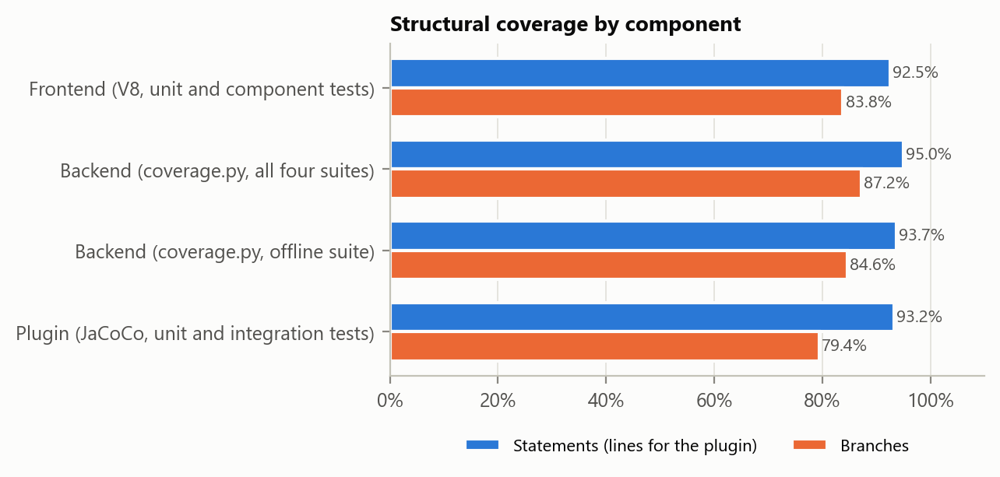
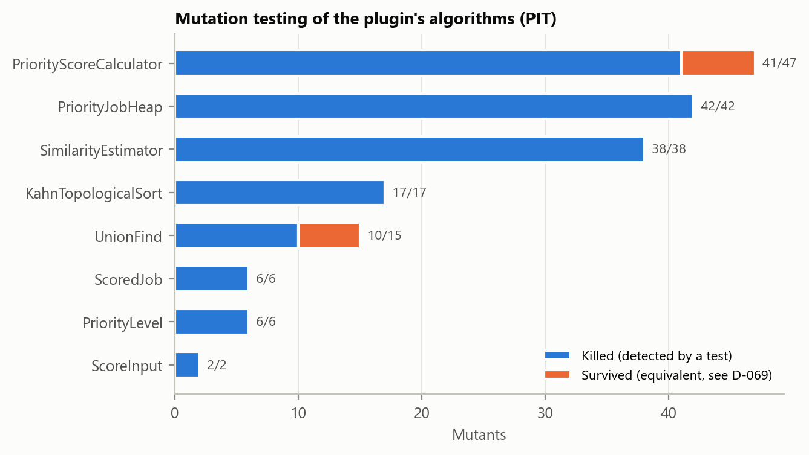
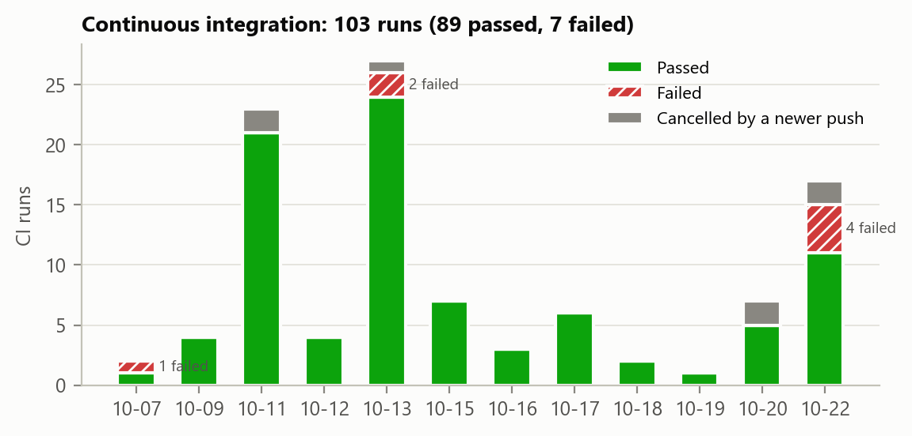
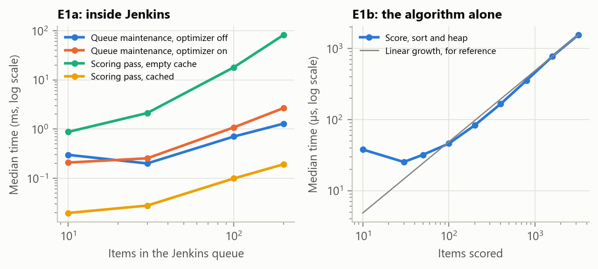
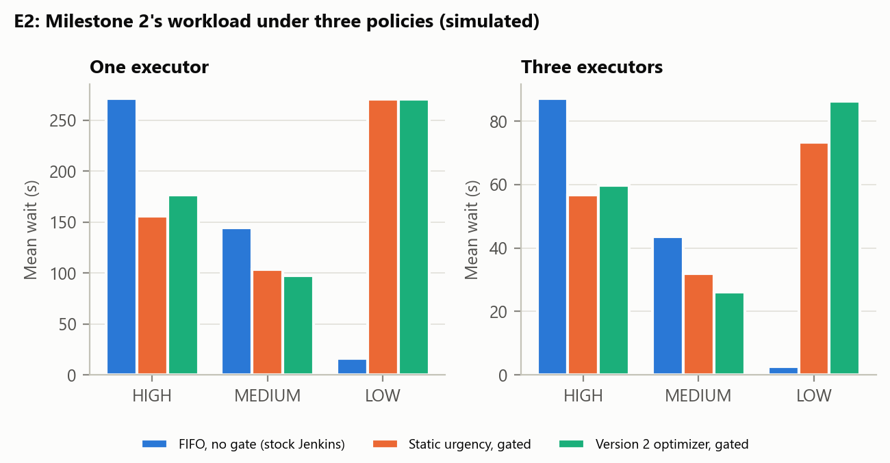
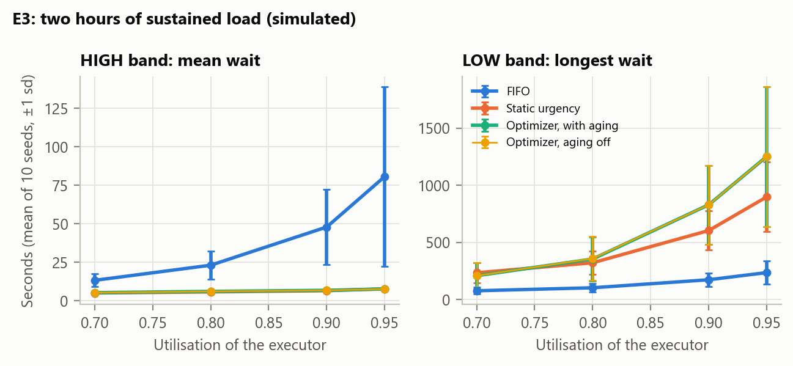
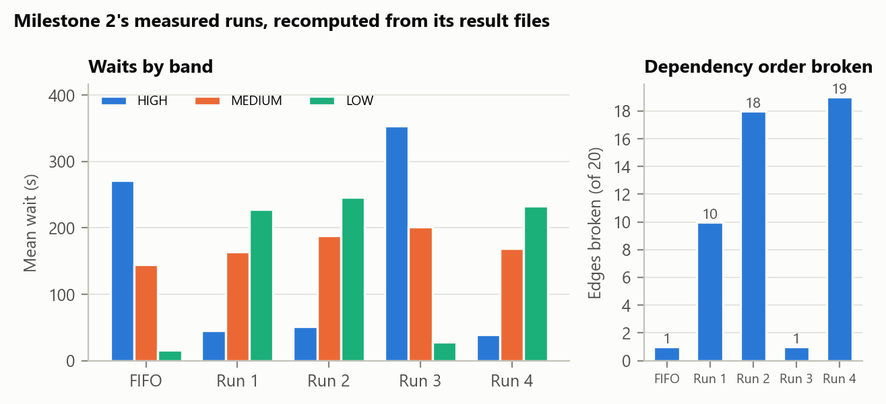
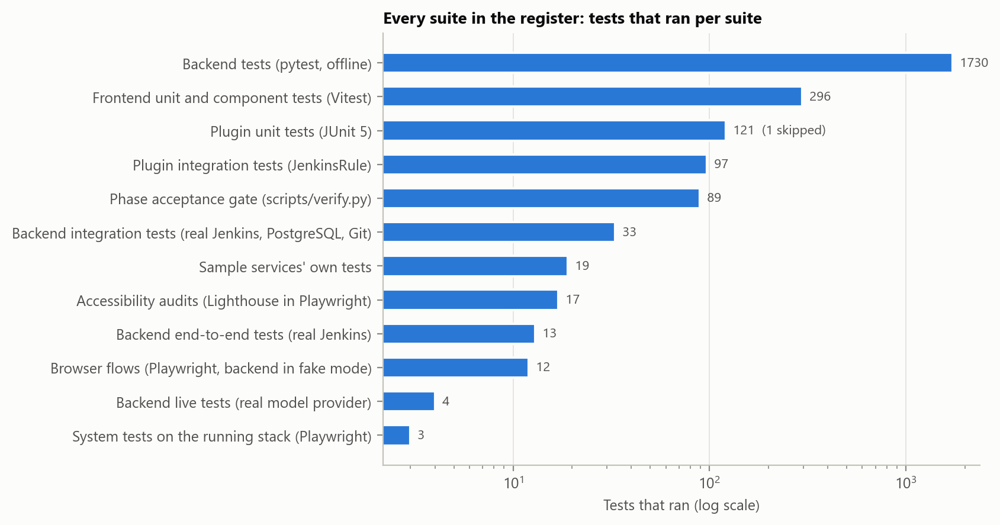
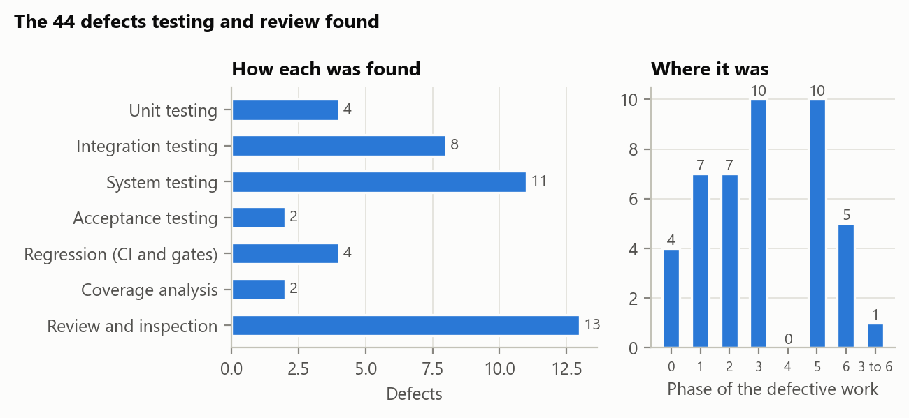

# Chapter 8: Software Testing

## 8.1 Introduction

This chapter reports how the Intelligent CI/CD Orchestrator was tested, what the tests found, and
what the results show. It covers the four parts of the system and the stack they run in:

- the Jenkins plugin that scores and orders the build queue (Chapter 6's algorithms);
- the backend, with its two assistants that turn plain English into Jenkins jobs;
- the web frontend;
- the Docker Compose stack: Jenkins, two agents, PostgreSQL, the backend and the frontend.

The chapter follows the testing strategy of Pressman and Maxim [22, ch. 19–21] and the test-planning
process of Perry [23, ch. 8]. Section 8.2 sets out the strategy. Section 8.3 is the test plan,
built through Perry's six tasks. Sections 8.4 to 8.7 report white-box, black-box, integration and
system testing. Section 8.8 reports three experiments and simulations, Section 8.9 discusses the
results, and Section 8.10 summarises.

**The rule for evidence.** Every result in this chapter comes from a run that happened, at a commit
that is named. One evidence campaign ran every suite once, at commit `31eb935` on
22 October 2026, and kept each runner's own report: JUnit XML, coverage data, the mutation report and the
logs (`scripts/test_campaign.py`). Those reports are committed, unchanged and with their checksums,
in `docs/testing/evidence/raw/`. The register in Annexure B is built from them and the
gate run's log, and lists every test that ran (`scripts/report/test_register.py`). Where a figure comes from an earlier run, it
says so. Nothing is estimated. Anything not yet run is listed as not yet run in Section 8.9.4.

**A rehearsal of the campaign, at the earlier commit `ac8305a`, is not cited as evidence.** It is
recorded all the same:
- three of its backend steps failed during a 15-minute network outage on the development machine
  (DNS for GitHub and the model provider), and passed when run again;
- its one skipped test led to a defect (DF-42), whose fix moved the campaign to its final commit.

Its logs are kept in `docs/testing/evidence/raw/`, and Annexure A.2 describes it.

**The results in brief.**
- **The register of every test** holds 2,434 tests in 12 suites, from the
  evidence campaign and the gate run: 2,433 passed, 0 failed and
  1 skipped (Section 8.9.1; every test in Annexure B).
- **The acceptance gate** passed all 89 of its checks in gate run 7, at
  `4f1bb36` (Sections 8.4.8 and 8.6.3).
- **Coverage:**
  - the plugin, 93.2% of lines and 79.4% of branches;
  - the backend, 95.0% of statements over all its suites;
  - the frontend, 92.5% of statements.
- **Mutation testing** detected 162 of the plugin's 173 algorithm mutants: every one a test could
  tell from the original.
- **Testing and review found 44 defects,** 56 separate problems; 41 are fixed (Section 8.9.2).
- **Three experiments qualified three of the report's claims:** the plugin's cost, what aging does
  under load, and what Milestone 2's headline result cost (Sections 8.8 and 8.9.3).

## 8.2 Testing strategy

### 8.2.1 From the component outwards

Pressman and Maxim describe testing as a spiral that starts at the component and works outwards:
unit testing exercises each component's code; integration testing assembles components and
exercises their interfaces; validation testing checks the assembled software against the
requirements; and system testing checks it inside the system it belongs to [22, ch. 19–20]. This
project follows that order at each level of its build, as Table 8.1 shows.

**Table 8.1: Test levels, what each one exercises, and where it runs**

| Level | What it exercises | Suites | Where it runs |
| --- | --- | --- | --- |
| Unit | One class or module, with no real Jenkins, database, network or model | Plugin unit tests (JUnit), backend offline tests (pytest), frontend unit and component tests (Vitest), the sample services' own tests | Locally and in CI on every push |
| Integration | A component against the real thing it depends on | Plugin tests inside a real Jenkins (JenkinsRule); backend tests against the real jenkins-dev, PostgreSQL and Git; backend tests against the real model provider | Locally on the Compose stack; the plugin's in CI too |
| Validation | The assembled software against the report's requirements | One acceptance test per acceptance criterion of the report's user stories; each phase's acceptance gate (`scripts/verify.py`) | Locally; the acceptance tests in CI too |
| System | The whole stack as a user meets it | Browser flows, Lighthouse accessibility audits, end-to-end tests against the real Jenkins, system tests through the stack's own frontend, load and recovery tests | Locally on the stack; the flows and audits in CI too |

### 8.2.2 Verification and validation

Pressman and Maxim, after Boehm [24], separate *verification*, building the product right, from
*validation*, building the right product [22, ch. 19]. Here the two have different sources of truth:

- **Verification** is checked against the build specification (`BUILD_PROMPT.md`), which turns the
  report into precise behaviour. Unit and integration tests, static analysis and most gate checks
  verify.
- **Validation** is checked against the report itself: the user stories and their acceptance
  criteria in Section 4.7, and the quality requirements in Section 4.8. The acceptance tests, the
  accessibility audits and the tests through the running stack validate.

### 8.2.3 Who tests

The tests were written with the code, by the same developers, as Pressman and Maxim say the unit
level should be [22, ch. 19]. Two things stand in for the independent test group they recommend for
larger projects:

- **Automated gates.** No phase was closed until its acceptance gate printed "ALL CHECKS PASSED".
  Each acceptance clause of each phase is a check of its own, so a clause cannot pass unnoticed.
- **An independent review.** The security review of Phases 3, 5 and 6 was done by a separate AI
  agent, a Claude Code subagent that had no part in writing the code, working from a read-only copy
  of it. It was independent of the code's authors, though not of the kind of tool that assisted
  them, and it did not cover the Java plugin. An earlier review of Phase 5 was not independent: its reviewer stopped on a usage limit,
  and the developer finished it, which its own record says.

Development was assisted by an AI coding assistant, Claude Code, and every change was reviewed and
checked by the tests and gates described here. The disclosure the report owes is recorded in
`docs/report-updates.md`.

### 8.2.4 Tools

**Table 8.2: Test tools and versions**

| Purpose | Tool | Version |
| --- | --- | --- |
| Plugin unit tests | JUnit Jupiter, on the JUnit platform | 6.1.3 |
| Plugin integration tests | Jenkins Test Harness (`JenkinsRule`), Maven Failsafe | as pinned by the Jenkins plugin parent POM 6.2236 |
| Plugin coverage | JaCoCo | 0.8.15 |
| Plugin mutation testing | PIT (`pitest-maven`, `pitest-junit5-plugin`) | 1.30.0, 1.2.3 |
| Plugin static analysis | SpotBugs, Spotless | 4.10.4.1 (plugin), 3.10.2 |
| Backend tests | pytest, pytest-asyncio | 9.1.1, 1.4.0 |
| Backend coverage | coverage.py through pytest-cov | 7.16.2, 7.1.0 |
| Backend static analysis | Ruff (with its Bandit security rules), mypy (strict) | as pinned in `backend/pyproject.toml` |
| Frontend tests | Vitest, Testing Library | 5.0.3, 16.3.3 |
| Frontend coverage | `@vitest/coverage-v8` | 5.0.3 |
| Frontend static analysis | ESLint, TypeScript (strict) | 10.12.0, 5.9.3 |
| Browser tests | Playwright, in Google Chrome | 1.63.0 |
| Accessibility | Lighthouse | 13.5.0 |
| Complexity | lizard | 1.24.1 |
| Continuous integration | GitHub Actions | workflow `.github/workflows/ci.yml` |
| Acceptance gates | `scripts/verify.py` | the repository's own |

Every pinned version and where it was checked is in `docs/versions.md`.

## 8.3 Test plan

Perry builds a test plan in six tasks: profile the software project, understand its risks, select
the testing techniques, plan unit testing and analysis, build the plan, and inspect it [23, ch. 8].
This section follows those tasks.

### 8.3.1 Task 1: profile of the software project

**Table 8.3: Project profile**

| Aspect | Profile |
| --- | --- |
| Purpose | Let a developer create Jenkins jobs in plain English, and order Jenkins' queue by urgency, dependency and expected duration instead of arrival |
| Components | A Jenkins plugin (Java 21, Jenkins 2.568.3); a backend (Python 3.12, FastAPI, PostgreSQL 16) holding two assistants and a rule-based fallback for the language model; a React 19 frontend; a Docker Compose stack |
| Size of the code under test | Plugin: 1,200 executable lines in 23 source files (34 classes, nested ones included); backend: 7,729 statements in 76 modules; frontend: 2,025 statements |
| Users | Developers, DevOps engineers and Admins, each with their own permissions |
| Environment | Staging only. Production deploys are refused by policy for every role |
| External dependencies | Jenkins and its agents, GitHub for the sample services' repositories, PostgreSQL, a hosted language model (Groq, free tier) |
| Process | Nine phases (0 to 8), each closed by an acceptance gate; CI on every push; this chapter covers Phases 0 to 6 and their hardening |
| Constraints | One Jenkins controller; a rate-limited free model tier; one developer machine; the Milestone 2 code frozen in `legacy/` |

### 8.3.2 Task 2: project risks

Perry's second task is to understand the risks, so that testing goes where failure would cost
most [23, ch. 8]. Table 8.4 lists the risks this project's testing was planned around, and the test
response to each.

**Table 8.4: Risks and the test response to each**

| # | Risk | Likelihood | Impact | Test response |
| --- | --- | --- | --- | --- |
| R1 | The implemented score drifts from the report's formula, as it did in Milestone 2, where two weights were swapped | High | High | `AppendixCExampleTest` reproduces report Appendix C to 0.001; component tests of U, D, T and aging; mutation testing of the calculator |
| R2 | A job runs before the job it depends on | Medium | High | Dependency gate tests in a real Jenkins; dependency violations counted in every simulation |
| R3 | The plugin slows or blocks Jenkins' queue | Medium | High | A 5 ms budget test for 200 items; the overhead measured inside Jenkins (E1); a test that a stalled metrics backend never blocks recording |
| R4 | The language model writes a shell command, or a production deploy gets through | Medium | High | Tests that every generated command comes from the service catalog; the policy refuses production for every role; prompt-injection tests |
| R5 | Unauthorised access, or a stolen session | Medium | High | Authentication, role and rate-limit tests; two security reviews, one of them independent; an audit of suspicious activity; known-vulnerability scans of dependencies |
| R6 | LOW-urgency jobs starve | Medium | Medium | Aging tests; a sustained-load simulation (E3) |
| R7 | Model output is not deterministic, so tests flicker | High | Medium | Fake and replay modes for every test that does not need the real model; live tests only on request |
| R8 | The environment fails: an agent loses DNS, GitHub is slow | Medium | Medium | Retried checkouts; end-to-end tests run on the real stack |
| R9 | Components disagree about an interface: field names, types | Medium | High | Frontend types generated from the backend's OpenAPI schema and checked in CI; parsers tested on responses recorded from the live plugin |
| R10 | The interface is hard to use, or inaccessible | Medium | Medium | Lighthouse audits; screenshots reviewed against the design document |
| R11 | A later change breaks earlier work | High | Medium | CI on every push; every gate re-runs the checks of all earlier phases |
| R12 | The tests themselves report success falsely | Medium | High | A gate check counts a skipped acceptance test as a failure; the integration tests' binding is checked; mutation testing; coverage checked for measurement errors |

### 8.3.3 Task 3: testing techniques

Perry divides system-level techniques into structural ones, which test how the system works, and
functional ones, which test what it does [23, ch. 8]. Table 8.5 shows each technique, whether it was
used, and where its evidence is.

**Table 8.5: Perry's structural and functional techniques, as applied**

| Technique | Perry's purpose | Applied as | Evidence |
| --- | --- | --- | --- |
| *Structural* | | | |
| Stress | Does the system handle more than normal volume? | One user sends 450 API requests at once, past the 300-a-minute limit; the algorithm scored for up to 3200 items; two hours of simulated load at 95% utilisation | 8.7.1, E1, E3 |
| Execution | Does it perform well enough? | API latency under 1, 5 and 10 concurrent users; the plugin's cost to Jenkins' queue maintenance | 8.7.1, E1 |
| Recovery | Can it be returned to service after a failure? | PostgreSQL, the backend and Jenkins each restarted, with the time to recover and a check that nothing was lost | 8.7.1 |
| Operations | Can it be run in its normal environment? | The stack built and started from its images; health checks; the bootstrap and the gates' stack checks | Gate, Phase 1 and 3 |
| Compliance | Was it built to its standards? | Gate checks of the project's own rules: no script console, the formula's constants, templates derived from reference configs, pinned versions, the frozen legacy code | Gate, every phase |
| Security | Is it protected against misuse? | Two security reviews, one independent; tests of authentication, roles, tokens, rate limits, redaction, the content policy and the audit; dependency scans | 8.7.3, Annexure A |
| *Functional* | | | |
| Requirements | Does it do what is specified? | Acceptance tests of the report's user stories; the gates' acceptance checks | 8.5.4, gate |
| Regression | Does what worked still work? | CI on every push; every gate re-runs every earlier phase's checks | 8.6.3 |
| Error handling | Does it handle errors properly? | Invalid commands, Jenkins down, the model unreachable, a failing test branch | 8.5, 8.7 |
| Manual support | Does the human side work? | Accessibility audits; screenshots reviewed; keyboard-only flows | 8.7.2 |
| Intersystem | Do the connected systems work together? | Plugin to backend metrics; backend to Jenkins, Git and the model; frontend to backend over HTTP and WebSocket | 8.6 |
| Control | Do the controls work? | Audit entries; idempotent approval; the per-service chain lock; the daily HIGH quota; role guards | 8.5, 8.7 |
| Parallel | Do old and new give the same, or better, results? | FIFO against the optimizer on the same workload: Milestone 2's measured runs, and the simulation | 8.8 |

### 8.3.4 Task 4: unit testing and analysis

Perry plans unit testing under three headings [23, ch. 8], and each is used here:

- **Functional testing and analysis.** Tests derived from the specification: equivalence classes and
  boundary values for every input with a range (Section 8.5.2), and special values such as report
  Appendix C's worked example.
- **Structural testing and analysis.** Tests derived from the code: statement and branch coverage
  for all three components, basis paths for the critical functions, and cyclomatic complexity to
  find where untested branches matter most (Section 8.4).
- **Error-oriented testing and analysis.** Tests that look for faults directly: mutation testing of
  the plugin's algorithms (Section 8.4.7), regression tests for every defect found, and negative
  controls such as a test branch built to fail.

### 8.3.5 Task 5: the plan

**Test objectives.** Each objective is measurable, and its threshold comes from the specification
where the specification sets one.

**Table 8.6: Test objectives**

| # | Objective | Threshold | Source of the threshold |
| --- | --- | --- | --- |
| O1 | Every acceptance criterion of the report's user stories has a test that passes | All of them | Report 4.7 |
| O2 | The score matches the report's formula on its worked example | Within 0.001 | `BUILD_PROMPT.md` 4.3.10 |
| O3 | No job runs before an upstream job it depends on, with the optimizer on | 0 violations | `BUILD_PROMPT.md` 4.8.4 (a KPI new in version 2) |
| O4 | Scoring and sorting 200 queued items stays within budget | Under 5 ms | `BUILD_PROMPT.md` 4.3.10 |
| O5 | The plugin never blocks Jenkins' queue | Recording returns at once even when the backend stalls | `BUILD_PROMPT.md` 4.3.9 |
| O6 | Every protected API operation refuses a request without a session, and each role is allowed only what it may do | All of them | Report 4.7.4 |
| O7 | Shell commands come only from the catalog, and production is refused | All of them | `BUILD_PROMPT.md` 4.6.1, 4.5.5 |
| O8 | Both assistant pages are accessible | Lighthouse 95 or more | `BUILD_PROMPT.md` Phase 6 |
| O9 | Each phase meets its acceptance clauses | The gate prints ALL CHECKS PASSED | `BUILD_PROMPT.md` Part 3 |

Coverage and mutation scores have no threshold in the specification. They are reported as measured
(Section 8.4), not judged against a number chosen afterwards.

**The test matrix.** Perry's plan relates each function to the tests that cover it [23, ch. 8].
Here the functions are the report's acceptance criteria and quality requirements, and the matrix is
Table 8.18 in Section 8.5.4.

**Entry and exit criteria.**

- A phase's testing starts with its first task. Where a behaviour was uncertain, the test came first:
  T2.1 began with integration tests written to fail, to confirm how Jenkins queues a Pipeline job
  before anything was built on it.
- A phase is finished when its gate prints ALL CHECKS PASSED, CI passes on its last commit, and
  `PROGRESS.md` records both.
- Testing is suspended on any failing gate check. A skipped acceptance test counts as failed: one
  that could not run proves nothing.
- A flaky test is a defect to find, not a test to retry. Two were found this way: a Pipeline
  reporting itself finished before its log was complete (DF-14), and a retried checkout changing
  the model's prompt (DF-23).

**Deliverables.** The test code; the gate checks; the evidence campaign's reports; the register of
every test (Annexure B); the evidence and data (Annexure A); and this chapter.

**Schedule.** Tests were written within each phase, from 28 September to 22 October 2026 (Annexure
A.14, Figures A.1 and A.2), and the evidence campaign ran on 22 October 2026. The Phase 7 experiment on real Jenkins, and the Phase 8 chatbot
evaluation with human-labelled answers, come later and are outside this chapter (Section 8.9.4).

### 8.3.6 Task 6: inspection of the plan

Perry's last task is to inspect the plan before relying on it [23, ch. 8]. This plan was inspected
three ways:

- **Each acceptance clause is a gate check.** The gate began with 11 checks in Phase 0 and has 89
  for Phases 0 to 6. An audit on 18 October 2026 found acceptance clauses with no check of their
  own, and those checks were added.
- **Reviews.** The security reviewers ran the existing suites as well as reading the code; the
  review of Phases 3, 5 and 6 was independent of the code's authors. Each of its 15 findings was
  fixed with a regression test, and every fix that changed code was checked by removing it and
  watching its test fail (`docs/security-review-phases-3-5-6.md`).
- **The tests were themselves tested.** Mutation testing showed which assertions were missing
  (Section 8.4.7). Coverage showed which paths no test took, and found the coverage measurement
  itself under-reporting (Section 8.4.6).

## 8.4 White-box testing

White-box testing derives tests from the code's structure, so that every independent path through
a critical function is executed at least once [22, ch. 19]. This section applies it in five ways:
basis paths for the critical functions (8.4.2); condition, loop and data-flow testing (8.4.3 to
8.4.5); statement and branch coverage across the code (8.4.6); and mutation testing of the plugin's
algorithms (8.4.7).

### 8.4.1 What is critical, and why

The functions analysed by hand are the ones whose failure would defeat the system's purpose or
safety:

- **The score** (`PriorityScoreCalculator`): the report's formula, which Milestone 2 got wrong.
- **The order and the gate** (`DynamicQueueSorter`, `DependencyGate`): which job Jenkins runs next,
  and whether a job can run before its producer.
- **Admission to the system** (`RateLimiter`, `safeNext`): how many guesses a password gets, and
  whether the sign-in page can be turned into a redirect to another site.

### 8.4.2 Basis path testing

For each function, the flow graph's cyclomatic complexity V(G) gives the number of independent
paths that a basis set must cover [22, ch. 19; 25]. V(G) is computed as the number of predicate
nodes plus one; each simple condition of a compound one counts as its own predicate. Each path is
listed with the test that takes it.

**Table 8.7: `PriorityScoreCalculator.agingBonus`, V(G) = 4**

```java
if (waitMillis <= 0 || agingIntervalMinutes <= 0) return 0.0;   // P1, P2
long intervals = (waitMillis / 60_000) / agingIntervalMinutes;
return Math.min(agingCap, agingBonusPerInterval * intervals);  // P3: capped or not
```

| Path | Condition | Expected | Test |
| --- | --- | --- | --- |
| 1 | No wait (0 or negative) | 0.0 | `AgingTest.noBonusWithoutWaiting`; `bonusStepsAndCaps` at 0 minutes |
| 2 | A wait, but an interval of 0 | 0.0, not a division by zero | `AgingTest.zeroIntervalEarnsNothing` (added 2026-10-20, Section 8.4.7) |
| 3 | Bonus below the cap | 0.05 per whole 5 minutes | `bonusStepsAndCaps` at 5, 9, 10 and 14 minutes |
| 4 | Bonus at or above the cap | 0.15 | `bonusStepsAndCaps` at 15, 20, 60 and 1440 minutes |

Path 2 was not in the basis set until coverage and mutation testing showed that no test took it.

**Table 8.8: `PriorityScoreCalculator.executionTimeFactor`, V(G) = 4**

```java
if (estimate.isEmpty() || !anyKnown || estMax == estMin) return 0.5;   // P1, P2, P3
return 1.0 - (estimate - estMin) / (double) (estMax - estMin);
```

| Path | Condition | Expected | Test |
| --- | --- | --- | --- |
| 1 | No estimate for this job | 0.5, neither favoured nor punished | `ScoreComponentTest$ExecutionTime.unknownEstimateIsNeutral` |
| 2 | An estimate, but none known in the queue | — | **Infeasible**: a job with an estimate makes `anyKnown` true |
| 3 | Every estimate equal | 0.5, not a division by zero | `identicalEstimatesAreNeutral`; `singleJobIsNeutral` |
| 4 | A spread of estimates | 1 for the shortest, 0 for the longest | `spansTheRange` |

**Table 8.9: `DependencyGate.blockageFor`, V(G) = 10**

| Path | Condition | Expected | Test (all JenkinsRule) |
| --- | --- | --- | --- |
| 1 | Optimizer off | Never blocks: the experiment's baseline arm keeps stock Jenkins | `ObserveOnlyIT`: the dependency gate is inactive in observe-only mode |
| 2 | A Pipeline node block | Never blocks a run already in progress | The Pipeline tests (`PipelinePriorityIT`, `QueueShapeProbeIT`): their node blocks pass the gate, which JaCoCo records as taken |
| 3 | The item resolves to no job | Never blocks | **Not covered** (defensive) |
| 4 | The job has no priority property | Never blocks | `FreestylePriorityIT`: a job with no priority property is treated as MEDIUM |
| 5 | An upstream that does not exist | Skipped, reported elsewhere as unresolved | `MissingUpstreamIT`: a job depending on a nonexistent upstream still runs |
| 6 | The job names itself | Skipped, so it cannot deadlock | `DependencyGateIT`: a self-dependency does not deadlock the job |
| 7 | The upstream is building | Blocks, naming it | `DependencyGateIT`: a HIGH downstream job waits for its LOW upstream |
| 8 | The upstream is queued | Blocks | `DependencyGateIT`: waits while its upstream is merely queued |
| 9 | Every upstream finished | Does not block | `DependencyGateIT`: a finished upstream stops blocking |
| 10 | An upstream that failed | Does not block; the backend decides about chains | `DependencyGateIT`: an upstream that merely failed does not block |

Two defensive paths are not taken by any test: path 3, and the method that wraps this one, which
lets an item run if the check itself throws. Both need a fault Jenkins does not produce on its own.

**Table 8.10: `RateLimiter._consume` (backend), V(G) = 6**

Five predicates: a new caller, a token left, never recorded, recorded a window ago or more, and
whether to record. The last is decided by the two before it, so one basis path cannot occur.

| Path | Condition | Expected | Test: `test_one_refusal_a_window_is_marked_for_the_audit` |
| --- | --- | --- | --- |
| 1 | A caller's first request | Allowed; a bucket is made, less this request | its first call |
| 2 | Tokens left (including tokens refilled with time) | Allowed | its second call, and its call after 30 seconds |
| 3 | Empty, never recorded | Refused (429) and recorded | its first refusal |
| 4 | Empty, recorded within the window | Refused, not recorded again | its second refusal |
| 5 | Empty, last recorded a window ago or more | Refused and recorded again | its refusal after 61 seconds |
| 6 | Recorded is decided, but not recorded | — | **Infeasible** |

**Table 8.11: `safeNext` (frontend), V(G) = 9**

| Path | Input | Expected | Test vector in `next.test.ts` |
| --- | --- | --- | --- |
| 1 | Not a path (null, empty, relative, absolute URL, `javascript:`) | The overview | `null`, `""`, `"queue"`, `"https://elsewhere.example/"`, `"javascript:alert(1)"` |
| 2 | Starts `//` | The overview | `"//elsewhere.example/queue"` |
| 3 | Starts `/\` | The overview | `"/\\elsewhere.example"` |
| 4 | The URL parser throws | The overview | **Infeasible**: the URL standard's parser never throws for a path resolved against a valid base |
| 5 | Resolves to another origin | The overview | `"/\t/elsewhere.example"` (the tab is stripped) |
| 6 | Resolves to the sign-in page | The overview | `"/sign-in"` |
| 7 | Resolves to a path starting `//` | The overview | `"/.//evil.example"`, `"/..//evil.example"`, `"/a/..//evil.example"` |
| 8 | Resolves to a path starting `/\` | The overview | `"/./\\evil.example"` |
| 9 | A path on this site | That path, with its query and fragment | `"/queue"`, `"/runs?service=payment-service#latest"` |

Paths 7 and 8 exist because of the independent security review's finding 8: before it, a path
that became protocol-relative only once resolved reached the router.

### 8.4.3 Condition testing and boundary conditions

Condition testing exercises each simple condition of a compound one both ways [22, ch. 19].
Branch coverage (Section 8.4.6) measures it directly: JaCoCo and coverage.py count each outcome of
each simple condition. Where an outcome was never taken, it was either tested or shown to be
infeasible:

- **Infeasible:**
  - `maxGroupSize <= 1` with a group of two or more (the largest group is never smaller than any
    group);
  - `!anyKnown` with an estimate present (Table 8.8);
  - in the heap's `remove`, an entry that is indexed but not in the heap, which the heap's own
    invariant rules out;
  - in `JobPriorityProperty`'s cycle search, the check for the job's own name, which an earlier
    check has already refused.
- **Tested once found:** the zero aging interval (Table 8.7, path 2); union by rank joining a
  shallower tree under a deeper one in both directions; Kahn's sort ignoring an edge whose consumer
  is not in the group, as well as one whose producer is not.

### 8.4.4 Loop testing

Loops were tested at the counts Pressman and Maxim recommend: skipped, once, twice, a typical
number and many [22, ch. 19].

- **The scoring loops** (`scoreAll` and group inheritance): a queue of one
  (`ScoreComponentTest`: a single queued job takes the neutral factor), two, four (report Appendix
  C), 200 (`SchedulerOverheadTest`) and up to 3200 items (experiment E1b). An empty queue returns
  before either loop.
- **The heap's sift loops:** empty, one entry, ties, re-scoring that moves an entry up or down,
  and 200 entries rebuilt under concurrent readers and writers (`PriorityJobHeapTest`).
- **Union-find's path walk:** a chain long enough to overflow a recursive implementation's stack
  (`UnionFindKahnTest`: a long chain does not overflow the stack).
- **The gate's upstream loop:** no upstream, one, a mix of real and missing ones
  (`MissingUpstreamIT`), and a chain of three (`DependencyGateIT`: a whole chain runs in order).

### 8.4.5 Data-flow testing: where the dependency factor came from

Data-flow testing follows each value from where it is defined to where it is used [22, ch. 19].
Following the dependency factor D this way found the most consequential defect of this chapter
(DF-30, D-067).

- **Where D was defined:** in `DependencyGraphService.build`, from the groups formed over the items
  the sorter was given. Jenkins gives a `QueueSorter` only the *buildable* items.
- **What else acts on those items:** `DependencyGate`, earlier in the same maintenance pass, holds
  back every job whose upstream is still queued or building. Jenkins files a held job as *blocked*,
  so it never reaches the sorter.
- **So:** an upstream job and the jobs waiting on it were never in the sorter's list together.
  Every group had one member, D was 0 for every job, and the group inheritance of report
  Appendix C, where a LOW producer takes the score of the HIGH job waiting for it, could not happen.
  The unit tests had passed throughout, because they build their groups by hand.

A test was written first, to confirm the defect in a real Jenkins (`GroupInheritanceIT`). With a LOW
build, the HIGH deployment that depends on it, and three MEDIUM jobs on one executor, Jenkins ran
`gi-medium-1, gi-medium-2, gi-medium-3, gi-build-api, gi-deploy-api`: the build that the urgent job
needed ran last, and its D was 0.0. The sorter now forms groups over the buildable and the held
items together, and ranks only the buildable ones. The same test then caught a second defect in the
first version of the fix: its cache key could not tell a held job from a buildable one (DF-31).
Section 8.8.2 measures what the fix changes.

### 8.4.6 Statement and branch coverage

Coverage measures how much of the code the tests executed: the statements (or lines), and each
outcome of each branch [22, ch. 19]. It was measured for all three components in the evidence
campaign:
- **The plugin:** JaCoCo, over its unit and JenkinsRule tests.
- **The backend:** coverage.py, once over the offline suite and once more with the integration,
  end-to-end and live suites added.
- **The frontend:** V8's own coverage, over its unit and component tests.

**Table 8.12: Statement and branch coverage** (the evidence campaign at `31eb935`; every
module in Annexure A.5, Figure 8.1)

| Component | Measured over | Lines or statements | Branches |
| --- | --- | ---: | ---: |
| Plugin, all of it | 121 unit and 97 JenkinsRule tests (JaCoCo) | 93.2% (1,118 of 1,200 lines) | 79.4% (408 of 514) |
| Plugin: `scoring` | the same | 100% (76 of 76) | 94.4% (34 of 36) |
| Plugin: `heap` | the same | 100% (56 of 56) | 94.4% (17 of 18) |
| Plugin: `dependency` | the same | 95.3% (163 of 171) | 89.3% (75 of 84) |
| Plugin: `gate` | the same | 92.2% (59 of 64) | 89.5% (34 of 38) |
| Plugin: `metrics` | the same | 90.9% (200 of 220) | 65.4% (51 of 78) |
| Backend, offline suite | 1730 tests (coverage.py, greenlet-aware) | 93.7% (7,241 of 7,729 statements) | 84.6% (1,397 of 1,652) |
| Backend, all four suites | the offline suite plus integration, end-to-end and live | 95.0% (7,344 of 7,729) | 87.2% (1,440 of 1,652) |
| Frontend | 296 unit and component tests (V8) | 92.5% (1,874 of 2,025 statements) | 83.8% (1,364 of 1,627) |

**What the figures do and do not say.**
- **The plugin's uncovered branches are mostly rare inputs and failure handling,** read from
  JaCoCo's report method by method:
  - escaping control characters in job names for the metrics JSON (8 of its 12 branches missed);
  - the publisher's handling of HTTP errors (7 of 16);
  - the agent label a build recorded, when it is absent or unusual (6 of 12);
  - a build's parameters, which few test jobs have (5 of 6);
  - the dispatch comparator's paths for items that could not be scored (5 of 8).

  In the scoring and heap packages, the only three branches no test took are the three that
  Section 8.4.3 shows to be infeasible.
- **The plugin's coverage rose with the tests D-069 added for what coverage found.** Over the 185
  tests it then had, it read 85.8% of lines and 69.5% of branches; over the campaign's 218 tests,
  93.2% and 79.4%.

**The measurement itself was wrong at first.** The backend's first reading was 87%, with
`app/services/auth.py` at 67.6%, although that module is among the most tested in the project. The
backend's database layer runs on greenlets (SQLAlchemy's async engine), and coverage.py's default
tracer loses the lines that run after a greenlet switch, so code that ran was counted as missed.
Told about greenlets, the same tests on the same code read 92%, and `auth.py` 92.3% (DF-34, D-069).
The setting is now in `backend/pyproject.toml`, so every later measurement is right without a flag.



**Figure 8.1: Statement and branch coverage, by component**

**What coverage found, beyond the number:**
- untested paths in security code: tokens for accounts that no longer exist, the password rehash at
  sign-in, the token denylist's expiry, a WebSocket that never authenticates, and an idle socket's
  heartbeat;
- `MetricsPublisher` at 5% of its branches, although the specification gives it the plugin's
  hardest rule, never to block Jenkins' queue;
- the configuration form's validation, which had never run in any test;
- the startup warning about a competing queue sorter, which Part 4.3.7 requires;
- three functions nothing called, which were removed (DF-35).

Each gap now has a test, listed in D-069.

**Complexity and coverage together.** Cyclomatic complexity [25] was measured for every function
with lizard, to see where an untested branch matters most. Annexure A.14 plots each function's
complexity against its branch coverage (Figure A.4):

**Table 8.13: Cyclomatic complexity by component** (lizard 1.24.1, the components' own code; Annexure A.13)

| Component | Functions | Mean CCN | Median | Highest | Over 10 | Over 15 |
| --- | ---: | ---: | ---: | ---: | ---: | ---: |
| Plugin | 146 | 2.49 | 1 | 17 | 3 | 1 |
| Backend | 703 | 3.44 | 2 | 28 | 35 | 11 |
| Frontend | 620 | 2.17 | 1 | 31 | 9 | 2 |

**Table 8.14: The five most complex functions of each component, and their branch coverage**

| Component | Function | CCN | Branches covered | Coverage measured per |
| --- | --- | ---: | ---: | --- |
| Plugin | `build` (`DependencyGraphService.java:38`) | 17 | 90% | method |
| Plugin | `sort` (`KahnTopologicalSort.java:74`) | 12 | 100% | method |
| Plugin | `post` (`MetricsPublisher.java:179`) | 11 | 56% | method |
| Plugin | `blockageFor` (`DependencyGate.java:65`) | 10 | 94% | method |
| Plugin | `jsonEscape` (`MetricEvent.java:91`) | 10 | 33% | method |
| Backend | `run_card` (`chains.py:386`) | 28 | 95% | function |
| Backend | `required_stages` (`planner.py:140`) | 27 | 97% | function |
| Backend | `parse_ranking` (`plugin.py:276`) | 25 | 100% | function |
| Backend | `intent_summary` (`conversations.py:565`) | 22 | 91% | function |
| Backend | `_store` (`generation.py:358`) | 21 | 100% | function |
| Frontend | `OverviewPage` (`OverviewPage.tsx:48`) | 31 | 90% | file |
| Frontend | `usePipelinePreview` (`usePipelinePreview.ts:52`) | 28 | 72% | file |
| Frontend | `ScoreBar` (`ScoreBar.tsx:28`) | 15 | 100% | file |
| Frontend | `AssistantPage` (`AssistantPage.tsx:44`) | 15 | 92% | file |
| Frontend | `PreviewPanel` (`PreviewPanel.tsx:59`) | 15 | 85% | file |

### 8.4.7 Mutation testing

Mutation testing judges the tests, not the code. It makes many small changes to the code, each a
*mutant* (a `<` turned into `<=`, a `+` into a `-`, a method call removed), and runs the tests
against each one. A mutant the tests fail on is *killed*. One they pass on has *survived*: either it
behaves exactly like the original, an *equivalent* mutant, or the tests are missing an assertion
[26]. Perry lists it among error-oriented unit testing techniques [23, ch. 8].

PIT [27] mutated the plugin's algorithm classes: scoring, the heap, union-find, Kahn's sort, the
estimator and the priority levels. These are the classes with no Jenkins in them, whose tests run in
milliseconds. The Jenkins-facing classes are covered by integration tests that take seconds each,
too slow to run once per mutant.

**Table 8.15: Mutation testing of the plugin's algorithm classes** (PIT 1.30.0, at
`31eb935`; Annexure A.6, Figure 8.2)

| Class | Mutants | Killed by a failing test | Killed by a time-out | Survived |
| --- | ---: | ---: | ---: | ---: |
| `PriorityScoreCalculator` | 47 | 41 | 0 | 6 |
| `PriorityJobHeap` | 42 | 32 | 10 | 0 |
| `SimilarityEstimator` | 38 | 38 | 0 | 0 |
| `KahnTopologicalSort` (with its `Edge` and `Result`) | 17 | 17 | 0 | 0 |
| `UnionFind` | 15 | 8 | 2 | 5 |
| `PriorityLevel` | 6 | 6 | 0 | 0 |
| `ScoredJob` | 6 | 6 | 0 | 0 |
| `ScoreInput` | 2 | 2 | 0 | 0 |
| **All** | **173** | **150** | **12** | **11** |

A mutant killed by a time-out made a loop run forever, for example in the heap's sift. PIT stops it
and counts it as detected, since a test that never finishes fails.



**Figure 8.2: Mutation testing of the plugin's algorithm classes, by class**

**The first run, before the tests below existed, killed 150 of 173 mutants (87%).** Each of the 23
survivors was examined:
- **11 are equivalent.** No test can tell them from the original. For example, a wait of exactly
  zero earns no aging whether the guard says `<= 0` or `< 0`, and union by rank joins the same
  elements whichever root it puts under the other. Each is argued in Annexure A.6.
- **12 revealed missing assertions.** Among them:
  - an aged job's own score was never checked, so a mutant that would show every aged job as
    "inherited" in the UI survived;
  - five removed `unlock()` calls, which only a second thread could see;
  - the zero aging interval;
  - the estimator's similarity threshold, at its exact boundary;
  - the estimator's two documented tie-breaks.

New tests kill all 12, so every non-equivalent mutant is now killed. In the evidence campaign's run,
162 of the 173 mutants were detected (93.6%), and the 11 that survived are the same 11 equivalent
ones: 162 of the 162 that a test could tell apart.

### 8.4.8 Static analysis

Every component is also checked without running it, on every push (Table 8.16).

**Table 8.16: Static analysis**

| Component | Tool | What it checks | Result | Where it ran |
| --- | --- | --- | --- | --- |
| Plugin | SpotBugs | Bug patterns in the bytecode | 0 bug instances | the campaign's plugin build |
| Plugin | Spotless | Formatting | clean | the campaign's plugin build |
| Backend | Ruff, with its Bandit security rules, and its formatter | Lint, imports, naming, security patterns, format | clean | gate run 7 |
| Backend | mypy, strict | Types | clean | gate run 7 |
| Frontend | ESLint, TypeScript strict | Lint, types | clean | gate run 7 |

Gate run 7 ran at `4f1bb36`. Between the campaign's commit and that one, the
product's code changed only in the frontend's Vite version, a development tool (D-075); every other
change is documentation or the scripts that build this chapter's tables.

## 8.5 Black-box testing

Black-box testing derives tests from what an interface promises, not from how it is built
[22, ch. 19]. This section covers the system's interfaces (8.5.1), the input domains of each
(8.5.2), the API's contract (8.5.3), the report's acceptance criteria (8.5.4) and the user
interface (8.5.5).

### 8.5.1 The interfaces

- **The REST API:** 42 operations, published as an OpenAPI schema from which the frontend's types
  are generated. CI fails if the schema and the generated types disagree.
- **The WebSocket:** live events, authenticated by the first frame, never by the address.
- **The plugin's interfaces:** its ranking and metrics endpoints in Jenkins, its job property, and its
  settings page in Manage Jenkins. Section 8.9.2 tells how that page was found missing (DF-41).
- **The assistants' language interface:** what a user may type, and what each kind of request
  produces.
- **The web interface:** nine pages (signing in, and eight inside the app), at two screen widths and
  in two colour themes.

### 8.5.2 Equivalence partitioning and boundary values

Equivalence partitioning divides an input's domain into classes that the system should treat the
same, and tests one value from each; boundary value analysis adds the values at and around each
class's edges, where defects collect [22, ch. 19]. Table 8.17 lists every input with a range and the
values tested.

**Table 8.17: Equivalence classes and boundary values**

| Input | Valid classes | Invalid classes | Boundary values tested | Tests |
| --- | --- | --- | --- | --- |
| Minutes a job has waited (aging) | 0–4 → 0; 5–9 → 0.05; 10–14 → 0.10; 15 and over → 0.15 | none (a negative wait earns 0) | 0, 1, 4, 5, 9, 10, 14, 15, 20, 60, 1440 minutes; 0 and −1 s | `AgingTest.bonusStepsAndCaps` (11 cases), `noBonusWithoutWaiting` |
| Urgency level | HIGH → 1.0, MEDIUM → 0.6, LOW → 0.3 | anything else → MEDIUM | each level; an unreadable one | `ScoreComponentTest$Urgency` |
| Group size (D) | 1 → 0; 2 to the largest → linear; the largest → 1 | — | 1, 2, the largest; every group of one | `ScoreComponentTest$Dependency` |
| Duration estimates (T) | a spread → 1 for the shortest, 0 for the longest | unknown → 0.5 | all equal; one job; none known | `ScoreComponentTest$ExecutionTime` |
| Similarity of a past build | at or above the threshold: a candidate | below: excluded | exactly at the threshold; below it | `SimilarityEstimatorTest`: exactly at the threshold counts; below is excluded |
| Similarity threshold (setting) | 0 to 1 | below 0; above 1 | −0.01, 0, 0.35, 1, 1.01 | `OptimizerConfigurationValidationIT.similarityThresholdIsAFraction` |
| Aging interval, k, history window, rescore interval | 1 and more | 0 and less | −1, 0, 1, 2, 1000 | `OptimizerConfigurationValidationIT.wholeNumberSettingsStartAtOne` |
| Aging bonus, its cap, recency decay | 0 and more | negative | −0.001, 0, 0.05 | `OptimizerConfigurationValidationIT.nonNegativeSettings` |
| The three weights | each 0 or more | negative; a sum other than 1 warns | −0.1; the report's 0.5, 0.3, 0.2; a sum of 1.1, on the form and saved | `OptimizerConfigurationValidationIT.weightsAreCheckedSinglyAndTogether`, `.theWeightWarningFollowsTheForm`; `OptimizerConfigurationPageIT.theWeightCheckReadsTheOtherTwoFields` |
| Rescore interval, in seconds | 1 and more; at 60, the current minute | 0 or less: refused, and counted as 1 if it ever arrives | the edges of a 1, 30, 60 and 3600-second interval; 0; −1 | `RescoreBucketTest` (3 tests) |
| Sign-ins per account per minute | 1 to 5 | the 6th and later: 429 with a wait | 5th; 6th; 7th; a successful sign-in counts too | `test_login_is_rate_limited`, `test_rate_limit_says_when_to_retry`, `test_the_limit_counts_attempts_not_failures` |
| Sign-ins per address per minute, across accounts | 1 to 30 | the 31st and later | 30th; 31st; 32nd | `test_one_address_is_capped_across_accounts`, `test_a_password_spray_is_audited_when_the_address_limit_engages` |
| A chosen password's length | 12 to 256 characters | 11 or fewer; 257 or more | 11, 12, 256, 257, at creation and at reset | `test_a_chosen_password_is_12_to_256_characters` (added 2026-10-20) |
| JWT signing secret | 32 characters or more | shorter; the placeholder | weak secrets; a strong one | `test_security_review_fixes.py` (finding 9) |
| A message to an assistant | up to the limit | over it: refused before any model call | at the limit; over it; invisible padding | `test_ai_checks.py` |
| HIGH requests per Developer per day | within the quota | past it: downgraded to MEDIUM with a reason | 0, 2, 3 and 9 used of 3 | `test_ai_policy.py::test_a_developer_past_the_daily_quota_is_downgraded_to_medium_with_a_reason` |
| Target environment | staging | production, for every role | — | `test_us5_ac2_production_is_refused_for_every_role`; the policy sweep in `test_ai_policy.py` |
| Git branch or tag | an ordinary ref | an option-shaped or shell-shaped ref, empty, over-long | `--upload-pack=…`, `-u`, `main;rm -rf /`, 256 characters; `main`, `demo/failing-tests`, `v1.0.0` | `test_git.py`: dangerous refs are rejected (11 cases), ordinary refs accepted (5) |
| A page to return to after sign-in | a path on this site | anything else | Table 8.11's vectors | `next.test.ts` |
| Items in the queue | none → nothing ranked; one → ranked; many | — | 0, 1, 2, 20, 200, 3200 | `HeapFreshnessIT`, `CacheEvictionRegressionIT`, `SchedulerOverheadTest`, E1 |
| A session token | valid | expired; replayed; for a deleted account; from before a password reset | each | `test_auth.py`, `test_ws.py`, `test_security_review_fixes.py`, `test_suspicious_activity_audit.py` |

### 8.5.3 The API's contract

Pressman and Maxim's interface testing checks that each interface accepts what it promises and
refuses what it does not [22, ch. 19]. Two tests check the API's whole surface rather than a sample
of it:

- **Every protected operation refuses a request without a session.** The test reads the application's
  own OpenAPI schema, takes every operation that declares bearer security (38 of
  42), and sends each one a request without a token. Every one answered 401. The four open
  operations are exactly the ones meant to be open: signing in, renewing a session, and the two
  health probes (`test_us5_ac1_without_signing_in_every_protected_operation_is_refused`).
- **Each role is allowed exactly what it may do.** Every operation behind a role guard was called by
  each of the three roles: a role below the operation's minimum was refused with 403 and the role
  it needs, and a role at or above it was let through
  (`test_us5_ac2_a_session_is_allowed_only_what_its_role_permits`, three cases).

The error format is part of the published schema too, so the frontend's handling of every error is
typed against it (D-055).

### 8.5.4 Validation against the report's requirements

Validation testing asks whether the software meets the requirements its users stated
[22, ch. 20]. The report states them as user stories with Given-When-Then acceptance criteria
(Section 4.7) and six quality requirements (Section 4.8). Its stories are numbered 1, 2, 4 and 5;
there is no User Story 3. Table 8.18 is the test matrix of Perry's
plan [23, ch. 8]: every criterion and requirement, and the tests that check it. Where a criterion
concerns the API, it has an acceptance test of its own, worded as the report words it, in
`backend/tests/test_acceptance_user_stories.py`.

**Table 8.18: Test matrix: the report's requirements and their tests**

| Requirement (report section) | Tests |
| --- | --- |
| **US1, AC1** (4.7.1): an authenticated user's valid command is parsed into a structured pipeline action | `test_us1_ac1_a_valid_command_is_parsed_into_a_structured_action`; `test_a_clear_request_is_parsed_recorded_and_ready`; browser flow: a freestyle deploy, with a clarification, through to Run started |
| **US1, AC2**: an invalid command shows a validation error and does not trigger Jenkins | `test_us1_ac2_an_invalid_command_is_answered_and_never_reaches_jenkins` (production, prompt injection, an unknown service, a vague request), `test_us1_ac2_an_oversized_command_is_a_validation_error`; browser flow: refuses a production deploy and says why |
| **US1, AC3**: a valid command produces Jenkins-ready output | `test_us1_ac3_a_valid_command_generates_jenkins_ready_freestyle_jobs` and `test_us1_ac3_a_valid_command_generates_a_linted_jenkinsfile`; `test_rendered_output_matches_the_golden_files` (4 golden files); against the real Jenkins, `test_the_linter_accepts_every_jenkinsfile_the_generator_produces`; system test: a Pipeline build is linted and run by the real Jenkins |
| **US2, AC1** (4.7.2): a new urgent job arriving among waiting ones is ranked, not appended | `CacheEvictionRegressionIT`: a job queued mid-drain is ranked, not appended; `GroupInheritanceIT`: a consumer queued after its producer was ranked lifts the producer at once |
| **US2, AC2**: when a runner frees, the next most suitable job is chosen | `MultiExecutorIT` (both tests); `CacheEvictionRegressionIT`: draining 20 jobs keeps priority order throughout; `FreestylePriorityIT`: all three bands drain in priority order |
| **US2, AC3**: an updated ranking is reflected on the dashboard | Queue page: follows queue events; asks again on every event that moves a run in or out of the queue; asks again every 10 seconds; browser flow: shows a HIGH job above a LOW job, in the plugin's order |
| **US4, AC1** (4.7.3): a running pipeline's status is visible | System tests: a freestyle build runs on the real Jenkins, and its run card follows it live; a Pipeline build is linted and run by the real Jenkins, its stages followed live; `RunCard` tests |
| **US4, AC2**: queue changes update the metrics live | `test_ws.py` (events reach their subscribers only); `LiveEventsClient` tests; gate check: a live plugin event reaches the backend |
| **US4, AC3**: a completed job's logs and result appear | Runs page: opens a failed run, with its stages, jobs, the end of its log and why it failed; follows the runs as events arrive; `test_jenkins_console.py` (12: a log is read from its offset, its end kept with true line numbers, and read again until Jenkins says it is whole) |
| **US5, AC1** (4.7.4): without signing in, access is denied | `test_us5_ac1_without_signing_in_every_protected_operation_is_refused`; `test_ws.py`: a bad token is closed with a policy code; browser flow: returns to the page that was asked for |
| **US5, AC2**: a session may do only what its role permits | `test_us5_ac2_a_session_is_allowed_only_what_its_role_permits` (three roles); `test_us5_ac2_production_is_refused_for_every_role`; the policy sweep in `test_ai_policy.py`; browser flow: a Developer is not offered Admin |
| **US5, AC3**: suspicious activity is logged for audit | `test_us5_ac3_suspicious_activity_is_logged_and_an_admin_can_read_it`; `test_suspicious_activity_audit.py` (9); `test_an_injection_attempt_is_refused_and_logged` |
| **Performance** (4.8) | `SchedulerOverheadTest` (200 items under 5 ms); experiment E1; the load test (Section 8.7.1) |
| **Scalability** | E1b, scoring up to 3200 items; `MultiExecutorIT`; E2 on three executors; the load test at 1, 5 and 10 users |
| **Reliability** | The recovery test; `MetricsPublisherIT` (a stalled backend never blocks recording); retried checkouts; the end-to-end suite on the real Jenkins |
| **Usability** | 16 Lighthouse audits; 40 screenshots reviewed against the design document; a keyboard-only flow |
| **Maintainability** | Static analysis clean (Section 8.4.8); complexity (Section 8.4.6); every gate re-runs every earlier phase's checks |
| **Security** | The independent review and its regression tests (25 in `test_security_review_fixes.py`, and the others its record names); browser flow: the app runs under its Content-Security-Policy without a single violation; gate check: every published port is bound to loopback; Table 8.17's limits; the dependency scans |

Every requirement in Table 8.18 has at least one test, and every test the chapter names ran and passed in the evidence campaign. `scripts/report/check_citations.py` checks this against Annexure B's register: it found all 76 tests the chapter cites (47 by name, 11 by file, 16 by title and 2 by the component they test), every one of them passed, and the 3 test counts the chapter states are right.

User Story 5's third criterion did not pass at first. Tracing it to tests showed that three kinds of
suspicious activity the backend detected were never written to the audit log: a role guard refusing
a request, a spent refresh token being replayed, and a sign-in limit engaging (DF-32, D-068). They
are now audited, and a limit that keeps engaging writes one entry a minute rather than one for every
refused request, so that hammering it cannot flood the log.

### 8.5.5 The user interface

- **Components** (Vitest with Testing Library): each page and component is rendered and driven the
  way a user drives it, by role, label and text, with the API answering from fixtures captured from
  the real backend. The tests cover every state a page can be in: loading, empty, failed with a
  retry, and live updates.
- **Flows** (Playwright in Chrome): sign-in, both assistants from a sentence to a running job,
  a refused production deploy, the rule parser answering when the model cannot, a keyboard-only run,
  the Queue page's ranking, role-based access to the Admin page, and the content security policy.
  They run against the real backend in fake mode, so no Jenkins or model is needed, in CI on every push.
- **Screenshots:** every screen at 1440 and 390 pixels wide, in both themes (40 images), reviewed
  against the design document; Annexure A.9 indexes them.
- **The plugin's settings page in Jenkins** (`OptimizerConfigurationPageIT`, through the page as a
  browser sees it):
  - it holds all 15 settings of report Appendix D;
  - saving it unchanged keeps every value, a zero, a one and the token included;
  - a value typed on it is saved;
  - its weight check is sent the other two weights from the form.

## 8.6 Integration testing

### 8.6.1 Strategy

Integration was bottom-up [22, ch. 20]. Each component was tested against the real thing it
depends on before anything was built on top of it:

- **The plugin inside Jenkins** (Phase 2), in a real Jenkins started for each test by the Jenkins
  Test Harness, before the stack existed. The build order put Phase 2 before Phase 1 for this
  reason: these tests need no Docker (D-001).
- **The backend against the real Jenkins, PostgreSQL and Git** (Phase 3), before the assistants
  (Phase 5) were built on those clients.
- **The assistants against the real Jenkins** (Phase 5): end-to-end tests that create, run and read
  real jobs.
- **The frontend against the real backend** (Phase 6), first with the backend in fake mode, then
  through the running stack's own frontend container.

Below each level, test doubles play the parts not yet under test, as Pressman and Maxim's drivers
and stubs do [22, ch. 20]: fake Jenkins, plugin, Git and model clients for the backend, a fake
backend and socket for the frontend. Each double was kept honest by tests against the real thing.
The plugin client's parser, for one, is tested on responses recorded from the live plugin, after a
parser written from the specification's prose read every field as 0 against the real plugin
(DF-24).

### 8.6.2 What was integrated, and the results

**Table 8.19: Integration suites**

| Integration | Suite | Tests | Result (the evidence campaign, unless named) |
| --- | --- | ---: | --- |
| The plugin in Jenkins: queue order for freestyle, Maven and Pipeline jobs, the gate, several executors, configuration as code and the settings page, the API, metrics | Plugin integration tests (JenkinsRule) | 97 | 97 passed |
| The backend and jenkins-dev, PostgreSQL's migrations, Git's remotes | Backend integration tests | 33 | 33 passed |
| The backend and the hosted model | Backend live tests | 4 | 4 passed |
| The assistants through to builds on jenkins-dev | Backend end-to-end tests | 13 | 13 passed |
| The frontend and the backend (fake mode) | Browser flows | 12 | 12 passed |
| The whole stack, through its frontend container | Stack system tests | 3 | 3 passed |
| The plugin's metrics reaching the backend | Gate check: a live plugin event reaches the backend | 1 | Passed in gate run 7: 718 events published since jenkins-dev started, none failed or dropped |
| The frontend's types and the backend's schema | CI: `frontend/openapi.json` is the backend's current schema, and `schema.d.ts` is exactly what it generates | 2 steps | Passed in CI at `31eb935` (run 39728484869) |

### 8.6.3 Regression testing and continuous integration

Regression testing re-runs earlier tests after every change, so that a change breaking something
that worked is caught where it was made [22, ch. 20]. Here it happens at two levels:

- **CI on every push.** GitHub Actions runs the Phase 0 checks, the plugin's build and every test in
  it, the backend's linters, type check and offline tests, the frontend's linter, type check, tests
  and build, the browser flows and the accessibility audits (`.github/workflows/ci.yml`). Over the
  project, 103 runs: 89 passed, 7 failed and 7 were cancelled
  by a newer push (Figure 8.3).
- **Every gate re-runs all earlier phases.** The Phase 6 gate runs Phase 0's checks through Phase
  6's: 89 checks.

CI's failures were real defects, not noise:
- **On a clean checkout,** the Phase 0 gate depended on empty folders git does not store (DF-09),
  and the failure analysis's test logs had been kept out of the repository by an ignore rule
  (DF-20). Both had passed on the developer's machine.
- **A work-in-progress script, committed while this chapter was being written, quoted the script
  console's address in a string,** and Phase 0's guard failed CI on two commits (DF-43). The guard
  was right: the script had been committed without Phase 0 being run first. The evidence campaign
  was moved to the commit that removed it, whose CI passed.



**Figure 8.3: Continuous integration runs, by day and outcome**

## 8.7 System testing

System testing exercises the software in the system it belongs to: here, the Compose stack with a
real Jenkins, its agents and PostgreSQL. Perry's structural techniques test how the system works,
and his functional ones what it does [23, ch. 8]; Pressman and Maxim add the specialised tests a web
application needs [22, ch. 21].

### 8.7.1 Structural system testing

**Execution and stress.** `scripts/system_load_test.py` sent the API's read requests through the
stack's own nginx, as a browser does. It ran 1, 5 and 10 concurrent users at 3 requests a second
each for 30 seconds, then one user sending 450 requests at once. That is past the 300-a-minute API
limit, to see what the limit does under stress.

**Table 8.20: Load and stress, through the stack's own frontend** (`scripts/system_load_test.py`; Annexure A.8)

| Load | Requests | Per second | Median (ms) | 95th percentile (ms) | Longest (ms) | Statuses |
| --- | ---: | ---: | ---: | ---: | ---: | --- |
| 1 user, 3 a second each, 30 s | 90 | 3.0 | 26.5 | 37.5 | 40.6 | 200: 90 |
| 5 users, 3 a second each, 30 s | 450 | 14.9 | 33.2 | 52.7 | 400.3 | 200: 450 |
| 10 users, 3 a second each, 30 s | 900 | 29.9 | 63.2 | 115.6 | 173.3 | 200: 900 |
| Stress: 450 requests at once, 30 threads | 450 | 139.3 | 201.7 | 417.8 | 704.6 | 200: 315, 429: 135 |

What the run shows:
- **Within the limit, every request was answered.** All 1,440 paced requests returned
  200. The median grew with the number of users, from 26.5 ms for one to
  63.2 ms for ten, and the 95th percentile stayed at or under 115.6 ms.
- **Past the limit, the API refused rather than failed.** Of the 450 requests sent at once,
  315 were answered and 135 refused with 429 and the time to retry. More
  than 300 got through because the limit is a bucket of 300 that refills at five a second
  (`app/core/ratelimit.py`), and the burst lasted 3.2 s.
- **No request in either run failed with a server error or a broken connection.**

**Recovery.** `scripts/recovery_test.py` restarted each dependency in turn while the backend was
being used, and timed its return.

**Table 8.21: Recovery, one dependency restarted at a time** (`scripts/recovery_test.py`; seconds; Annexure A.8)

| Restarted | Restart took | Meanwhile | Back after | Then | Result |
| --- | ---: | --- | ---: | --- | --- |
| PostgreSQL | 0.8 | database reported down | 0.6 | signed-in request: 200 | passed |
| The backend | 1.5 | - | 3.1 | runs stored: 100 before, 100 after | passed |
| jenkins-dev | 1.0 | Jenkins reported down; the queue API answered 200, ranking unavailable | 9.4 | both agents online after 2.1 s | passed |

Each restart was recovered from without intervention. The backend reconnected to its database by
itself and served a signed-in request. After its own restart it was live again in
3.1 s, with all 100 runs it had stored. While Jenkins restarted, the
backend said so rather than failing: the Queue API answered 200 with the ranking marked
unavailable. Jenkins was back 9.4 s after its restart, and both agents were online
2.1 s after that.

**Operations.** The gate's stack checks run against the stack as it stands, starting nothing by hand.
They check:
- that the controller answers with the bot's token, runs no builds itself, and has both agents
  online;
- that the backend reports its database, Jenkins and model provider;
- since D-070, that every container runs what the current source builds.

All passed in gate run 7, at `4f1bb36`.

**Compliance.** The project's own rules are gate checks, not conventions:
- no use of Jenkins' script console anywhere;
- the legacy code unchanged since it was frozen;
- the formula's constants exactly the report's;
- job templates derived from Jenkins' own exports;
- every version pinned and checked;
- LF line endings for shell scripts;
- every published port bound to the loopback address.

**Security.** Covered in Section 8.7.3.

### 8.7.2 Functional system testing

- **Requirements.**
  - **The end-to-end suite** has a test for each of the nine commands the specification lists
    (Part 4.6.5), and runs it through the assistants to builds on the real jenkins-dev.
    - **In the evidence campaign it ran with the real model,** in the suite's live mode, which it
      takes whenever a model key is configured: 13 tests, 13 passed.
    - **The gate runs it on replayed recordings of the model,** so that its verdict depends on
      neither the model nor its quota. Gate run 7 passed 12, plus the failing-branch chain
      separately.
  - **The stack's system tests** take a freestyle chain and a Pipeline from a sentence typed into
    the stack's own frontend to a build that succeeds on an agent, followed live on the run card. The
    stack runs its model in fake mode, its default, so these tests check the system around the model,
    not the model.
- **Error handling.** A branch built to fail, `demo/failing-tests`, was run against a control on
  `main`. On it the test job failed and the deploy job never started, on both services. On `main`
  every chain reached deploy (Phase 5's acceptance; `docs/evidence/2026-10-11-demo-failing-tests/`).
  The control is what exposed four defects in the first three attempts (DF-10 to DF-13). With the
  model unreachable, the rule parser answers and says so (`ai_fallback: true`, gate check, Phase 4).
  With Jenkins restarting, the backend reports it unreachable and the queue reports its ranking
  unavailable, without a server error (the recovery test).
- **Intersystem.** Plugin to backend: metric events, posted over HTTP/1.1 since DF-07. Backend to
  Jenkins: jobs created, triggered, tracked and their logs streamed. Frontend to backend: HTTP
  through nginx and live events over the WebSocket. Each has a test above.
- **Control.** Approval is idempotent: the same key twice starts nothing new, and a second key is
  refused. One chain runs per service at a time. A Developer's HIGH requests are capped per day.
  Every policy denial is audited. Each has a test (Table 8.17, and `test_generation_api.py`,
  `test_chains.py` and `test_ai_policy.py`).
- **Manual support.** Every audit Lighthouse ran scored 100 for accessibility, in all
  16 combinations of the two assistant pages, empty and with a conversation, desktop and mobile,
  light and dark. A flow approves and runs a build with the keyboard alone, and 40 screenshots were
  reviewed against the design document.
- **Parallel.** The old system and the new were compared on the same input: Milestone 2's measured
  runs, and the simulation in Section 8.8.

### 8.7.3 Specialised testing

Pressman and Maxim's specialised tests for web and mobile applications [22, ch. 21], as they apply
here:

- **Security testing.**
  - The independent review of Phases 3, 5 and 6 found 15 issues (2 Medium, 7 Low, 6 Info). All were
    fixed, each with a regression test that was seen to fail without its fix.
  - The tests cover authentication, refresh-token rotation and reuse, rate limits, role guards,
    redaction of secrets in logs, prompt-injection attempts and the content security policy.
  - Gate checks keep every port on loopback and Jenkins' update-site signatures checked.
  - Known-vulnerability scans of the dependencies (Annexure A.12):
    - `npm audit`, over the frontend's dependencies and tools: one high, in Vite 8.3.2's development server, fixed under D-075 (none after);
    - `pip-audit`, over the 49 packages the backend's image installs: one, in `certifi`, fixed
      under D-071. None remain.
- **Performance testing.** Load and stress (Section 8.7.1), and the plugin's overhead inside
  Jenkins (Section 8.8.1).
- **Accessibility testing.** Lighthouse, as above.
- **Content, interface and navigation testing.**
  - Every page is drawn in every state it has, and every link is followed by role and name.
  - The policy test loads six pages under the production content security policy and fails on any
    violation.
- **Real-time testing.**
  - Live events reach only the subscribers of their topic.
  - A slow client drops its oldest event rather than slowing the tracker.
  - A socket that never authenticates is closed, and an idle one hears a heartbeat.
  - A socket closes when its token expires.
- **Testing the AI components.** The model's output is never trusted. The tests check what code
  does around it:
  - commands come only from the catalog;
  - production is refused;
  - prompt injection is refused and audited;
  - quoted text cannot escape its fence;
  - generated XML and Jenkinsfiles are validated, the Jenkinsfile by Jenkins' own linter.

  Tests run the model three ways:
  - *fake:* deterministic answers, for the offline suite;
  - *replay:* recorded answers of the real model, which the gate uses for the end-to-end suite,
    and where a recording missing for a prompt counts as a failure;
  - *live:* the real model, for the live tests, and for the end-to-end suite whenever a model key is
    configured, as in the evidence campaign.

  The evaluation of the assistants' accuracy on a human-labelled test set is Phase 8's
  (Section 8.9.4).

## 8.8 Experiments and simulations

Three experiments were run for this chapter, and one from Milestone 2 is reported from its own
files. None of them is Phase 7's experiment, which compares the two arms on a real Jenkins with
repetitions and has not been run yet (Section 8.8.5). The simulations are labelled as simulations
wherever their results appear.

### 8.8.1 E1: what the plugin costs Jenkins

**Purpose.** Section 6.6 says that at the POC's scale (a queue of up to 30 and a history of up to 50
builds) the scheduler "adds no measurable overhead to Jenkins queue maintenance, which we verify
experimentally in the testing chapter". This experiment is that verification.

**Method** (`SchedulerOverheadExperiment`, run on request only):
- **E1a, inside Jenkins.** A real Jenkins started by the test harness holds N freestyle items, N
  being 10, 30, 100 or 200. Every job has built once, so the estimator has real history, and one in
  five depends on the job before it, so the gate holds some.
- Queue maintenance (`Queue.maintain()`) is timed 25 times after 5 warm-up passes, with the
  optimizer off and then on. Off is the experiment's baseline arm, in which the plugin does nothing.
- The sorter is also timed alone: from an empty cache, which is a full pass of grouping, history,
  estimates, scores and the heap; and from a full one, which is the usual case within a minute.
- **E1b, the algorithm alone.** Scoring, sorting and heaping n items with no Jenkins, for n from 10
  to 3200, the median of 101 runs after 50 warm-ups.

**Table 8.22: E1a, the plugin's cost inside Jenkins** (milliseconds: the median of 25 passes,
the 90th percentile in brackets; `scheduler-overhead-jenkins.csv`, Figure 8.4)

| Items queued | Held by the gate | History records | Maintenance, optimizer off | Maintenance, optimizer on | Scoring pass, empty cache | Scoring pass, full cache |
| ---: | ---: | ---: | ---: | ---: | ---: | ---: |
| 10 | 2 | 10 | 0.30 (0.58) | 0.21 (0.32) | 0.87 (1.76) | 0.020 (0.020) |
| 30 | 6 | 40 | 0.20 (0.35) | 0.25 (0.26) | 2.11 (2.40) | 0.028 (0.049) |
| 100 | 20 | 140 | 0.70 (0.90) | 1.08 (1.19) | 18.0 (25.3) | 0.099 (0.143) |
| 200 | 40 | 340 | 1.29 (1.59) | 2.68 (4.08) | 82.4 (125.6) | 0.192 (0.235) |

**Table 8.23: E1b, scoring, sorting and heaping alone** (microseconds: the median of 101 runs,
the 90th percentile in brackets; `scheduler-overhead-algorithm.csv`)

| Items | 10 | 30 | 50 | 100 | 200 | 400 | 800 | 1600 | 3200 |
| --- | ---: | ---: | ---: | ---: | ---: | ---: | ---: | ---: | ---: |
| µs | 38 (60) | 25 (40) | 32 (52) | 46 (77) | 83 (89) | 166 (176) | 355 (413) | 775 (854) | 1552 (1660) |



**Figure 8.4: E1: the plugin's cost inside Jenkins, and the algorithm alone**

What E1 shows:
- **The routine pass costs Jenkins almost nothing at the POC's scale.** With 30 items queued, a
  maintenance pass took 0.20 ms with the optimizer off and 0.25 ms with it on (medians). At 10 items
  the difference was inside the noise: the median with the optimizer on was the lower one.
- **The full scoring pass is where the cost is.** It runs when the queue changes, and once per
  rescore interval otherwise: 2.1 ms at 30 items and 82 ms at 200. With the cache full, the same
  pass took 0.03 and 0.19 ms.
- **It grows with items times history.** The estimator compares each queued job with every
  recorded build, and history holds up to 50 builds of *every job on the controller*, not of the
  queued ones only. Here the jobs of the earlier sizes stayed on the controller, so 200 queued items
  met 340 records. From 30 items up, the cost per item-and-record pair stayed between about 1 and
  2 µs, as an O(n·h) computation's should. At 10 items the fixed cost of a pass dominates.
- **The algorithm alone is fast and grows as O(n log n):** 83 µs at 200 items, against the 5 ms
  budget of objective O4, and 1.6 ms at 3200, roughly doubling as the queue doubles. (Its 10-item
  median is above its 30-item one: at that size the timer measures the JIT, not the code.)

**Against the report's claim** (Section 6.6, "every operation completes in microseconds to a
fraction of a millisecond, so the plugin adds no measurable overhead"):
- the routine pass bears it out at the POC's scale;
- the full pass does not: it takes milliseconds, and its *h* is up to 50 builds per job, so it grows
  with the number of jobs on the controller. Section 6.5 itself says per job; Section 6.6's "h up
  to 50" disagrees with it.

The correction is recorded for the report (`docs/report-updates.md`, D-073).

### 8.8.2 E2: Milestone 2's workload under each policy (simulated)

**Purpose.** To isolate the algorithm's effect from Jenkins' timing noise. Also to check the
simulator against the only real measurements this project has, Milestone 2's, before using it to
compare policies.

**Method** (`QueueSimulationExperiment`, run on request only):
- A discrete-event simulation of one queue and k executors.
- It scores with the plugin's own classes: the calculator, union-find and Kahn's sort, called as the
  sorter calls them. It holds a job while one of its upstream jobs is queued or running, as the gate
  does.
- The workload is Milestone 2's: 30 jobs, all queued at once in file order, as its trigger script
  queued them (`legacy/m2-poc/experiment/scripts/jobs.json`).
- Each build lasts its nominal time plus a per-build overhead. The overhead, 236 ms, is
  calibrated so that FIFO's makespan equals the one Milestone 2 measured, which fits one number to
  one number.
- The validation is everything else: each band's wait, and a replay of the order Milestone 2's
  plugin actually dispatched in.

**Table 8.24: The simulator against Milestone 2's measurements** (one executor; seconds;
`simulation-m2-summary.csv`)

| Run | Mean wait | HIGH | MEDIUM | LOW | Edges broken |
| --- | ---: | ---: | ---: | ---: | ---: |
| Measured: stock Jenkins (FIFO) | 156.88 | 271.50 | 144.49 | 15.89 | 1 |
| Simulated: FIFO | 156.82 | 271.46 | 144.40 | 15.92 | 1 |
| Measured: Milestone 2's plugin, run 4 | 143.02 | 39.08 | 169.42 | 232.94 | 19 |
| Simulated: that run's dispatch order, replayed | 139.49 | 37.51 | 165.21 | 228.14 | 19 |

**The simulator reproduces what it was not fitted to.** Calibrated on FIFO's makespan alone
(nominal build times total 315.00 s against 322.07 s measured, so 236 ms a build), it reproduced
each FIFO band's wait within 0.1 s. Replaying the order Milestone 2's plugin actually dispatched in,
it reproduced that run's band waits within 5 s each (at most 4.0%), and its 19 broken edges. The measured plugin run took
6 s longer overall than the replay: the dispatcher's own delays, which the simulator does not model.
Annexure A.14 draws the comparison band by band (Figure A.3).

**Table 8.25: Milestone 2's workload under each policy** (simulated; mean wait per band and
makespan in seconds; estimates known)

| Policy | 1 executor: HIGH | MEDIUM | LOW | Makespan | Edges broken | 3 executors: HIGH | MEDIUM | LOW | Makespan | Edges broken |
| --- | ---: | ---: | ---: | ---: | ---: | ---: | ---: | ---: | ---: | ---: |
| FIFO (stock Jenkins) | 271.5 | 144.4 | 15.9 | 322.1 | 1 | 87.2 | 43.6 | 2.6 | 114.1 | 3 |
| Urgency alone, with the gate | 155.9 | 103.6 | 270.6 | 322.1 | 0 | 56.8 | 32.0 | 73.4 | 113.6 | 0 |
| Version 2's optimizer | 176.7 | 97.1 | 270.6 | 322.1 | 0 | 59.8 | 26.1 | 86.4 | 117.1 | 0 |
| Version 2 before D-067 | 155.9 | 103.6 | 270.6 | 322.1 | 0 | 56.8 | 32.0 | 73.4 | 113.6 | 0 |
| Version 2, aging off | 176.7 | 97.1 | 270.6 | 322.1 | 0 | 59.8 | 26.1 | 86.4 | 117.1 | 0 |



**Figure 8.5: E2: Milestone 2's workload under each policy, simulated**

What E2 shows:
1. **Against FIFO, the optimizer moves waiting from urgent work to routine work, without breaking
   dependency order.** On one executor, the HIGH band's mean wait fell by 35% (271.5 to 176.7 s) and
   the MEDIUM band's by 33%. The LOW band's rose from 16 to 271 s, and the makespan did not change.
   On three executors, HIGH fell by 31% and MEDIUM by 40%, for a makespan 3 s (2.6%) longer. No
   dependency edge was broken, where FIFO broke 1 and 3.
2. **Milestone 2's 39-second HIGH wait was bought by breaking dependency order.** Its plugin ran
   HIGH deployments before the builds and tests they depend on: 19 of 20 edges broken. With the
   gate, no simulated policy started a HIGH job before its upstream had finished, and none got the
   HIGH band's wait below 155.9 s on this workload. A comparison of version 2 with Milestone 2's
   published figure has to say so.
3. **Before D-067, version 2 *was* urgency alone,** to the hundredth of a second: the dependency
   factor and group inheritance contributed nothing, because no group ever had two members. After
   the fix, the optimizer orders differently. On one executor the MEDIUM band waited 6% less than
   under urgency alone, and the HIGH band 13% more.
4. **Urgency alone is not worse than the optimizer here, and the per-job orders show why**
   (`simulation-m2-jobs.csv`).
   - **This workload's HIGH jobs depend on MEDIUM builds and tests, not LOW ones.** So urgency alone
     already runs their producers early, and the inheritance that lifts a LOW producer in
     `GroupInheritanceIT` has little to do.
   - **What the optimizer changes is the order across dependency groups.** It finished the chains
     leading to the smoke test first: `smoke-test-production` started at 147 s instead of 243 s, and
     `deploy-frontend-app` at 106 s instead of 233 s.
   - **That cost other HIGH work.** `deploy-payment-service` started at 191 s instead of 94 s, and
     `integration-test-suite` at 232 s instead of 123 s.
5. **Aging made no difference in this burst.** With it off the results were identical: the whole
   burst lasts about 5 minutes, and the first aging step comes at 5 minutes.
6. **Estimates mattered a little.** With no build history (every estimate unknown), the optimizer's
   HIGH wait on one executor was 184.2 s instead of 176.7 s; on three executors it was unchanged.

### 8.8.3 E3: what aging does under sustained load (simulated)

**Purpose.** Aging exists to stop LOW-urgency jobs starving (report Section 6.2). Milestone 2's
30-job burst lasted about 5 minutes, too short for the first 5-minute aging step to change anything.
E3 asks what aging does when the queue never empties.

**Method.**
- Independent jobs arrive at random (a Poisson process) for two hours, with Milestone 2's band mix
  and durations, on one executor.
- Utilisations of 0.7, 0.8, 0.9 and 0.95, ten random seeds each.
- Four policies: FIFO, static urgency, the optimizer, and the optimizer with aging switched off.

**Table 8.26: E3, two hours of random arrivals on one executor** (simulated; seconds; the mean
of ten seeds at each utilisation; `simulation-sustained-load.csv`, Figure 8.6)

| Utilisation | Policy | HIGH mean | MEDIUM mean | LOW mean | LOW 95th percentile | Longest LOW wait |
| ---: | --- | ---: | ---: | ---: | ---: | ---: |
| 0.70 | FIFO | 13.3 | 14.4 | 12.9 | 41.3 | 76.1 |
| 0.70 | Urgency alone | 5.1 | 12.0 | 30.7 | 121.1 | 233.9 |
| 0.70 | Optimizer | 5.3 | 12.4 | 19.5 | 84.0 | 207.8 |
| 0.70 | Optimizer, aging off | 5.3 | 12.4 | 19.5 | 84.0 | 207.8 |
| 0.95 | FIFO | 80.7 | 84.6 | 82.3 | 194.5 | 235.5 |
| 0.95 | Urgency alone | 7.8 | 31.2 | 304.9 | 767.3 | 899.1 |
| 0.95 | Optimizer | 7.7 | 29.8 | 191.2 | 809.8 | 1253.0 |
| 0.95 | Optimizer, aging off | 7.7 | 29.6 | 191.2 | 828.1 | 1253.0 |



**Figure 8.6: E3: waits under two hours of sustained load, simulated**

All four utilisations are in Annexure A.7 and Figure 8.6. What E3 shows:
1. **Urgent work stays protected under load.** Under the optimizer, the HIGH band's mean wait
   stayed between 5 and 8 s at every utilisation; under FIFO it grew from 13 to 81 s.
2. **Routine work pays, most of all at high load.** At 95% utilisation the LOW band's mean wait was
   191 s against FIFO's 82 s, and its longest wait 1253 s, nearly 21 minutes, against 236 s.
3. **Aging, as the report specifies it, did almost nothing.**
   - With aging on or off, every mean wait at every utilisation agreed within 2%, and at 0.70 and
     0.80 every measure did.
   - Only the tails moved, and only at high load. At 0.95 the MEDIUM band's longest wait was 313 s
     with aging and 343 s without, and the LOW band's 95th percentile 810 against 828 s.
   - The longest LOW wait was 1253 s either way.

   The reason is in the formula:
   - the bonus is the same for every band, and it reaches its cap of 0.15 after 15 minutes, so
     under sustained load the long-waiting jobs of *every* band are at the cap and it no longer
     separates them;
   - the cap is exactly the urgency gap between LOW and MEDIUM (0.5 × 0.3 = 0.15), and less than the
     gap between LOW and HIGH (0.35). An aged LOW job can draw level with a fresh MEDIUM job, never
     pass waiting HIGH work.

   Report Section 6.2 gives aging the job of preventing starvation; with Appendix D's parameters,
   on this workload, it does not. The formula is the report's and is not changed here (CLAUDE.md
   fixes it); the finding is recorded for the report (D-073).
4. **Shorter-first trades the mean for the tail.** The optimizer's LOW mean was lower than urgency
   alone's (191 against 305 s), but its longest LOW wait was higher (1253 against 899 s). The
   execution-time factor favours short jobs, which shortens the average wait and lengthens the
   longest one, the classic trade of shortest-job-first.

### 8.8.4 Milestone 2's experiment, from its own files

Milestone 2 ran its 30-job workload once on stock Jenkins and four times with its plugin, all on one
executor. Its stored `comparison.json` disagrees with its own inputs (DF-01), so the figures below
were recomputed from the result files (`docs/m2-baseline.md`).

**Table 8.27: Milestone 2's five measured runs, recomputed** (waits in seconds; one executor;
`docs/testing/data/m2-runs.csv`, Figure 8.7)

| Run | Makespan | Mean wait | HIGH | MEDIUM | LOW | Dependency edges broken (of 20) |
| --- | ---: | ---: | ---: | ---: | ---: | ---: |
| Stock Jenkins (FIFO) | 322.07 | 156.88 | 271.50 | 144.49 | 15.89 | 1 |
| Plugin, run 1 | 322.43 | 140.88 | 44.88 | 163.50 | 228.31 | 10 |
| Plugin, run 2 | 344.35 | 158.92 | 51.27 | 188.57 | 246.30 | 18 |
| Plugin, run 3 | 407.49 | 212.31 | 353.34 | 201.37 | 28.12 | 1 |
| Plugin, run 4 (the report's) | 328.21 | 143.02 | 39.08 | 169.42 | 232.94 | 19 |



**Figure 8.7: Milestone 2's five measured runs, recomputed from its result files**

Three findings, one of them new:

1. **Reordering moved waiting between the bands; it did not remove any.** In runs 1, 2 and 4, the
   HIGH band's mean wait fell from 271.5 s to between 39 and 51 s. The LOW band's rose from 16 s to
   between 228 and 246 s, and the makespan did not improve. On one executor with a fixed set of jobs,
   the makespan is the sum of the build times in whatever order they run, so a scheduler can only
   choose who waits. This is why version 2 adds aging (E3 tests what aging does).
2. **Run 3 is FIFO.** Its HIGH band waited longer than stock Jenkins' did and its LOW band almost as
   little, and it broke the same single edge FIFO breaks. It is Milestone 2's known problem 6 on
   record: a change that stopped refilling the heap degraded the dispatcher to arrival order, and no
   test noticed. Version 2 rebuilds the heap on every pass, a cache hit included, and
   `CacheEvictionRegressionIT` fails if it stops.
3. **The plugin broke dependency order, which Milestone 2 never measured.** An edge is broken when a
   job starts before a job it depends on has finished.
   - **Under FIFO, one edge broke.** The workload is submitted LOW, then MEDIUM, then HIGH, and one
     MEDIUM job depends on a HIGH one.
   - **The working runs broke 10, 18 and 19 of the 20 edges.** Milestone 2's code shows why
     (`DependencyResolver.java`, lines 67 to 110):
     - a dependency was a score, not a hold. An unmet one scored 20 on its 0 to 100 scale instead of
       80, and a HIGH job's urgency outweighed that;
     - "met" meant that each upstream job's *last* build had succeeded, which any earlier run
       satisfies. So nothing held a job whose upstream job was still waiting in the same run.
   - **Version 2's gate holds such a job** (Table 8.9), and E2 measures what that costs and
     what it buys.

### 8.8.5 Experiment v2 (Phase 7): not yet run

Phase 7's run matrix (`BUILD_PROMPT.md` 4.8.2):
- **Main group:** the optimized arm against its own observe-only arm (the same plugin, ordering
  nothing), on freestyle, Pipeline and mixed workloads of 30 jobs submitted LOW, then MEDIUM, then
  HIGH; on one and three executors; three repetitions each.
- **Further groups:** a cold start with no build history, two seeded random orders, an aging
  ablation (the optimizer with aging off), and one sanity run on stock Jenkins.

Its KPIs add dependency violations (target 0), the longest LOW wait and the scheduler's overhead per
cycle to the report's Appendix F. None of it has run. E2 and E3 bear on its design:
- **The aging-ablation arm will probably show nothing.** It runs freestyle-30, a burst of about
  five minutes, which is when aging's first step comes. E2 found no difference on that workload,
  and E3 found little even under two hours of load. To measure aging at all, Phase 7 would need a
  sustained-load arm, or a report that says why the ablation shows no effect.
- **The observe-only arm will break dependency order and the optimized arm will not.** With the
  optimizer off, the gate is off too and Jenkins keeps its own order: E2 predicts one broken edge on
  one executor and three on three, against none.
- **Expect a smaller but real advantage on three executors** (E2: HIGH 31% and MEDIUM 40% shorter
  than FIFO), and a makespan within a few seconds of FIFO's.

## 8.9 Results and discussion

### 8.9.1 What ran, and what passed

**Table 8.28: Every suite in the register** (the evidence campaign at `31eb935`, and the gate's checks from gate run 7 at `4f1bb36`; every test, with its file, phase, commit and CI link, is in Annexure B)

| Suite | Level | Tests | Passed | Failed | Skipped | Seconds | Also in CI |
| --- | --- | ---: | ---: | ---: | ---: | ---: | --- |
| Plugin unit tests (JUnit 5) | Unit | 121 | 120 | 0 | 1 | 4 | yes |
| Plugin integration tests (JenkinsRule) | Integration | 97 | 97 | 0 | 0 | 456 | yes |
| Backend tests (pytest, offline) | mixed | 1730 | 1730 | 0 | 0 | 232 | yes |
| Backend integration tests (real Jenkins, PostgreSQL, Git) | Integration | 33 | 33 | 0 | 0 | 420 | no |
| Backend end-to-end tests (real Jenkins) | System | 13 | 13 | 0 | 0 | 584 | no |
| Backend live tests (real model provider) | Integration | 4 | 4 | 0 | 0 | 4 | no |
| Frontend unit and component tests (Vitest) | Unit and component | 296 | 296 | 0 | 0 | 85 | yes |
| Browser flows (Playwright, backend in fake mode) | System | 12 | 12 | 0 | 0 | 86 | yes |
| Accessibility audits (Lighthouse in Playwright) | System | 17 | 17 | 0 | 0 | 95 | yes |
| System tests on the running stack (Playwright) | System | 3 | 3 | 0 | 0 | 42 | no |
| Sample services' own tests | Unit and integration | 19 | 19 | 0 | 0 | 34 | no |
| Phase acceptance gate (scripts/verify.py) | Acceptance | 89 | 89 | 0 | 0 | 0 | yes |
| **All** |  | **2,434** | **2,433** | **0** | **1** | **2,041** |  |



**Figure 8.8: Every test in the register, by suite: the evidence campaign's and the gate run's**

### 8.9.2 The defects testing found

Testing and review found 44 defects between 28 September and 22 October 2026. One entry, DF-28,
gathers 13 low-severity findings of the independent security review, so there were 56 separate
problems in all. Annexure A.10 lists each defect with the test or record that shows it and the
commit that dealt with it:
- **41 are fixed.**
- **One is mitigated.** DF-22: agents intermittently fail to resolve `github.com` under Docker
  Desktop's resolver, and a checkout now retries twice.
- **Two are recorded rather than fixed.** DF-01, the stale `comparison.json`, is in Milestone 2's
  frozen code, which this project never edits. DF-05 is behaviour the specification asks for: the
  estimator's similarity threshold filters weakly on a uniform controller (D-016). It is reported to
  the report's authors instead.

Figure 8.9 shows how each defect was found and where.



**Figure 8.9: The defects testing and review found, by how each was found and by phase**

What the distribution says:

- **Most defects lived between components, not inside them.** Unit tests found 4. Integration and
  system tests found 19, and those were defects no unit test could have seen, because each unit was
  right on its own terms:
  - The scoring classes computed the dependency factor correctly, but the sorter handed them only the
    buildable items. So in a live queue no group ever had two members, and the factor was always 0
    (DF-30).
  - The backend's ranking parser was written from the specification's prose, and every unit test of
    it passed. Against the live plugin, every factor read 0 (DF-24).
  - The failing-branch demonstration needed four attempts. A branch default the Git plugin does not
    expand, scripts committed without the executable bit, agents that could not reach Docker's
    socket, and a health probe aimed at the wrong host each stopped a chain that every component's
    own tests passed (DF-10 to DF-13).

  This is the case Pressman and Maxim make for integration testing [22, ch. 20]: interfaces carry
  assumptions that only meet when the parts do.

  Two system-level finds were in no code of this project at all, but in what it depends on:
  - the first known-vulnerability scan of the backend's dependencies found that `certifi`, two
    levels down, trusted a CA root whose intermediates had leaked keys (DF-40, D-071);
  - the evidence campaign's scan of the frontend's found six advisories against the Vite
    development server the project builds with (DF-44, D-075).
- **Review found the most, 13.** Eight came from the two security reviews, and each of their fixes
  has a regression test. The other five came from checking data, builds, documents and results by
  hand:
  - Milestone 2's stored results (DF-01);
  - Maven's lifecycle, in which `mvn verify` had been skipping every integration test while
    reporting success (DF-04);
  - this chapter's own recomputation of Milestone 2's runs (DF-39);
  - checking this chapter's own statements against the code (DF-41). It found that the plugin
    had no settings page, a Milestone 2 problem version 2 was required to fix, and that one of its
    settings had never been read. The task had been ticked on the class alone;
  - asking why one integration test was skipped in the evidence campaign (DF-42). It was a
    placeholder that had never been written, so nothing had ever proved that the migrations build
    the schema the models describe, or that any migration downgrades.
- **The test machinery had defects too, and finding them mattered as much.** Ten of the 44 were in
  the tests, gates, CI or measurements, not in the product:
  - a script-console guard that missed untracked files (DF-02);
  - a test that assumed a Pipeline enters the queue once (DF-03);
  - Failsafe unbound (DF-04);
  - a Phase 0 gate that failed on a clean checkout (DF-09);
  - test data that git ignored, so CI lacked it (DF-20);
  - a gate check matching stale text (DF-33);
  - coverage under-reported by five points (DF-34);
  - page tests that assumed one second was enough (DF-36);
  - a gate that could pass on a stale container (DF-37);
  - a placeholder test that always skipped, and a gate check that reported downgrades it never ran
    (DF-42).

  Each would have made later results mean less than they appeared to, and DF-04 and DF-37 would
  have made them mean nothing.
- **Phases 3 and 5 had the most defects, 10 each.**
  - **Phase 5** is where the assistants first drove the real Jenkins, Git hosting and agents.
  - **Phase 3** is the backend's foundation. Six of its ten were found by the work for this chapter:
    tracing the user stories to tests (DF-32), measuring coverage (DF-34, DF-35), the dependency
    scan (DF-40), and preparing and running the evidence campaign (DF-38, DF-42).
- **Phase 4 had none recorded.** That may say as much about where testing looked as about the code.
  Phase 4's parser and model chain meet no outside system except the model, and how accurate they
  are is Phase 8's evaluation, which has not run yet (Section 8.9.4).

### 8.9.3 What the experiments say about the report's claims

Three of the report's claims were put to the test, and each needs qualifying; the report changes are
recorded in `docs/report-updates.md` (D-073).

- **"The plugin adds no measurable overhead" (Section 6.6).** True of the routine pass at the POC's
  scale: 0.05 ms on a 0.20 ms maintenance pass at 30 items. Not true of the full rescore, which took
  2.1 ms at 30 items and 82 ms at 200 and runs at least once a rescore interval.
  - **The cost grows with the jobs on the controller as well as with the queue**, since the history
    is 50 builds *per job*.
  - **An extrapolation, not a measurement:** at the measured 1 to 2 µs a pair, a controller with
    1,000 jobs of 50 builds each and 500 items queued would spend tens of seconds on a full rescore,
    inside queue maintenance.
  - **Where the design would change at that scale:** bounding the history in total, or estimating
    each job once rather than once per pass. The POC's scale is far below it.
- **"The aging bonus prevents starvation" (Section 6.2).**
  - **In a short burst it never acts** (E2): the first step comes at five minutes.
  - **Under sustained load it acts but changes little** (E3). The bonus is the same for every band
    and capped below the gap between LOW and HIGH, so a LOW job can wait 20 minutes with or without
    it.
  - **The formula is the report's and stays.** What the report should say is that aging, with these
    parameters, trims only the longest waits, slightly, and does not prevent starvation; band-aware
    aging, or a higher cap, is future work.
- **Milestone 2's improvement (Chapter 12).** Its HIGH band's wait fell from 271.5 to 39.1 s, and
  the same run broke 19 of 20 dependency edges. Version 2 keeps every edge, and the price of that, on
  this workload and one executor, is a HIGH band that waits at least 155.9 s under every simulated
  policy that keeps them. When Chapter 12 compares the two, the column of broken edges belongs beside the waits.

**What the scheduler is for, as the experiments show it:**
- **On one executor it chooses who waits; it removes no waiting.** The makespan was the same under
  every policy.
- **Urgent work gains at the expense of routine work:** a third less waiting for HIGH and MEDIUM
  work on Milestone 2's workload, and HIGH waits that stayed flat under load.
- **It does this without ever running a job before its producer**, which Milestone 2 could not.

That is the report's claim, with its cost stated.

### 8.9.4 Limitations, and what was not tested

**Not yet run:**
- **Phase 7's experiment** (Section 8.8.5). E1 to E3 are this chapter's own. E2 and E3 are
  simulations, so none of them stands in for the controlled comparison on real Jenkins controllers
  that the report's Chapter 12 will need.
- **Phase 8's evaluation of the assistants.** This chapter tests what the code does around the
  model (Section 8.7.3): commands from the catalog only, production refused, injection refused,
  output validated. How often the model understands a request correctly, or explains a failure
  correctly, is a question for a human-labelled test set, and that is Phase 8's.

**Limits of what did run:**
- **One machine.** Every local result comes from one Windows 11 machine with 16 GB of memory, with
  the stack under Docker Desktop. CI ran on GitHub's Ubuntu runners. The load figures (Section 8.7.1)
  describe this machine; they are not capacity claims.
  - **It is a laptop with little memory to spare.** Two full gate runs were stopped by the
    development tool for low memory. A third, gate run 6, failed one check when the laptop went onto
    battery, which halves its processor's speed, and was suspended for 22 minutes in the middle of
    the run; its log is kept beside the others. Each was run again in full.
  - **Every result this chapter cites ran on mains power,** as Windows' power status and battery
    report show for the evidence campaign, the gate run cited, and the load and recovery tests.
- **One browser.** The browser flows, audits and screenshots ran in Google Chrome only. Firefox and
  Safari were not tested.
- **Independence.** The developers wrote the tests, with an AI coding assistant. Only the security
  review of Phases 3, 5 and 6 was independent of them, its reviewer was itself an AI agent, and it
  did not cover the Java plugin. The plugin's
  defences are its own tests and the gates, plus a white-box check of its web surface made while
  writing this chapter, by the developers and so not independent:
  - each of its three endpoints only reads, changing nothing, and requires Jenkins' Overall/Read
    permission;
  - both of its views escape their output by default;
  - its one form validator that looks up other jobs sees only jobs the caller may read;
  - its settings are written through Manage Jenkins or configuration as code, both of which need an
    administrator.
- **Mutation testing covered the plugin's algorithm classes only**, not its Jenkins-facing classes,
  the backend or the frontend. For those, coverage says which lines ran, not whether a test would
  notice them change.
- **Usability was assessed without users.** The checks were automated accessibility audits, a
  keyboard-only flow, and the review of 40 screenshots against the design document. No user study
  was run, so Section 4.8's usability requirement is supported, not demonstrated.
- **Security testing had no penetration test.** It consisted of the reviews, the tests that came
  from them, and known-vulnerability scans of dependencies:
  - **Frontend:** `npm audit` over all its dependencies, its tools included: one high, in Vite 8.3.2's development server, fixed under D-075 (none after).
  - **Backend:** `pip-audit` 2.10.1 on the 49 packages its image installs. The scan found one known
    vulnerability, in `certifi` (PYSEC-2026-4320). It was fixed under D-071, and a second scan found
    none.
  - **Plugin:** it bundles no third-party library (its `.hpi` holds only its own jar). It runs on
    Jenkins core and on plugins pinned in `plugins.txt`, which were not scanned.

**Threats to the experiments' validity:**
- **E1** times Jenkins started by the test harness, with its build history in memory, not the Compose
  stack's controller.
- **E2's calibration fits one number** (the per-build overhead, to FIFO's measured makespan). Its
  validation is everything else it then reproduced: each band's wait under FIFO, and the replay of
  Milestone 2's dispatch order.
- **E3's workload is synthetic:** random arrivals with Milestone 2's mix of bands and durations. The
  absolute waits depend on that choice. What carries over is the comparison between policies under
  the same arrivals (common random numbers).
- **Milestone 2's figures are single runs** on one executor, and its plugin's four runs disagree
  with each other (Section 8.8.4).

## 8.10 Chapter summary

This chapter tested the Intelligent CI/CD Orchestrator at every level of Pressman and Maxim's
strategy, under a plan built through Perry's six tasks:
- **unit and white-box:** basis paths, coverage, complexity and mutation;
- **black-box:** equivalence classes, boundary values and the API's contract;
- **validation:** every acceptance criterion of the report's user stories;
- **integration:** each component against the real thing it depends on;
- **system:** structural and functional tests of the running stack, and the specialised tests a web
  application with a language model needs.

Every result comes from a run at a named commit, and every test that ran is in Annexure B.

Four lessons stand out:

1. **Most defects lived between components.** Unit tests found 4 of the 44 defects; integration
   and system tests found 19. The most consequential, a dependency factor that was always 0 in a
   live queue, passed every unit test of the code that computed it.
2. **The test machinery needed testing too.** Ten defects were in tests, gates, CI or measurement,
   not in the product. Two would have made later results meaningless: integration tests that never
   ran, and a gate that could pass on a stale container.
3. **A green result says only what was run.** The coverage tool under-read the backend by five
   points. A placeholder test skipped, unnoticed, in every run. A gate check reported downgrades it
   never ran. Each was found by asking what a number actually measured.
4. **Three of the report's claims need qualifying, and the evidence says how:**
   - the plugin's cost is negligible in the routine pass but not in a full rescore, and it grows
     with the controller's jobs;
   - aging, as specified, does not prevent starvation under sustained load;
   - Milestone 2's headline improvement came from breaking 19 of 20 dependency edges, which
     version 2 never does.

What remains is outside this chapter: Phase 7's controlled experiment on real Jenkins controllers,
and Phase 8's evaluation of the assistants against human-labelled answers. E2 and E3 have already
shaped the first; the second needs the drafted evaluation items reviewed by people.

## References

[22] R. S. Pressman and B. R. Maxim, *Software Engineering: A Practitioner's Approach*, 9th ed.
New York, NY, USA: McGraw-Hill Education, 2020, ch. 19–21.

[23] W. E. Perry, *Effective Methods for Software Testing*, 3rd ed. Wiley, 2007, ch. 8.

[24] B. W. Boehm, *Software Engineering Economics*. Englewood Cliffs, NJ, USA: Prentice-Hall, 1981.

[25] T. J. McCabe, "A complexity measure," *IEEE Trans. Softw. Eng.*, vol. SE-2, no. 4,
pp. 308–320, Dec. 1976.

[26] R. A. DeMillo, R. J. Lipton and F. G. Sayward, "Hints on test data selection: Help for the
practicing programmer," *Computer*, vol. 11, no. 4, pp. 34–41, Apr. 1978.

[27] H. Coles, T. Laurent, C. Henard, M. Papadakis and A. Ventresque, "PIT: A practical mutation
testing tool for Java," in *Proc. 25th Int. Symp. Softw. Testing and Analysis (ISSTA)*, 2016,
pp. 449–452.
